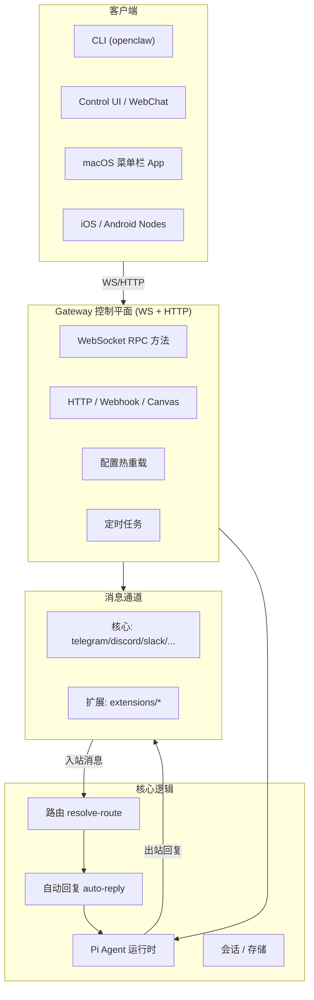
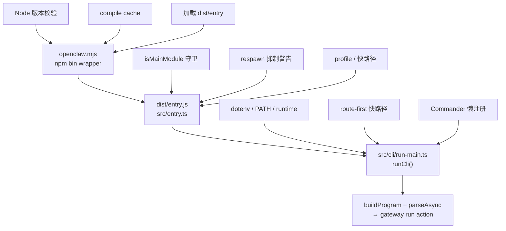
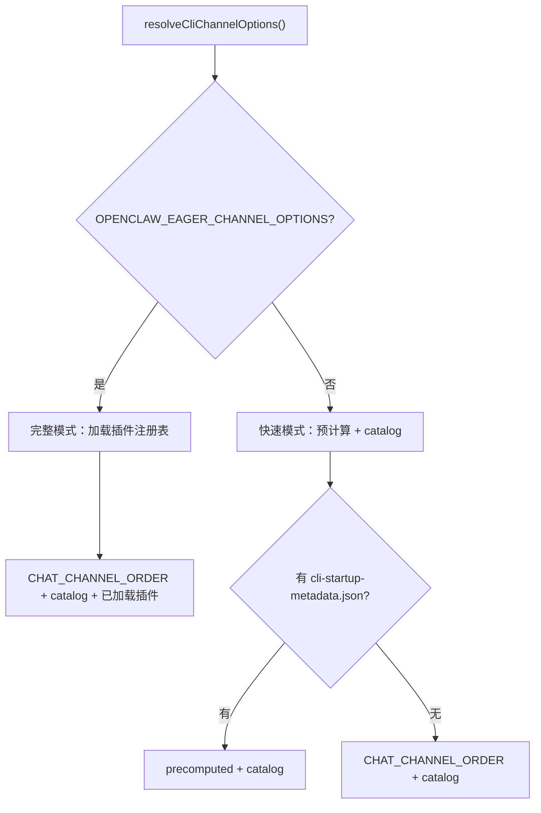
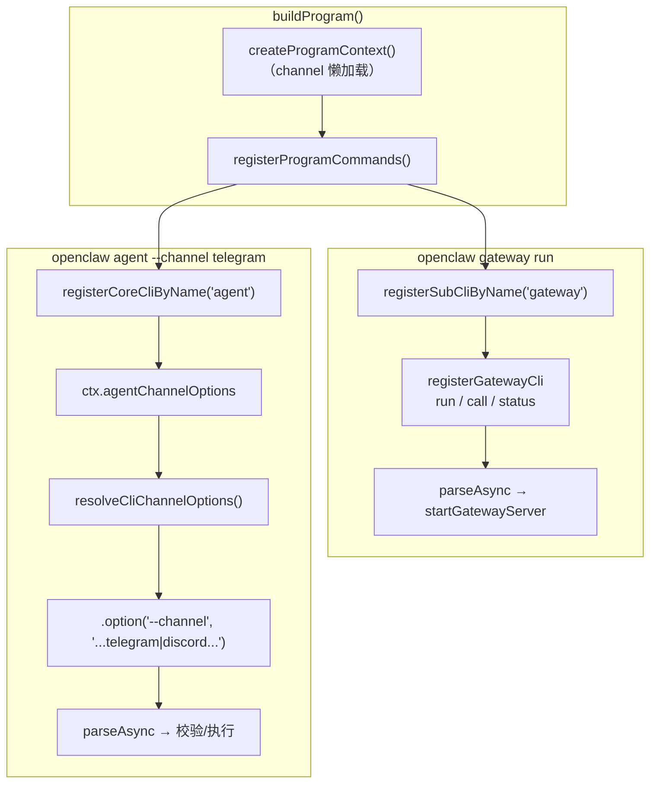
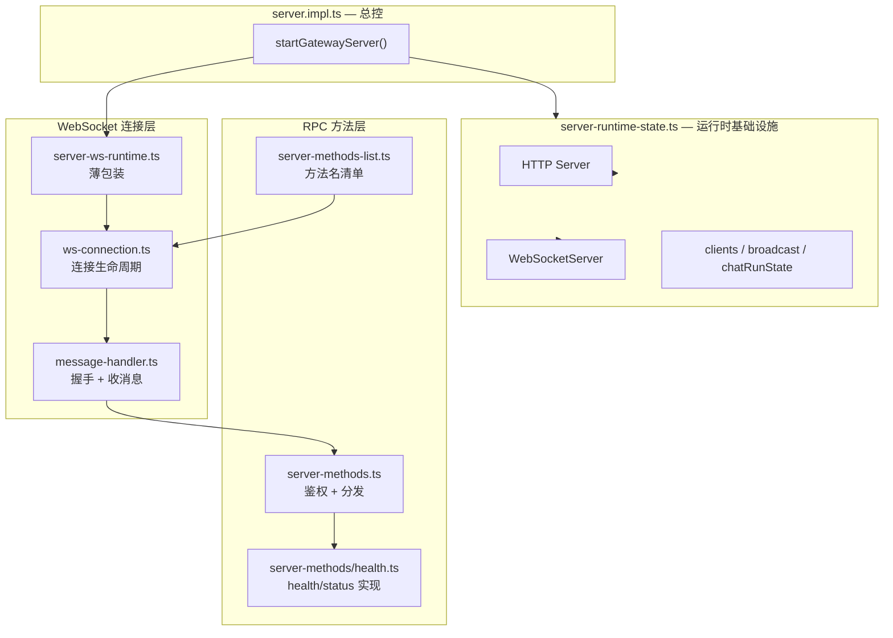
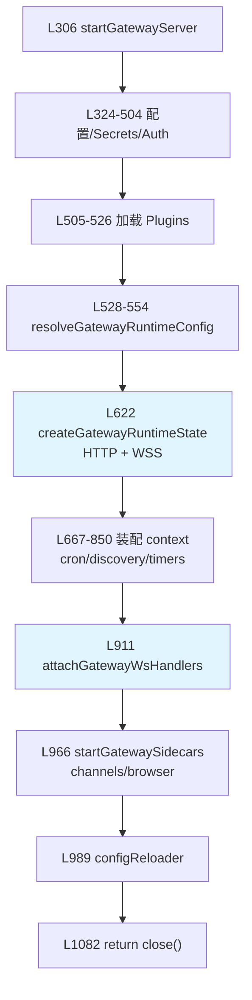

# Openclaw framework analysis
_Exported on 8/19/2026 at 11:50:56 GMT+8 from Cursor (3.6.31)_

---

**User**

解析openclaw的框架

---

**Cursor**

先从项目根目录和核心入口入手，梳理 OpenClaw 的目录结构与主要模块。


# OpenClaw 框架解析

OpenClaw 是一个**本地优先的个人 AI 助手平台**。核心思路是：在你自己的设备上跑一个 **Gateway（网关）控制平面**，把 WhatsApp、Telegram、Slack 等消息渠道统一接入，再交给 **Pi Agent 运行时** 处理，并通过 CLI、Web UI、macOS/iOS/Android 客户端进行控制。

---

## 1. 整体架构



Gateway 是**控制平面**，不是产品本身；真正的「助手」= Agent + 通道 + 工具 + Skills。

---

## 2. 仓库结构（Monorepo）

| 目录 | 职责 |
|------|------|
| `src/` | 核心 TypeScript 源码（~50 个子模块） |
| `extensions/*` | 插件包（通道、认证、记忆、语音等） |
| `apps/macos`, `apps/ios`, `apps/android` | 原生伴侣应用 |
| `ui/` | Control UI 前端 |
| `skills/` | 内置/可管理的 Agent Skills |
| `docs/` | Mintlify 文档 |
| `packages/` | 别名包（如 `clawdbot`, `moltbot`） |

技术栈：**Node ≥ 22**、TypeScript ESM、pnpm workspace、Commander CLI、Vitest 测试、Pi Agent SDK（`@mariozechner/pi-*`）。

---

## 3. 启动链路：从命令到 Gateway

典型命令：`openclaw gateway run --port 18789`

```
openclaw.mjs
  → src/entry.ts        # 进程级守卫、respawn、profile、快速 help/version
  → src/cli/run-main.ts # 懒加载 Commander、路由到具体命令
  → src/cli/program/    # buildProgram + command-registry
  → gateway 命令实现
  → src/gateway/server.impl.ts  # startGatewayServer()
```

关键设计：

- **`entry.ts` 有 `isMainModule` 守卫**：防止被 `index.js` import 时重复启动 Gateway（端口/锁冲突）。
- **CLI 按需加载**：`command-registry.ts` 用动态 `import()` 注册命令，避免一次性加载全部实现。
- **Profile 隔离**：`--dev` / `--profile` 会改写 `OPENCLAW_STATE_DIR`、端口等环境变量。

---

## 4. Gateway：控制平面

`src/gateway/server.impl.ts` 的 `startGatewayServer()` 是 Gateway 的心脏，负责：

1. 读配置、迁移旧配置、校验
2. 加载插件注册表（`plugins/registry.ts`）
3. 启动 HTTP + WebSocket
4. 启动通道管理器（`server-channels.ts`）
5. 维护定时器、Tailscale 暴露、Canvas sidecar
6. 配置热重载、健康检查、节点注册

**WebSocket RPC 方法** 汇总在 `src/gateway/server-methods.ts`：

```1:39:openclaw-main/src/gateway/server-methods.ts
/**
 * 网关 WS 方法注册：汇总所有 core 方法（connect、health、channels、chat、agent、sessions、send 等），
 * 并按 client role（operator/node）与 scopes 做 authorizeGatewayMethod 校验；health 不做鉴权。
 */
// ... agent, chat, channels, config, cron, nodes, send, sessions, skills, ...
```

客户端角色分两类：

- **operator**：CLI、Web UI、管理操作
- **node**：macOS/iOS/Android 设备节点（语音、Canvas、推送等）

---

## 5. 消息流：入站 → 路由 → 回复

### 5.1 通道层

- **核心通道**（源码在 `src/telegram`, `src/discord`, `src/slack` 等）
- **扩展通道**（`extensions/*`，如 Matrix、Feishu、MSTeams）
- 统一抽象：`src/channels/plugins/types.ts` 的 `ChannelPlugin`
- 注册表：`src/channels/registry.ts` 定义展示顺序与元数据

### 5.2 路由层

`src/routing/resolve-route.ts` 根据 channel、account、peer、guild/team 等解析：

```44:65:openclaw-main/src/routing/resolve-route.ts
/** 解析结果：agent、会话键、上次路由策略及匹配来源，供自动回复与会话持久化使用 */
export type ResolvedAgentRoute = {
  agentId: string;
  channel: string;
  accountId: string;
  /** Internal session key used for persistence + concurrency. */
  sessionKey: string;
  /** Convenience alias for direct-chat collapse. */
  mainSessionKey: string;
  /** Which session should receive inbound last-route updates. */
  lastRoutePolicy: "main" | "session";
  /** Match description for debugging/logging. */
  matchedBy:
    | "binding.peer"
    | "binding.peer.parent"
    // ...
    | "default";
};
```

支持**多 Agent 路由**：不同频道/账号/群组/角色可绑定到不同 Agent workspace。

### 5.3 自动回复层

`src/auto-reply/` 是消息处理的业务核心：

```
dispatchInboundMessage()
  → finalizeInboundContext()      # 规范化入站上下文
  → dispatchReplyFromConfig()
  → getReplyFromConfig()        # get-reply.ts
      → 命令检测 / 指令解析 (/think, /model 等)
      → 媒体理解 / 链接理解
      → runPreparedReply()
      → runReplyAgent()         # agent-runner.ts
          → runAgentTurnWithFallback()
          → queueEmbeddedPiMessage()  # Pi 运行时
  → ReplyDispatcher 发回通道
```

特点：

- **命令系统**：`/status`, `/model`, subagents, ACP 等
- **流式回复**：block streaming、typing 指示
- **队列策略**：同 session 并发控制
- **模型 failover**：主模型失败自动切换

---

## 6. Agent 运行时（Pi）

`src/agents/` 是最大的模块（800+ 文件），基于 **Pi Agent SDK**：

| 子模块 | 作用 |
|--------|------|
| `agent-scope.ts` | 多 Agent 配置、workspace、模型选择 |
| `pi-embedded-runner/` | 嵌入式 Pi 会话执行 |
| `auth-profiles/` | OAuth/API Key 轮换与冷却 |
| `bash-tools.ts` | Shell 执行、审批、PTY |
| `skills/` | Skill 加载与刷新 |
| `tools/` | Agent 工具（browser、canvas、cron 等） |
| `subagent-registry.ts` | 子 Agent 管理 |

Agent 数据默认存放在 `~/.openclaw/sessions/` 和 workspace 目录。

---

## 7. 插件系统

`extensions/*` 是独立 npm 包，通过 `openclaw/plugin-sdk` 扩展能力。

`src/plugins/registry.ts` 维护注册项：

- **ChannelPlugin** — 新消息通道
- **ProviderPlugin** — LLM 认证/代理
- **Tool factories** — Agent 工具
- **CLI 子命令**
- **HTTP 路由 / Webhook**
- **Hooks** — 生命周期钩子
- **Services** — 后台服务

加载流程：Gateway 启动 → `loadGatewayPlugins()` → jiti 动态加载 extension entry → 填充 registry。

---

## 8. 配置与会话

| 概念 | 位置 | 说明 |
|------|------|------|
| 主配置 | `~/.openclaw/openclaw.json` | Gateway、通道、Agent、模型 |
| Session Store | `src/config/sessions/` | sessionKey → 元数据 |
| Secrets | `src/secrets/` | 运行时密钥快照 |
| Pairing | `src/pairing/` | DM 配对安全策略 |

Session 模型：

- **`main`**：私聊主会话
- **群组隔离**：每个群/线程独立 sessionKey
- **activation / queue 模式**：控制何时响应、如何排队

---

## 9. 客户端生态

| 平台 | 目录 | 能力 |
|------|------|------|
| macOS | `apps/macos` | 菜单栏、Gateway 宿主、Canvas、Voice Wake |
| iOS | `apps/ios` | Node、Live Activity、语音 |
| Android | `apps/android` | Talk Mode、Voice Wake |
| Web | `ui/` | Control UI、WebChat |
| Chrome | `assets/chrome-extension` | 浏览器扩展 |

客户端通过 Gateway WebSocket 以 **node** 或 **operator** 角色连接，共享 `GatewayModels.swift` 等生成的协议定义。

---

## 10. 其他重要模块

```
src/
├── config/          # 配置读写、校验、迁移
├── wizard/          # onboard 向导
├── cron/            # 定时任务
├── canvas-host/     # A2UI Canvas 宿主
├── browser/         # Playwright 浏览器工具
├── media/           # 媒体管道（图片/音频/视频）
├── hooks/           # 全局 hooks
├── tui/             # 终端 UI
├── daemon/          # launchd/systemd 守护进程
└── infra/           # 端口、env、日志、心跳等基础设施
```

---

## 11. 心智模型总结

可以把 OpenClaw 理解成四层：

1. **接入层** — Channels（30+ 消息平台）
2. **编排层** — Gateway + Routing + Sessions（谁处理、存在哪）
3. **智能层** — Pi Agent + Tools + Skills + Memory
4. **交互层** — CLI / Web / macOS / Mobile Nodes

数据流一句话：**通道收消息 → 路由定 Agent/Session → auto-reply 调 Pi Agent → 工具执行 → 回复发回通道**。

---

## 12. 建议的阅读顺序

仓库里已有阅读清单：`docs/reading-cli-gateway-checklist.md`，推荐按此顺序：

1. `openclaw.mjs` → `src/entry.ts` → `src/cli/run-main.ts`
2. `src/gateway/server.impl.ts`
3. `src/routing/resolve-route.ts`
4. `src/auto-reply/dispatch.ts` → `reply/get-reply.ts` → `reply/agent-runner.ts`
5. `src/agents/pi-embedded-runner/`
6. `src/plugins/registry.ts` + 任意 `extensions/*/src/`

---

如果你想深入某一块（例如 Gateway WS 协议、多 Agent 路由规则、Pi 工具链、或某个具体通道的实现），告诉我具体方向，我可以继续拆解。

---

**User**

openclaw.mjs → src/entry.ts → src/cli/run-main.ts   详细解读这部分内容

---

**Cursor**

正在读取这三层入口及相关依赖，梳理完整启动链路。


补充读取关键依赖文件，以便把三层启动链路讲清楚。


补充读取关键依赖文件，确保解读准确完整。


---

**User**

openclaw.mjs → src/entry.ts → src/cli/run-main.ts   详细解读这部分内容

---

**Cursor**

补充读取关键依赖文件，以便更准确解读启动链路。


# OpenClaw 启动链详解：`openclaw.mjs` → `entry.ts` → `run-main.ts`

这三层构成了 OpenClaw CLI 的**完整启动管道**。设计思路是：**越靠近用户入口，越只做轻量、进程级的事；越往后，才加载业务逻辑**。

下面以典型命令为例贯穿全文：

```bash
openclaw gateway run --port 18789 --bind loopback
```

对应 `process.argv`（Windows 上大致为）：

```text
[
  "C:\\Program Files\\nodejs\\node.exe",   // argv[0]
  "E:\\openclaw-main\\openclaw-main\\openclaw.mjs",  // argv[1]
  "gateway", "run", "--port", "18789", "--bind", "loopback"  // argv[2..]
]
```

---

## 总览：三层分工



| 层级 | 文件 | 职责 | 是否含业务逻辑 |
|------|------|------|----------------|
| 0 | `openclaw.mjs` | npm 可执行包装，加载构建产物 | 否 |
| 1 | `src/entry.ts` | 进程级启动、防双开、快路径 | 极少 |
| 2 | `src/cli/run-main.ts` | CLI 完整初始化 + Commander 解析 | 是（命令分发起点） |

---

## 第一层：`openclaw.mjs` —— 最薄的 Shell

这是 `package.json` 里 `bin.openclaw` 指向的文件，**全局安装后用户实际执行的就是它**。

```1:7:openclaw-main/openclaw.mjs
#!/usr/bin/env node
/**
 * OpenClaw CLI 可执行入口（wrapper）。
 * 不包含业务逻辑：仅做 Node 版本校验、可选编译缓存、警告过滤，
 * 然后动态加载构建产物 dist/entry.js 或 dist/entry.mjs。
 * 业务 CLI 与网关逻辑在 entry → index → buildProgram 链中。
 */
```

### 做了什么（按顺序）

**1. Node 版本门禁（≥ 22.12）**

```javascript
// 不满足则 stderr 提示 nvm 用法，process.exit(1)
ensureSupportedNodeVersion();
```

开发时若直接 `tsx src/entry.ts` 会跳过这层；npm 全局安装路径一定会经过这里。

**2. 启用 Node 编译缓存（可选）**

```javascript
module.enableCompileCache();  // 除非 NODE_DISABLE_COMPILE_CACHE 已设置
```

**3. 安装进程警告过滤器**

从 `dist/warning-filter.js` 动态 import，与 TypeScript 运行时行为保持一致。源码阶段若 `dist/` 尚未 build，会尝试 `.mjs`，都失败则继续（entry 里还会再装一次）。

**4. 加载真正入口**

```javascript
await import("./dist/entry.js");  // 优先 .js，其次 .mjs
// 都没有 → throw "missing dist/entry.(m)js"
```

要点：

- **源码在 `src/`，运行依赖 `pnpm build` 产出的 `dist/`**
- 开发时用 `pnpm openclaw` → `scripts/run-node.mjs`，通常走 tsx 直接跑 TS，不一定经过 `openclaw.mjs`
- 这层**不解析任何子命令**，只做「能不能跑、加载谁」

---

## 第二层：`src/entry.ts` —— 进程级守门员

`dist/entry.js` 由 `src/entry.ts` 编译而来，负责**在跑 CLI 之前**处理进程级问题。

### 核心机制：`isMainModule` 守卫

这是整个启动链里**最关键的设计**之一：

```43:50:openclaw-main/src/entry.ts
if (
  !isMainModule({
    currentFile: fileURLToPath(import.meta.url),
    wrapperEntryPairs: [...ENTRY_WRAPPER_PAIRS],
  })
) {
  // Imported as a dependency — skip all entry-point side effects.
} else {
```

`isMainModule` 的判断逻辑（`src/infra/is-main.ts`）：

1. `argv[1]` 的路径 === 当前文件路径 → 是主模块
2. PM2 场景：`env.pm_exec_path` === 当前文件
3. **Wrapper 映射**：`argv[1]` 是 `openclaw.mjs`，当前文件是 `entry.js` → 也算主模块
4. 兜底：basename 相同

```22:25:openclaw-main/src/entry.ts
const ENTRY_WRAPPER_PAIRS = [
  { wrapperBasename: "openclaw.mjs", entryBasename: "entry.js" },
  { wrapperBasename: "openclaw.js", entryBasename: "entry.js" },
] as const;
```

**为什么要这样？**

`dist/index.js`（`src/index.ts`）也可能 import `entry.js` 作为共享依赖。若没有守卫，`entry.ts` 顶层代码会**再跑一遍 `runCli()`**，导致 Gateway 双开、端口/锁冲突、进程崩溃。

```
openclaw.mjs → entry.js  → isMainModule=true  → 执行启动逻辑 ✓
index.js import entry.js → isMainModule=false → 跳过启动逻辑 ✓
```

---

### 主模块路径下的执行流程

#### Step 1：基础环境

```javascript
process.title = "openclaw";
installProcessWarningFilter();
normalizeEnv();           // 规范化 OPENCLAW_* 等环境变量
enableCompileCache();     // 再次尝试（best-effort）
```

#### Step 2：特殊命令的环境补丁

**`secrets audit` → 只读 auth store**

```28:35:openclaw-main/src/entry.ts
function shouldForceReadOnlyAuthStore(argv: string[]): boolean {
  const tokens = argv.slice(2).filter((token) => token.length > 0 && !token.startsWith("-"));
  for (let index = 0; index < tokens.length - 1; index += 1) {
    if (tokens[index] === "secrets" && tokens[index + 1] === "audit") {
      return true;
    }
  }
  return false;
}
```

基准 `gateway run` 的 tokens = `["gateway","run","18789","loopback"]` → `false`。

**`--no-color` → 禁用彩色输出**

```javascript
process.env.NO_COLOR = "1";
process.env.FORCE_COLOR = "0";
```

#### Step 3：ExperimentalWarning respawn（进程重启）

Node 某些实验特性会打印 `ExperimentalWarning`。`--disable-warning=ExperimentalWarning` **不能写进 `NODE_OPTIONS`**，所以 OpenClaw 选择 **spawn 子进程**：

```107:114:openclaw-main/src/entry.ts
const child = spawn(
  process.execPath,
  [EXPERIMENTAL_WARNING_FLAG, ...process.execArgv, ...process.argv.slice(1)],
  {
    stdio: "inherit",
    env: process.env,
  },
);
```

子进程 argv 大致变为：

```text
["node.exe", "--disable-warning=ExperimentalWarning", "openclaw.mjs", "gateway", "run", ...]
```

**跳过 respawn 的条件：**

| 条件 | 原因 |
|------|------|
| `--help` / `--version` | 不需要干净输出环境 |
| `OPENCLAW_NO_RESPAWN=1` | 用户显式禁用 |
| `OPENCLAW_NODE_OPTIONS_READY=1` | 已是 respawn 后的子进程 |
| 已有 `--disable-warning` | 无需再 respawn |

respawn 后父进程通过 `attachChildProcessBridge` 转发信号（Windows: SIGTERM/SIGINT/SIGBREAK），子进程 exit 后父进程跟着 exit。**父进程不会继续跑 CLI**。

#### Step 4：Windows argv 规范化

```javascript
process.argv = normalizeWindowsArgv(process.argv);
```

处理 Windows 上多余的 `node.exe` 路径、控制字符、引号等，避免 Commander 解析异常。

#### Step 5：Profile 解析（第一次）

```javascript
const parsed = parseCliProfileArgs(process.argv);
// 基准: { ok: true, profile: null, argv: 原样 }
// --dev:  { ok: true, profile: "dev", argv: 去掉 --dev 后的数组 }
```

`--dev` 效果（`applyCliProfileEnv`）：

- `OPENCLAW_PROFILE=dev`
- `OPENCLAW_STATE_DIR=~/.openclaw-dev`
- `OPENCLAW_CONFIG_PATH=~/.openclaw-dev/openclaw.json`
- `OPENCLAW_GATEWAY_PORT=19001`（若未显式设置）

**注意**：profile 在 `entry.ts` 和 `run-main.ts` 各解析一次；entry 会先剥离 `--dev`/`--profile`，run-main 收到的是已清理的 argv。

#### Step 6：快路径（跳过完整 CLI）

**Version 快路径** — `openclaw -V` / `openclaw --version`：

```javascript
// 只 import version.js + git-commit.js，打印后 exit(0)
// 不加载 Commander、不加载 gateway
```

**Help 快路径** — `openclaw --help`：

```javascript
// 只 buildProgram().outputHelp()，不 parseAsync
```

#### Step 7：进入 run-main

```javascript
import("./cli/run-main.js")
  .then(({ runCli }) => runCli(process.argv))
```

基准 `gateway run` 不走快路径，动态 import `run-main.js`，调用 `runCli(process.argv)`。

---

## 第三层：`src/cli/run-main.ts` —— CLI 真正的大脑

`runCli(argv)` 是 Commander 启动的完整 orchestrator。文件内注释已用 `gateway run` 逐步推演，下面按阶段解读。

### 阶段 1：argv + profile（第二次）

```203:215:openclaw-main/src/cli/run-main.ts
export async function runCli(argv: string[] = process.argv) {
  let normalizedArgv = normalizeWindowsArgv(argv);
  const parsedProfile = parseCliProfileArgs(normalizedArgv);
  // ...
  normalizedArgv = parsedProfile.argv;
```

基准命令 profile=null，argv 不变。若 entry 已剥离 profile 旗标，这里通常也是 no-op。

辅助函数：

- `rewriteUpdateFlagArgv`：`--update` → 子命令 `update`
- `shouldEnsureCliPath`：快路径命令（`status`、`config get` 等）跳过 PATH 设置

### 阶段 2：环境与运行时

```217:226:openclaw-main/src/cli/run-main.ts
  loadDotEnv({ quiet: true });
  normalizeEnv();
  if (shouldEnsureCliPath(normalizedArgv)) {
    ensureOpenClawCliOnPath();
  }
  assertSupportedRuntime();
```

| 步骤 | 作用 |
|------|------|
| `loadDotEnv` | 读 `.env`，填充环境变量 |
| `ensureOpenClawCliOnPath` | 把 openclaw 可执行目录加入 PATH（Agent 调 shell 时需要） |
| `assertSupportedRuntime` | 再次校验 Node/Bun 版本 |

`gateway run` → `shouldEnsureCliPath=true` → 会设置 PATH。  
`openclaw status` → 跳过 PATH，减少启动开销。

### 阶段 3：route-first 快路径

```228:231:openclaw-main/src/cli/run-main.ts
  if (await tryRouteCli(normalizedArgv)) {
    return;
  }
```

`tryRouteCli`（`src/cli/route.ts`）逻辑：

1. `OPENCLAW_DISABLE_ROUTE_FIRST=1` → 跳过
2. 有 `--help`/`--version` → 跳过
3. 解析命令路径 `["gateway","run"]`
4. 查 `findRoutedCommand(path)` → 有则直接 `route.run(argv)`，**不经过 Commander**

`gateway run` 通常**不命中** route-first，继续走 Commander。部分轻量命令（如某些 status 类）可能走这条捷径。

### 阶段 4：日志 + 构建 Commander

```233:239:openclaw-main/src/cli/run-main.ts
  enableConsoleCapture();
  const { buildProgram } = await import("./program.js");
  const program = buildProgram();
```

`buildProgram()`（`src/cli/program/build-program.ts`）：

```12:24:openclaw-main/src/cli/program/build-program.ts
export function buildProgram() {
  const program = new Command();
  const ctx = createProgramContext();
  // ...
  registerProgramCommands(program, ctx, argv);  // 挂 placeholder + 核心命令元数据
  return program;
}
```

此时 `program` 上已有命令**占位符**（lazy placeholder），但 `gateway` 的实现尚未真正 import。

同时注册全局错误处理：

```javascript
installUnhandledRejectionHandler();
process.on("uncaughtException", ...);
```

### 阶段 5：懒注册 primary 命令

这是 **按需加载** 的核心：

```252:267:openclaw-main/src/cli/run-main.ts
  const parseArgv = rewriteUpdateFlagArgv(normalizedArgv);
  const primary = getPrimaryCommand(parseArgv);  // → "gateway"
  if (primary) {
    await registerCoreCliByName(program, ctx, primary, parseArgv);  // coreEntries 无 gateway → false
    await registerSubCliByName(program, primary);  // 命中 → import gateway-cli → registerGatewayCli
  }
```

命令分两类：

| 类型 | 注册方式 | 示例 |
|------|----------|------|
| **Core CLI** | `command-registry.ts` 的 `coreEntries` | `setup`, `onboard`, `config`, `agent` |
| **Sub CLI** | `register.subclis.js` | `gateway`, `channels`, `message` |

`gateway` 属于 **Sub CLI**：

1. 移除 buildProgram 时挂的 placeholder
2. 动态 `import("./gateway-cli.js")`
3. 调用 `registerGatewayCli(program)` 挂上 `gateway run/stop/...` 子树

### 阶段 6：插件 CLI 注册（可选）

```271:287:openclaw-main/src/cli/run-main.ts
  const hasBuiltinPrimary =
    primary !== null && program.commands.some((command) => command.name() === primary);
  const shouldSkipPluginRegistration = shouldSkipPluginCommandRegistration({...});
  if (!shouldSkipPluginRegistration) {
    registerPluginCliCommands(program, config);
  }
```

`gateway` 预注册成功后 `hasBuiltinPrimary=true` → **跳过插件 CLI 注册**，避免插件覆盖同名命令。

### 阶段 7：Commander 解析执行

```291:291:openclaw-main/src/cli/run-main.ts
  await program.parseAsync(parseArgv);
```

Commander 匹配：

```text
gateway → run → action(opts)
  → runGatewayCommand({ port: "18789", bind: "loopback", ... })
    → startGatewayServer()  // src/gateway/server.impl.ts
```

---

## 完整数据流（基准命令）

```text
用户输入: openclaw gateway run --port 18789 --bind loopback

[openclaw.mjs]
  ✓ Node ≥ 22.12
  ✓ enableCompileCache
  ✓ installProcessWarningFilter (from dist)
  → import("./dist/entry.js")

[entry.ts]
  ✓ isMainModule: argv[1]=openclaw.mjs, current=entry.js → true
  ✓ normalizeEnv
  ✓ shouldForceReadOnlyAuthStore → false
  ✓ ensureExperimentalWarningSuppressed → false (或 respawn 后子进程继续)
  ✓ normalizeWindowsArgv
  ✓ parseCliProfileArgs → { profile: null }
  ✗ tryHandleRootVersionFastPath → false
  ✗ tryHandleRootHelpFastPath → false
  → import runCli(process.argv)

[run-main.ts]
  ✓ normalizeWindowsArgv (通常 no-op)
  ✓ parseCliProfileArgs → { profile: null }
  ✓ loadDotEnv + normalizeEnv
  ✓ ensureOpenClawCliOnPath (gateway 需要)
  ✓ assertSupportedRuntime
  ✗ tryRouteCli → false
  ✓ enableConsoleCapture
  ✓ buildProgram() → placeholder program
  ✓ primary = "gateway"
  ✓ registerSubCliByName("gateway") → 真注册 gateway 子树
  ✗ skip plugin CLI (hasBuiltinPrimary=true)
  ✓ program.parseAsync(argv)
    → gateway.run.action
      → startGatewayServer()
```

---

## 设计亮点总结

### 1. 三层分离 = 启动性能 + 可维护性

- `openclaw.mjs`：零 TS 依赖，npm 安装即可跑
- `entry.ts`：进程级，可独立 respawn
- `run-main.ts`：业务 CLI，按需 import 命令实现

### 2. 双保险防 Gateway 双开

`isMainModule` + wrapper 映射，避免 `index.js` import `entry.js` 时重复启动。

### 3. 多层快路径

| 快路径 | 触发 | 节省 |
|--------|------|------|
| version | `-V` / `--version` | 不加载 Commander |
| help | `--help` | 只 outputHelp |
| route-first | 特定命令 | 跳过 Commander |
| 懒注册 | 所有命令 | 只 load 当前 primary |

### 4. Profile 隔离

`--dev` / `--profile foo` 在 entry 阶段就改写 `OPENCLAW_STATE_DIR` 等，dev 与 prod 配置完全隔离。

### 5. Windows 兼容

`normalizeWindowsArgv` 在 entry 和 run-main 各跑一次；respawn 时信号用 SIGBREAK。

---

## 与 `src/index.ts` 的关系

还有一条并行入口路径：

```
openclaw.mjs → dist/index.js (src/index.ts)
```

`index.ts` 也会 `buildProgram()` + `parseAsync()`，但**没有** entry 的 respawn/profile 快路径逻辑。正常用户路径是 **mjs → entry → run-main**；`index.ts` 主要作为**库导出**和被其他模块 import 时使用。

---

## 调试建议

1. **看 argv 每一步变化**：在 entry L178、run-main L205 打 log
2. **respawn 问题**：设 `OPENCLAW_NO_RESPAWN=1` 禁用子进程重启
3. **跳过快路径**：`OPENCLAW_DISABLE_ROUTE_FIRST=1` 强制走 Commander
4. **dev 隔离**：`openclaw --dev gateway run` → 端口 19001、状态目录 `~/.openclaw-dev`

---

如果你想继续往下读，下一步通常是 **`registerSubCliByName("gateway")` → `gateway-cli.ts` → `startGatewayServer()`**，也就是 `docs/reading-cli-gateway-checklist.md` 里的阶段 2 及以后。需要的话我可以接着拆解 Gateway 命令注册和 `startGatewayServer` 的启动流程。

---

**User**

  ensureOpenClawCliOnPath(); 这个做了什么事情？

---

**Cursor**

# `ensureOpenClawCliOnPath()` 做了什么？

一句话：**把「能找到 `openclaw` 命令」的目录补进当前进程的 `PATH` 环境变量**，让 Agent 跑 shell、Skills 调 CLI、Gateway 在 launchd 等精简环境里都能执行 `openclaw`。

---

## 核心逻辑

实现位于 `src/infra/path-env.ts`：

```108:133:openclaw-main/src/infra/path-env.ts
/**
 * Best-effort PATH bootstrap so skills that require the `openclaw` CLI can run
 * under launchd/minimal environments (and inside the macOS app bundle).
 */
export function ensureOpenClawCliOnPath(opts: EnsureOpenClawPathOpts = {}) {
  if (isTruthyEnvValue(process.env.OPENCLAW_PATH_BOOTSTRAPPED)) {
    return;
  }
  process.env.OPENCLAW_PATH_BOOTSTRAPPED = "1";
  const existing = opts.pathEnv ?? process.env.PATH ?? "";
  const { prepend, append } = candidateBinDirs(opts);
  if (prepend.length === 0 && append.length === 0) {
    return;
  }
  
  const merged = mergePath({ existing, prepend, append });
  if (merged) {
    process.env.PATH = merged;
  }
}
```

流程：

1. **幂等**：若 `OPENCLAW_PATH_BOOTSTRAPPED=1`，直接返回
2. **收集候选目录**：`candidateBinDirs()` 扫描常见安装位置
3. **合并 PATH**：候选目录 **prepend** 到现有 PATH 前面（去重）
4. **写回** `process.env.PATH`

---

## 会加入哪些目录？

`candidateBinDirs()` 按优先级收集**真实存在**的目录：

| 来源 | 方式 | 说明 |
|------|------|------|
| macOS App Bundle | **prepend** | `process.execPath` 同目录下有可执行 `openclaw` |
| mise shims | prepend | `~/.local/share/mise/shims` |
| Homebrew | prepend | `HOMEBREW_PREFIX/bin`、`/opt/homebrew/bin` 等 |
| macOS pnpm | prepend | `~/Library/pnpm` |
| XDG | prepend | `$XDG_BIN_HOME` |
| 用户本地 bin | prepend | `~/.local/bin`、`~/.bun/bin`、`~/.yarn/bin` 等 |
| 系统路径 | prepend | `/opt/homebrew/bin`、`/usr/local/bin`、`/usr/bin`、`/bin` |
| 项目本地 | **append** | `node_modules/.bin`（默认关闭，需显式开启） |

项目本地 bin 默认**不加**，防 bin hijacking：

```72:82:openclaw-main/src/infra/path-env.ts
  // Project-local installs are a common repo-based attack vector (bin hijacking). Keep this
  // disabled by default; if an operator explicitly enables it, only append (never prepend).
  const allowProjectLocalBin =
    opts.allowProjectLocalBin === true ||
    isTruthyEnvValue(process.env.OPENCLAW_ALLOW_PROJECT_LOCAL_BIN);
  if (allowProjectLocalBin) {
    const localBinDir = path.join(cwd, "node_modules", ".bin");
    if (isExecutable(path.join(localBinDir, "openclaw"))) {
      append.push(localBinDir);
    }
  }
```

合并规则（`mergePath`）：

```text
新 PATH = [prepend 候选] + [原有 PATH] + [append 候选]
         （去重，保留第一次出现的顺序）
```

---

## 为什么要做这件事？

OpenClaw 的 Agent 会执行 bash 命令，Skills 也可能调用 `openclaw` 子命令。但在这些场景里 **PATH 往往不完整**：

- **launchd / systemd 守护进程**：PATH 可能只有 `/usr/bin:/bin`
- **macOS 菜单栏 App**：GUI 启动的环境变量和用户终端不同
- **pnpm / bun / mise 全局安装**：`openclaw` 在 `~/.local/share/pnpm` 等目录，不在默认 PATH 里

若不补 PATH，Agent 执行 `openclaw message send ...` 时会报 `command not found`。

---

## 在哪些地方被调用？

| 调用点 | 时机 |
|--------|------|
| `run-main.ts` | CLI 启动时（部分命令会跳过） |
| `gateway/server.impl.ts` | Gateway 启动时 |
| `index.ts` | 库入口初始化 |
| `node-host/runner.ts` | 移动端 Node 宿主 |
| `acp/client.ts` | ACP 客户端 |

`run-main.ts` 里不是每次都调，有豁免：

```124:141:openclaw-main/src/cli/run-main.ts
export function shouldEnsureCliPath(argv: string[]): boolean {
  if (hasHelpOrVersion(argv)) {
    return false;
  }
  const [primary, secondary] = getCommandPathWithRootOptions(argv, 2);
  if (!primary) {
    return true;
  }
  if (primary === "status" || primary === "health" || primary === "sessions") {
    return false;
  }
  if (primary === "config" && (secondary === "get" || secondary === "unset")) {
    return false;
  }
  if (primary === "models" && (secondary === "list" || secondary === "status")) {
    return false;
  }
  return true;
}
```

`gateway run` → 会调用；`openclaw status` → 跳过（减启动开销）。

---

## 举例

假设当前 PATH：

```text
PATH=/usr/bin:/bin
```

Windows 上全局 pnpm 装在 `C:\Users\Administrator\AppData\Local\pnpm`，且该目录存在，调用后可能变成：

```text
PATH=C:\Users\Administrator\AppData\Local\pnpm;C:\Users\Administrator\.local\bin;...;/usr/bin;/bin
```

macOS App Bundle 场景：若 `openclaw` 与 Node 可执行文件同目录，该目录会被 **prepend 到最前**，保证优先用 bundle 内的 CLI。

---

## 注意点

1. **只改当前进程**的 `process.env.PATH`，不改系统级 PATH
2. **best-effort**：目录不存在就跳过，不会抛错
3. **只执行一次**：`OPENCLAW_PATH_BOOTSTRAPPED=1` 防重复合并
4. **不是专门找 openclaw 二进制**：是把常见全局 bin 目录整体 prepend；注释里的目标是让 `openclaw` 能被找到

---

总结：`ensureOpenClawCliOnPath()` 是 **PATH 自举（bootstrap）**——在精简或 GUI 环境下，把 pnpm/bun/homebrew/App Bundle 等可能包含 `openclaw` 的目录补进 PATH，确保后续 Agent/Skill 执行 shell 时能调用到 `openclaw` CLI。

---

**User**

shouldEnsureCliPath 和 ensureOpenClawCliOnPath(); 为什么要结合起来？

---

**Cursor**

# 为什么 `shouldEnsureCliPath` 和 `ensureOpenClawCliOnPath()` 要组合使用？

本质是 **「决策」和「执行」分离**：前者决定**要不要**补 PATH，后者负责**怎么**补 PATH。

```typescript
if (shouldEnsureCliPath(normalizedArgv)) {
  ensureOpenClawCliOnPath();
}
```

---

## 1. 两个函数各自负责什么

| 函数 | 角色 | 特点 |
|------|------|------|
| `shouldEnsureCliPath(argv)` | **策略层**：这条命令需不需要 bootstrap PATH？ | 纯逻辑，只看 argv，不碰文件系统 |
| `ensureOpenClawCliOnPath()` | **执行层**：扫描目录、合并 PATH | 会 `fs.accessSync` / `fs.statSync` 检查一堆候选路径 |

如果每次都直接调 `ensureOpenClawCliOnPath()`，像 `openclaw status` 这种只读查询也会做一轮目录扫描，**没必要且更慢**。

---

## 2. 为什么要「有条件地」调用？

`ensureOpenClawCliOnPath()` 的成本在于：

- 遍历多个候选 bin 目录（Homebrew、pnpm、mise、`~/.local/bin` 等）
- 对每个目录做 `fs` 存在性/可执行性检查
- 合并并改写 `process.env.PATH`

而 PATH bootstrap 的真正目的是：

> 让 **Agent / Skill / 子进程** 能在 shell 里找到 `openclaw` 命令。

因此只有「**当前命令或其后续流程会 spawn 子进程、跑 bash、调 CLI**」时才需要。

`shouldEnsureCliPath` 的豁免列表就是按这个原则来的：

```124:141:openclaw-main/src/cli/run-main.ts
export function shouldEnsureCliPath(argv: string[]): boolean {
  if (hasHelpOrVersion(argv)) {
    return false;   // 只看帮助/版本，不跑 Agent
  }
  const [primary, secondary] = getCommandPathWithRootOptions(argv, 2);
  if (!primary) {
    return true;    // 无子命令 → 可能进交互向导，保守起见仍 bootstrap
  }
  if (primary === "status" || primary === "health" || primary === "sessions") {
    return false;   // 只读查询，连 Gateway 查状态即可
  }
  if (primary === "config" && (secondary === "get" || secondary === "unset")) {
    return false;   // 只读/轻量 config 操作
  }
  if (primary === "models" && (secondary === "list" || secondary === "status")) {
    return false;   // 只读模型列表
  }
  return true;      // 其他命令（gateway、agent、message send…）→ 需要
}
```

测试里也体现了这个边界（`run-main.test.ts`）：

- **跳过**：`status`、`sessions`、`config get`、`--help`
- **保留**：`message send`、`voicecall status`（插件命令，可能 spawn 子进程）

---

## 3. 为什么不把判断逻辑写进 `ensureOpenClawCliOnPath` 里？

因为 **`ensureOpenClawCliOnPath` 在多个地方被调用，策略并不相同**：

| 调用点 | 是否条件调用 | 原因 |
|--------|--------------|------|
| `run-main.ts` | ✅ 经 `shouldEnsureCliPath` | CLI 有各种快路径，能省则省 |
| `gateway/server.impl.ts` | ❌ 模块加载时**无条件**调用 | Gateway 长期运行，Agent 随时可能 exec bash |
| `index.ts` | ❌ 无条件 | 库入口，保守 bootstrap |
| `node-host/runner.ts` | ❌ 无条件 | 移动端 Node 宿主需要完整 PATH |

Gateway 在模块顶层直接调用：

```127:127:openclaw-main/src/gateway/server.impl.ts
ensureOpenClawCliOnPath();
```

也就是说：

- **`runCli` 路径**：先判断命令类型，再决定是否 bootstrap（性能优化）
- **Gateway 路径**：进程一启动就必须准备好 PATH，不管 argv 是什么

如果把 argv 判断塞进 `ensureOpenClawCliOnPath`，Gateway 等场景要么传 argv、要么被误跳过，反而更乱。

---

## 4. 设计上的三个目标

### 目标 A：启动性能（快路径）

```text
openclaw status          → shouldEnsureCliPath=false → 跳过 fs 扫描
openclaw config get x    → false
openclaw --help          → false

openclaw gateway run     → true  → ensureOpenClawCliOnPath()
openclaw agent --message → true
openclaw message send    → true
```

高频只读命令更快返回。

### 目标 B：功能正确（保守默认）

- **未知命令** → `return true`（宁可多扫，也不漏）
- **无子命令**（裸 `openclaw`）→ `return true`（可能进 onboard/交互）
- **会改状态的命令** → `return true`

### 目标 C：可测试性

- `shouldEnsureCliPath`：纯函数，测 argv → boolean
- `ensureOpenClawCliOnPath`：单独 mock `fs` 测 PATH 合并

职责分开，测试更简单。

---

## 5. 和 `ensureOpenClawCliOnPath` 自身幂等的关系

`ensureOpenClawCliOnPath` 内部有：

```javascript
if (process.env.OPENCLAW_PATH_BOOTSTRAPPED === "1") return;
```

所以即使 `run-main` 调了、`gateway` 又调一次，**实际 PATH 合并只做一次**。

那还要 `shouldEnsureCliPath` 吗？要。第一次调用前的 **fs 扫描** 仍然有成本；在 `status` 这类快路径上，连第一次都不想触发。

---

## 6. 一句话总结

```text
shouldEnsureCliPath     → 「这条 CLI 命令会不会用到子进程/shell？需要才准备 PATH」
ensureOpenClawCliOnPath → 「需要的话，把 openclaw 可能在的 bin 目录补进 PATH」
```

组合起来 = **在 CLI 启动链上做按需 lazy bootstrap**：该快的命令（status/help）不付 fs 成本；该跑 Agent/Gateway 的命令保证 PATH 就绪。Gateway 等长期进程则无条件 bootstrap，因为运行时随时可能 exec `openclaw`。

---

**User**

 if (shouldEnsureCliPath(normalizedArgv)) {
    // 基准 gateway → true：把 openclaw 可执行目录加入 PATH，比如：C:\Users\Administrator\.openclaw\cli
    ensureOpenClawCliOnPath();
  } 这个里面没有参数？

---

**Cursor**

是的，这里**故意不传参**。`ensureOpenClawCliOnPath()` 的所有参数都是可选的，默认用 `{}`，内部会读当前进程的环境。

---

## 函数签名

```112:112:openclaw-main/src/infra/path-env.ts
export function ensureOpenClawCliOnPath(opts: EnsureOpenClawPathOpts = {}) {
```

可选参数类型：

```7:14:openclaw-main/src/infra/path-env.ts
type EnsureOpenClawPathOpts = {
  execPath?: string;
  cwd?: string;
  homeDir?: string;
  platform?: NodeJS.Platform;
  pathEnv?: string;
  allowProjectLocalBin?: boolean;
};
```

不传时，内部默认是：

| 参数 | 默认值 |
|------|--------|
| `execPath` | `process.execPath`（当前 node.exe） |
| `cwd` | `process.cwd()` |
| `homeDir` | `os.homedir()` |
| `platform` | `process.platform` |
| `pathEnv` | `process.env.PATH` |
| `allowProjectLocalBin` | 看 `OPENCLAW_ALLOW_PROJECT_LOCAL_BIN` 环境变量 |

在 `run-main.ts` 里，CLI 就在**用户刚启动的这个 Node 进程**里跑，用这些默认值就对了，不需要再传一遍。

---

## 无参调用实际做了什么

```typescript
ensureOpenClawCliOnPath();
// 等价于
ensureOpenClawCliOnPath({});
```

流程：

1. 若 `OPENCLAW_PATH_BOOTSTRAPPED=1` → 直接返回（幂等）
2. 用 `process.env.PATH` 作为现有 PATH
3. 扫描一批**常见全局 bin 目录**（存在才加入）：
   - pnpm：`~/.local/share/pnpm`、macOS 上还有 `~/Library/pnpm`
   - bun：`~/.bun/bin`
   - Homebrew：`/opt/homebrew/bin` 等
   - mise shims、`.local/bin` 等
4. 合并后写回 `process.env.PATH`

---

## 关于注释里的路径

你看到的注释：

```typescript
// 比如：C:\Users\Administrator\.openclaw\cli
```

**这个例子不准确**。代码里**没有**专门把 `~/.openclaw/cli` 加进 PATH。

`.openclaw` 目录一般是**状态/配置**（如 `openclaw.json`、sessions），不是 CLI 安装位置。  
Windows 上 `openclaw` 更常见在：

- `C:\Users\Administrator\AppData\Local\pnpm`（pnpm 全局）
- 或 npm 全局 `node_modules\.bin`

注释容易误导，以 `path-env.ts` 的实现为准。

---

## 什么时候才需要传参？

主要是**测试**或**特殊宿主环境**，需要 override 默认值：

**测试**（mock 文件系统）：

```typescript
ensureOpenClawCliOnPath({
  execPath: cliPath,
  cwd: tmp,
  homeDir: tmp,
  platform: "darwin",
});
```

**Node 宿主**（显式传入 PATH）：

```typescript
// src/node-host/runner.ts
ensureOpenClawCliOnPath({ pathEnv: process.env.PATH ?? "" });
```

`run-main.ts` 是普通 CLI 入口，进程上下文就是用户环境，**无参调用是正常且预期的用法**。

---

## 和外面 `shouldEnsureCliPath` 的分工

```typescript
if (shouldEnsureCliPath(normalizedArgv)) {  // 传 argv：决定「要不要」
  ensureOpenClawCliOnPath();                 // 不传参：用当前进程环境执行
}
```

- **`shouldEnsureCliPath(normalizedArgv)`** 需要 argv，因为要判断命令类型（`status` 跳过、`gateway` 执行）
- **`ensureOpenClawCliOnPath()`** 不需要 argv，它只关心「当前进程的 PATH 够不够找 openclaw」，与具体子命令无关

---

**总结**：无参 = 使用 `process.*` / `os.homedir()` 等当前进程默认值；`run-main.ts` 场景下这样写是正确的。注释里的 `~/.openclaw/cli` 示例不对，实际加的是 pnpm/bun/homebrew 等全局 bin 目录。

---

**User**


export async function registerSubCliByName(program: Command, name: string): Promise<boolean> {
  //  查 entry
  //  如果 entry 为空，则返回 false
  //
  const entry = entries.find((candidate) => candidate.name === name);
  if (!entry) {
    return false;
  }
  // 移除 program 中的 entry.name 命令，
  // 比如：program.commands.some(c => c.name()==="gateway") → false,
  // 移除 program 中的 gateway 命令
  removeCommandByName(program, entry.name);
  await entry.register(program);
  // 重新解析 program
  return true;
}  这里命令已经存在，但是为什么还需要注册？

---

**Cursor**

先看 `register.subclis.ts` 和 placeholder 的创建方式，再解释为何要先移除再注册。


# 为什么命令「已经存在」，还要再注册？

关键在于：**program 上已有的不是完整命令，而是 placeholder（占位符）**。  
`registerSubCliByName` 做的是 **「拆掉占位符 → 挂上真命令」**，不是重复注册。

---

## 两阶段：先占位，后真注册

### 阶段 1：`buildProgram()` 只挂 placeholder

`registerSubCliCommands()` 里，对 `gateway` 会走 `registerLazyCommand`：

```337:346:openclaw-main/src/cli/program/register.subclis.ts
function registerLazyCommand(program: Command, entry: SubCliEntry) {
  const placeholder = program.command(entry.name).description(entry.description);
  placeholder.allowUnknownOption(true);
  placeholder.allowExcessArguments(true);
  placeholder.action(async (...actionArgs) => {
    removeCommand(program, placeholder);
    await entry.register(program);
    await reparseProgramFromActionArgs(program, actionArgs);
  });
}
```

此时 `program` 上的 `gateway` **只有**：

| 有 | 没有 |
|----|------|
| 名字 `gateway` | 子命令 `run` / `call` / `status` |
| 描述文字 | 各子命令的 options（`--port`, `--bind`） |
| 一个通用 `action`（首次执行时才 lazy load） | 真正的业务 handler |

目的是：**启动时不 `import gateway-cli.js`**，加快 CLI 启动。

---

### 阶段 2：`run-main.ts` 在 `parseAsync` 前换成真命令

```typescript
await registerSubCliByName(program, "gateway");
await program.parseAsync(parseArgv);  // gateway run --port 18789 ...
```

`registerSubCliByName` 流程：

```320:334:openclaw-main/src/cli/program/register.subclis.ts
export async function registerSubCliByName(program: Command, name: string): Promise<boolean> {
  const entry = entries.find((candidate) => candidate.name === name);
  if (!entry) {
    return false;
  }
  removeCommandByName(program, entry.name);   // ① 删掉 placeholder
  await entry.register(program);              // ② 注册完整 gateway 子树
  return true;
}
```

`entry.register` 会：

```typescript
const mod = await import("../gateway-cli.js");
mod.registerGatewayCli(program);  // 挂上 gateway run / call / discover / ...
```

---

## 对比：placeholder vs 真命令

```text
【Placeholder gateway】                【真 gateway（registerGatewayCli 后）】
gateway                                 gateway
  (无子命令)                              ├── run      --port --bind ...
  allowUnknownOption(true)                ├── call
  action: 首次触发才 import               ├── status
                                          ├── discover
                                          └── ...
```

执行 `openclaw gateway run --port 18789` 时：

- **只有 placeholder**：Commander 找不到 `run` 子命令，无法正确解析 `--port`
- **换成真命令后**：能匹配 `gateway → run → --port 18789`，进入 `startGatewayServer()`

---

## 为什么要先 `removeCommandByName`？

Commander **不允许同名命令挂两次**。测试里写得很清楚：

```124:130:openclaw-main/src/cli/program/register.subclis.test.ts
  it("replaces placeholder when registering a subcommand by name", async () => {
    const program = createRegisteredProgram(["node", "openclaw", "acp", "--help"], "openclaw");

    await registerSubCliByName(program, "acp");

    const names = program.commands.map((cmd) => cmd.name());
    expect(names.filter((name) => name === "acp")).toHaveLength(1);
```

流程必须是：

```text
removeCommandByName(program, "gateway")  → 移除 placeholder
entry.register(program)                  → 添加完整 gateway
```

不 remove 就直接 `register`，会 duplicate 或行为异常。

---

## 两种 lazy 路径

OpenClaw 其实有两条 lazy 加载路：

| 路径 | 何时触发 | 流程 |
|------|----------|------|
| **A. placeholder action** | 没预注册，用户直接跑命令 | action 触发 → remove placeholder → register → **重新 parse** |
| **B. registerSubCliByName** | `run-main` 在 parse 前预注册 | remove placeholder → register → **一次 parse 成功** |

`run-main.ts` 选 **路径 B**，因为：

1. **`parseAsync` 需要完整子命令树** — 要在 parse 阶段就识别 `gateway run --port`，不能等到 action 才加载  
2. **避免 double parse** — 路径 A 要先 parse 失败/进 action，再 register、再 reparse  
3. **`hasBuiltinPrimary` 判断** — 需要 program 上已有真正的 `gateway`，才能决定是否跳过插件 CLI 注册  

---

## 关于注释里的误解

你贴的注释：

```typescript
// 比如：program.commands.some(c => c.name()==="gateway") → false,
// 移除 program 中的 gateway 命令
```

**这里写反了**。在调用 `registerSubCliByName` **之前**：

```typescript
program.commands.some(c => c.name() === "gateway")  // → true（placeholder 已存在）
```

`removeCommandByName` 移除的正是这个 **已存在的 placeholder**，然后 `entry.register` 换上真命令。

---

## 一句话总结

```text
buildProgram()     → 挂「空壳 gateway」（placeholder，为了快）
registerSubCliByName → 拆掉空壳，换成「真 gateway」（含 run/call/...）
parseAsync()       → 按完整命令树解析 gateway run --port 18789
```

所以不是「命令已经有了还重复注册」，而是 **「先有一个名字相同的壳，再换成能干活的真命令」**。Core CLI（`registerCoreCliByName`）也是同一套 placeholder → remove → register 模式。

---

**User**

为什么直接加载命令会启动很慢？

---

**Cursor**

分析 eager 注册会拉起的依赖链，说明为何启动会变慢。


# 为什么「直接加载全部命令」会启动很慢？

OpenClaw CLI 默认用 **lazy registration（懒注册）**，就是为了解决：**一次 `openclaw gateway run`，不该把 40+ 个命令模块及其依赖树全部加载进来**。

---

## 1. 直接加载 = 什么都要 import

若设置 `OPENCLAW_DISABLE_LAZY_SUBCOMMANDS=1`，会走 eager 路径：

```352:357:openclaw-main/src/cli/program/register.subclis.ts
export function registerSubCliCommands(program: Command, argv: string[] = process.argv) {
  if (shouldEagerRegisterSubcommands(argv)) {
    for (const entry of entries) {
      void entry.register(program);
    }
    return;
  }
```

每个 `entry.register` 都会 `import("../xxx-cli.js")`。Sub CLI  alone 就有 **~25 个**（gateway、channels、models、plugins、pairing…），Core CLI 还有 **~15+ 个**（agent、message、config、browser…）。

懒加载时（`openclaw gateway run`）：

```text
只 import 1 个：gateway-cli.js (+ 其依赖链)
```

全量加载时：

```text
import 40+ 个 CLI 模块 + 各自依赖链
```

---

## 2. 单个 CLI 模块并不「轻」

Placeholder 只创建 Commander 节点，**几乎零依赖**：

```typescript
program.command("gateway").description("...")  // 几行代码
```

真注册会拉整条依赖链。例如 `gateway-cli/run.ts` 顶部：

```1:15:openclaw-main/src/cli/gateway-cli/run.ts
import { readSecretFromFile } from "../../acp/secret-file.js";
import { loadConfig, readConfigFileSnapshot, ... } from "../../config/config.js";
import { resolveGatewayAuth } from "../../gateway/auth.js";
import { startGatewayServer } from "../../gateway/server.js";
import { GatewayLockError } from "../../infra/gateway-lock.js";
// ... 还有更多
```

`startGatewayServer` 会牵出 `gateway/server.impl.ts`（1000+ 行），再牵出 channels、plugins、canvas、secrets、cron 等。**你只是想注册 CLI 选项，Node 已经把半个 Gateway 的模块图 parse + evaluate 了一遍**。

其他命令同理：

| 命令模块 | 容易牵出的重依赖 |
|----------|------------------|
| `channels-cli` | 各 channel 插件、配置校验 |
| `plugins-cli` / `pairing-cli` | 插件注册表、读 config、加载 extensions |
| `browser-cli` | Playwright 相关 |
| `models-cli` | 模型目录、provider 配置 |
| `memory-cli` | 记忆索引、向量存储 |

---

## 3. Node 模块加载本身的成本

每个 `import()` 在 Node ESM 里大致要做：

1. 解析路径、读文件
2. 编译/缓存（首次）
3. 执行模块顶层代码（top-level side effects）
4. 递归加载其 `import` 依赖

40 个 CLI 模块 × 各自几十到上百个 transitive imports = **启动阶段大量同步 I/O + CPU**。

OpenClaw 的 completion 生成能说明这一点——它**必须**全量注册，代码里直接写了原因：

```257:258:openclaw-main/src/cli/completion-cli.ts
      // Completion needs the full Commander command tree (including nested subcommands).
      // Our CLI defaults to lazy registration for perf; force-register core commands here.
```

补全脚本需要完整命令树，所以那里刻意做全量注册；**普通 CLI 启动则默认不做这件事**。

---

## 4. 懒加载的三级优化

OpenClaw 不只是一层 lazy，而是分层减负：

### 级别 A：只挂 placeholder，不 import 实现

```typescript
// 只有名字 + description，无子命令、无业务 import
registerLazyCommand(program, entry);
```

### 级别 B：只注册 primary 命令（`shouldRegisterPrimaryOnly`）

`openclaw gateway run` 时：

```359:365:openclaw-main/src/cli/program/register.subclis.ts
  const primary = getPrimaryCommand(argv);
  if (primary && shouldRegisterPrimaryOnly(argv)) {
    const entry = entries.find((candidate) => candidate.name === primary);
    if (entry) {
      registerLazyCommand(program, entry);  // 只挂 1 个 gateway placeholder
      return;
    }
  }
```

连 **25 个 placeholder 都不全挂**，只挂 `gateway` 一个。

### 级别 C：`run-main` 预注册只 load 当前命令

```typescript
await registerSubCliByName(program, "gateway");  // 只 import gateway-cli
await program.parseAsync(parseArgv);
```

### 对比

| 模式 | 启动时 load 的模块 | 典型场景 |
|------|-------------------|----------|
| 全量 eager | 40+ CLI + 依赖树 | `OPENCLAW_DISABLE_LAZY_SUBCOMMANDS=1` |
| 全 placeholder | ~0 业务模块 | `openclaw --help`（无 primary） |
| primary placeholder | ~0 业务模块 | 有 primary 但未预注册 |
| **默认 lazy + 预注册** | **1 个 CLI + 依赖** | `openclaw gateway run` |

---

## 5. 有些注册还会做额外 I/O

部分 `entry.register` 不止 import，还会读盘：

```typescript
// pairing / plugins 的 register
const config = await loadValidatedConfigForPluginRegistration();
registerPluginCliCommands(program, config);
```

全量加载时，这些在**启动阶段**就会读 config、初始化 plugin registry，即使用户只是跑 `gateway run`。

---

## 6. 直观类比

```text
全量加载 = 进餐厅把 40 道菜全部做好摆桌上，你只点一道 gateway run

懒加载   = 先给你菜单（placeholder），你点 gateway 再只做 gateway 那道
```

对 CLI 来说：

- **菜单（placeholder）**：毫秒级
- **做一道菜（import 一个 CLI 模块）**：几百 ms ~ 数秒（视磁盘、冷启动、依赖深度）
- **做 40 道菜（全量 eager）**：线性叠加，明显变慢

---

## 7. 如何验证

**懒加载（默认）：**

```bash
openclaw gateway run --port 18789
# buildProgram: 1 个 placeholder
# registerSubCliByName: 只 import gateway-cli
```

**强制全量加载：**

```bash
set OPENCLAW_DISABLE_LAZY_SUBCOMMANDS=1
openclaw gateway run --port 18789
# buildProgram 阶段就 register 全部 25+ subcli
```

通常能感到启动明显变慢（尤其冷启动、Windows、机械盘）。

---

## 总结

直接加载全部命令会慢，因为：

1. **命令多** — 40+ 个 CLI 模块，每个都要 `import`
2. **依赖重** — 一个 `gateway-cli` 就能牵出半个 Gateway
3. **Node 成本高** — 模块 parse、evaluate、递归依赖加载
4. **副作用** — 部分注册会读 config、加载 plugins
5. **用户只需要一个命令** — 全量加载是浪费

懒注册的核心思想：**pay for what you use** — 用户跑 `gateway run`，就只付 `gateway-cli` 的加载成本，而不是整个 OpenClaw 命令面的成本。

---

**User**

每个 entry.register 都会 import("../xxx-cli.js" 在哪里看到的，我只看到了一个program，没有*.js

---

**Cursor**

`import("../xxx-cli.js")` 写在 `entries` 数组里每个 entry 的 `register` 函数中，不是单独的 `*.js` 文件。正在定位具体代码位置。


# `import("../xxx-cli.js")` 在哪里？

就在 **`register.subclis.ts` 的 `entries` 数组**里，每个 entry 的 `register` 函数内部，用的是 **动态 import**，不是文件顶部的静态 import。

---

## 具体位置

以 `gateway` 为例：

```54:61:openclaw-main/src/cli/program/register.subclis.ts
  {
    name: "gateway",
    description: "Run, inspect, and query the WebSocket Gateway",
    hasSubcommands: true,
    register: async (program) => {
      const mod = await import("../gateway-cli.js");
      mod.registerGatewayCli(program);
    },
  },
```

`acp`、`daemon`、`logs`、`models` 等 entry 结构相同，例如：

```49:52:openclaw-main/src/cli/program/register.subclis.ts
    register: async (program) => {
      const mod = await import("../acp-cli.js");
      mod.registerAcpCli(program);
    },
```

---

## 调用链：什么时候会执行这个 import？

```typescript
// registerSubCliByName 里
await entry.register(program);   // ← 这里才触发 import
```

或 eager 模式：

```typescript
for (const entry of entries) {
  void entry.register(program);  // ← 每个 entry 都会 import 一次
}
```

或 placeholder 的 action 里（用户第一次跑该命令时）：

```typescript
placeholder.action(async (...actionArgs) => {
  removeCommand(program, placeholder);
  await entry.register(program);  // ← 这里 import
  await reparseProgramFromActionArgs(program, actionArgs);
});
```

**在 `buildProgram()` 挂 placeholder 时不会 import**，只有调用 `entry.register(program)` 时才会。

---

## 为什么写的是 `.js`，目录里却是 `.ts`？

这是 **TypeScript ESM 的惯例**：

| 你写的（源码） | 磁盘上的源文件 | 编译产物 |
|----------------|----------------|----------|
| `import("../gateway-cli.js")` | `src/cli/gateway-cli.ts` | `dist/cli/gateway-cli.js` |

TypeScript 要求 import 路径写 **编译后的 `.js` 扩展名**，运行时 Node 加载的是 `dist/` 里的 `.js`。

对应源文件在：

```text
src/cli/gateway-cli.ts          → 再 export 自 gateway-cli/register.ts
src/cli/acp-cli.ts
src/cli/daemon-cli.ts
src/cli/channels-cli.ts
...（共 ~31 个 *-cli.ts）
```

例如 `gateway-cli.ts` 只有一行 re-export：

```1:1:openclaw-main/src/cli/gateway-cli.ts
export { registerGatewayCli } from "./gateway-cli/register.js";
```

---

## 为什么你「只看到一个 program」？

因为 **`program` 是 Commander 的命令树对象**，import 的是 **往这个树上挂子命令的函数**：

```text
entry.register(program)
    │
    ├─ await import("../gateway-cli.js")     ← 动态加载模块（慢）
    │
    └─ mod.registerGatewayCli(program)       ← 把 gateway/run/call/... 挂到 program 上
```

- **placeholder 阶段**：只 `program.command("gateway").description(...)`，不 import
- **真注册阶段**：`import` + `registerGatewayCli(program)`，才挂上 `gateway run` 等完整子树

---

## 小结

| 问题 | 答案 |
|------|------|
| import 在哪？ | `register.subclis.ts` 的 `entries[].register` 里 |
| 为什么是 `.js`？ | TS ESM 规范，对应 `src/cli/*-cli.ts` 编译后的文件 |
| 何时执行？ | 调用 `entry.register(program)` 时，不是挂 placeholder 时 |
| program 是什么？ | Commander 根命令对象，import 来的函数往上面挂子命令 |

若要在 IDE 里跳转，打开 `register.subclis.ts` 第 44–310 行的 `entries` 数组，每个 entry 的 `register` 里都有对应的 `await import("../xxx-cli.js")`。

---

**User**

阶段 2：run-main.ts 在 parseAsync 前换成真命 在什么时候执行？

---

**Cursor**

# 「阶段 2：换成真命令」在什么时候执行？

这里的 **阶段 2** 指的是：`runCli()` 里 **`buildProgram()` 之后、`parseAsync()` 之前**，调用 `registerSubCliByName(program, primary)` 把 placeholder 换成真命令。

对应代码在 `run-main.ts` 第 **276–293 行**，在 **317 行 `parseAsync` 之前**。

---

## 完整时间线（以 `openclaw gateway run` 为例）

```text
openclaw.mjs
  └─ entry.ts
       └─ import run-main → runCli(process.argv)     ← 异步开始
            │
            ├─ ① normalizeArgv / profile            (L206-220)
            ├─ ② loadDotEnv / PATH / runtime         (L222-236)
            ├─ ③ tryRouteCli → false（gateway 通常不命中）(L238-242)
            ├─ ④ buildProgram()                     (L254)
            │      └─ registerSubCliCommands
            │           └─ 只挂 gateway placeholder  ← 阶段 1（空壳）
            │
            ├─ ⑤ primary = "gateway"                  (L275)
            ├─ ⑥ registerCoreCliByName → false        (L288)
            ├─ ⑦ registerSubCliByName("gateway")      (L293)  ← ★ 阶段 2（真命令）
            │      └─ remove placeholder
            │      └─ import gateway-cli.js
            │      └─ registerGatewayCli(program)
            │
            └─ ⑧ program.parseAsync(parseArgv)        (L317)  ← 解析并执行
                   └─ gateway.run.action → startGatewayServer
```

**阶段 2 的执行时刻**：第 ④ 步 `buildProgram()` **完成之后**，第 ⑧ 步 `parseAsync()` **开始之前**，且 **`primary` 不为 null** 时。

---

## 触发条件（必须全部满足）

```276:294:openclaw-main/src/cli/run-main.ts
  const primary = getPrimaryCommand(parseArgv);
  if (primary) {
    // ...
    await registerCoreCliByName(program, ctx, primary, parseArgv);
    await registerSubCliByName(program, primary);  // ← 阶段 2 在这里
  }
```

| 条件 | `gateway run` 时 |
|------|------------------|
| 能进入 `runCli()` | ✅（entry 没走 version/help 快路径） |
| `tryRouteCli` 未提前 return | ✅（gateway 一般不走 route-first） |
| `buildProgram()` 已执行 | ✅（placeholder 已挂上） |
| `getPrimaryCommand(parseArgv)` 有值 | ✅ → `"gateway"` |
| `registerSubCliByName` 找到 entry | ✅（entries 里有 gateway） |

---

## 什么情况下不会执行阶段 2？

### 1. 根本没进 `runCli`

`entry.ts` 的快路径会直接退出：

```typescript
// openclaw -V / --version → 不 import run-main
tryHandleRootVersionFastPath(process.argv)

// openclaw --help → 只 buildProgram().outputHelp()，不跑 runCli
tryHandleRootHelpFastPath(process.argv)
```

### 2. `tryRouteCli` 提前 return

```238:242:openclaw-main/src/cli/run-main.ts
  if (await tryRouteCli(normalizedArgv)) {
    return;  // 不会 buildProgram，更不会 registerSubCliByName
  }
```

少数命令走 route-first，会直接执行并 return，**整个 Commander 路径都跳过**。

### 3. `primary` 为空

```typescript
if (primary) {  // primary 为 null 时，整块跳过
  await registerSubCliByName(program, primary);
}
```

例如 argv 只有 `openclaw`、没有子命令时，`primary` 可能为 null，不会预注册。

### 4. `registerSubCliByName` 返回 false

primary 是 core 命令（如 `status`、`agent`）时：

- 先走 `registerCoreCliByName` → 可能已成功
- `registerSubCliByName("status")` → entries 里没有 → **false**（但 core 已在前面注册好了）

### 5. 另一条 lazy 路径：placeholder 的 action（不经过 run-main 预注册）

若某处**没有**调用 `registerSubCliByName`，用户直接 parse 到 placeholder，则阶段 2 发生在 **placeholder 的 action 里**（首次执行时）：

```345:348:openclaw-main/src/cli/program/register.subclis.ts
  placeholder.action(async (...actionArgs) => {
    removeCommand(program, placeholder);
    await entry.register(program);           // 等价于阶段 2，但在 action 里
    await reparseProgramFromActionArgs(...); // 还要再 parse 一次
  });
```

`run-main.ts` 的设计是：**在 parse 前就做完阶段 2**，避免走这条「parse → action → 再 register → 再 parse」的慢路径。

---

## 和 `buildProgram` 里阶段 1 的关系

| 时刻 | 位置 | 做了什么 |
|------|------|----------|
| **阶段 1** | `buildProgram()` → `registerSubCliCommands()` | 挂 placeholder（不 import） |
| **阶段 2** | `runCli()` L293，`parseAsync` 前 | `registerSubCliByName` 换真命令（import） |
| **阶段 3** | `runCli()` L317 | `parseAsync` 解析并执行 action |

两次都在 **同一次 `runCli()` 调用、同一个 `program` 对象** 上完成，间隔只有几毫秒到几百毫秒（取决于 `import gateway-cli` 的速度）。

---

## 一句话

**阶段 2 在 `runCli()` 内部执行**：环境准备好 → `tryRouteCli` 未命中 → `buildProgram()` 挂好 placeholder 之后 → **`await registerSubCliByName(program, primary)`** → 然后 **`await program.parseAsync(parseArgv)`**。

对 `openclaw gateway run`，就是 **`run-main.ts` 第 293 行**，进程启动后、Gateway 真正跑起来之前。

---

**User**

@program-context.ts (5-16)  这里做了什么事情？

---

**Cursor**

# `program-context.ts` 在做什么？

这段代码做了一件很简单的事：**把 OpenClaw 自己的「程序上下文」挂在 Commander 的 `program` 对象上，之后随时能取回来**。

Commander 的 `Command` 类型本身没有 `channelOptions`、`programVersion` 这类字段，所以用 **Symbol** 做私有属性存储。

---

## 代码在干什么

```1:15:openclaw-main/src/cli/program/program-context.ts
const PROGRAM_CONTEXT_SYMBOL: unique symbol = Symbol.for("openclaw.cli.programContext");

export function setProgramContext(program: Command, ctx: ProgramContext): void {
  (program as Command & { [PROGRAM_CONTEXT_SYMBOL]?: ProgramContext })[PROGRAM_CONTEXT_SYMBOL] =
    ctx;
}

export function getProgramContext(program: Command): ProgramContext | undefined {
  return (program as Command & { [PROGRAM_CONTEXT_SYMBOL]?: ProgramContext })[
    PROGRAM_CONTEXT_SYMBOL
  ];
}
```

| 函数 | 作用 |
|------|------|
| `setProgramContext` | 把 `ctx` 存到 `program` 上（用 Symbol 当 key） |
| `getProgramContext` | 从 `program` 上把 `ctx` 读出来 |

可以理解为：

```typescript
program[Symbol.for("openclaw.cli.programContext")] = ctx;  // 存
const ctx = program[Symbol.for("openclaw.cli.programContext")];  // 取
```

---

## `ProgramContext` 里有什么？

在 `context.ts` 里定义：

```4:9:openclaw-main/src/cli/program/context.ts
export type ProgramContext = {
  programVersion: string;
  channelOptions: string[];
  messageChannelOptions: string;
  agentChannelOptions: string;
};
```

例如：

- `programVersion` — CLI 版本号
- `channelOptions` — 可用通道列表（telegram、discord…）
- `messageChannelOptions` — 拼成 `"telegram|discord|..."` 给 Commander 的 choices 用
- `agentChannelOptions` — 带 `"last"` 前缀，给 agent 命令用

---

## 什么时候写入 / 读出？

**写入** — `buildProgram()` 创建 program 时：

```12:17:openclaw-main/src/cli/program/build-program.ts
export function buildProgram() {
  const program = new Command();
  const ctx = createProgramContext();
  // ...
  setProgramContext(program, ctx);
```

**读出** — 后面只有 `program`、没有 `ctx` 参数时，例如 `run-main.ts`：

```282:288:openclaw-main/src/cli/run-main.ts
    const { getProgramContext } = await import("./program/program-context.js");
    const ctx = getProgramContext(program);
    if (ctx) {
      await registerCoreCliByName(program, ctx, primary, parseArgv);
    }
```

`registerCoreCliByName` 注册 `agent`、`message` 等 core 命令时需要 `ctx.agentChannelOptions` 等，所以要先把 ctx 取出来。

---

## 为什么要用 Symbol，不直接 `program.ctx = ...`？

1. **不污染 Commander 对象** — 避免和 `program.name()`、`program.commands` 等属性冲突  
2. **Symbol.for 全局唯一** — 名字 `"openclaw.cli.programContext"` 在整个进程里只有一个 Symbol  
3. **TypeScript 友好** — Commander 的 `Command` 类型没有这些字段，用 Symbol + 类型断言扩展

---

## 数据流示意

```text
buildProgram()
  ├─ createProgramContext()     → ctx { version, channelOptions, ... }
  ├─ setProgramContext(program, ctx)   ← 存到 program 上
  └─ return program

run-main（稍后，只有 program）
  ├─ getProgramContext(program)        ← 取出来
  └─ registerCoreCliByName(program, ctx, "gateway", ...)
         （gateway 本身不需要 ctx，但 agent/message 等需要）
```

---

## 一句话总结

`program-context.ts` 是 **CLI 共享上下文的「背包」**：在 `buildProgram` 时把版本号、通道选项等塞进 `program`，在 `run-main`、`completion-cli` 等后续步骤里只拿着 `program` 也能通过 `getProgramContext(program)` 拿到这些数据，而不必把 `ctx` 从函数开头一直层层传参。

---

**User**

export function setProgramContext(program: Command, ctx: ProgramContext): void {
  (program as Command & { [PROGRAM_CONTEXT_SYMBOL]?: ProgramContext })[PROGRAM_CONTEXT_SYMBOL] =
    ctx;
} 这个是什么语法？

---

**Cursor**

# 这段代码是什么语法？

拆开来看，其实是 **4 种 TypeScript/JavaScript 语法叠在一起**：

```typescript
export function setProgramContext(program: Command, ctx: ProgramContext): void {
  (program as Command & { [PROGRAM_CONTEXT_SYMBOL]?: ProgramContext })[PROGRAM_CONTEXT_SYMBOL] =
    ctx;
}
```

---

## 1. 类型断言：`program as ...`

```typescript
program as Command & { [PROGRAM_CONTEXT_SYMBOL]?: ProgramContext }
```

含义：告诉 TypeScript——**把 `program` 当成这种更宽的类型来用**。

- `Command` 是 Commander 库的类型，**本身没有** `[PROGRAM_CONTEXT_SYMBOL]` 这个属性
- 直接写 `program[PROGRAM_CONTEXT_SYMBOL] = ctx` 会报类型错误
- 所以用 `as` 扩展成：`Command` **并且** 还可以有一个 Symbol 属性

`&` 是 **交叉类型（intersection）**：两种类型合并。

```typescript
Command & { [PROGRAM_CONTEXT_SYMBOL]?: ProgramContext }
// = Commander 的 Command + 一个可选的 Symbol 字段
```

---

## 2. Symbol 作为属性名：`[PROGRAM_CONTEXT_SYMBOL]`

文件顶部有：

```typescript
const PROGRAM_CONTEXT_SYMBOL: unique symbol = Symbol.for("openclaw.cli.programContext");
```

`PROGRAM_CONTEXT_SYMBOL` 是一个 **Symbol 值**，用作对象的 key：

```typescript
obj[PROGRAM_CONTEXT_SYMBOL] = ctx;
```

等价于在对象上挂了一个「特殊名字」的属性，普通字符串 key 碰不到，也不会和 `"name"`、`"commands"` 冲突。

---

## 3. 计算属性名（Computed Property Name）

方括号 `[PROGRAM_CONTEXT_SYMBOL]` 表示：**用变量的值当属性名**，不是字面量 `"PROGRAM_CONTEXT_SYMBOL"`。

```typescript
// 计算属性名 — 用 Symbol 的值当 key
program[PROGRAM_CONTEXT_SYMBOL] = ctx;

// 对比：字面量属性名 — 固定字符串 "foo"
program["foo"] = ctx;
```

---

## 4. 可选属性：`?`

```typescript
{ [PROGRAM_CONTEXT_SYMBOL]?: ProgramContext }
//                        ↑ 可选，表示「可能有，也可能没有」
```

和 `set` 时赋值、`get` 时可能 `undefined` 一致。

---

## 整行在运行时实际做了什么？

运行时就是普通的对象赋值：

```javascript
program[Symbol.for("openclaw.cli.programContext")] = ctx;
```

TypeScript 编译后，`as Command & { ... }` **会被擦掉**，只剩赋值。

---

## 为什么要写得这么绕？

| 问题 | 写法的作用 |
|------|------------|
| Commander 的 `Command` 类型没有自定义字段 | `as` 扩展类型，让 TS 不报错 |
| 不想用 `program.ctx = ...` 污染/冲突 | 用 Symbol 当隐藏属性 |
| 需要类型安全地读写 | 断言成带 `ProgramContext` 的类型 |

---

## 等价的「直白」写法（帮助理解）

若不用 Symbol、也不管类型，类似：

```typescript
(program as any).___openclawContext = ctx;  // 不推荐，但好理解
```

OpenClaw 选用 Symbol + 类型断言，是更规范的做法：

```typescript
// 存
(program as Command & { [PROGRAM_CONTEXT_SYMBOL]?: ProgramContext })[PROGRAM_CONTEXT_SYMBOL] = ctx;

// 取（getProgramContext 里）
return (program as Command & { [PROGRAM_CONTEXT_SYMBOL]?: ProgramContext })[PROGRAM_CONTEXT_SYMBOL];
```

---

## 小结

| 语法片段 | 名称 | 作用 |
|----------|------|------|
| `as Command & { ... }` | 类型断言 + 交叉类型 | 让 TS 允许在 Command 上挂 Symbol 属性 |
| `PROGRAM_CONTEXT_SYMBOL` | Symbol 常量 | 私有、不冲突的属性 key |
| `[PROGRAM_CONTEXT_SYMBOL]` | 计算属性名 | 用 Symbol 当对象的 key |
| `?:` | 可选属性 | 类型上表示该字段可有可无 |

**一句话**：用 **Symbol 当隐藏字段名**，用 **`as` 扩展 TypeScript 类型**，在 Commander 的 `program` 对象上偷偷存一份 `ProgramContext`。

---

**User**

@context.ts (10-36)  这里做了什么事情？

---

**Cursor**

# `createProgramContext()` 在做什么？

这个函数**创建 CLI 程序的全局上下文对象**，供注册 `agent`、`message` 等命令时使用。主要包含：**版本号** + **可用消息通道列表**（及几种不同格式）。

---

## 整体结构

```typescript
export function createProgramContext(): ProgramContext {
  let cachedChannelOptions: string[] | undefined;  // 闭包缓存

  const getChannelOptions = (): string[] => {
    if (cachedChannelOptions === undefined) {
      cachedChannelOptions = resolveCliChannelOptions();  // 首次访问才加载
    }
    return cachedChannelOptions;
  };

  return {
    programVersion: VERSION,
    get channelOptions() { ... },
    get messageChannelOptions() { ... },
    get agentChannelOptions() { ... },
  };
}
```

在 `buildProgram()` 里调用一次，再通过 `setProgramContext(program, ctx)` 挂到 `program` 上。

---

## 三个部分分别干什么

### 1. 懒加载 + 缓存通道列表

```typescript
let cachedChannelOptions: string[] | undefined;

const getChannelOptions = (): string[] => {
  if (cachedChannelOptions === undefined) {
    cachedChannelOptions = resolveCliChannelOptions();
  }
  return cachedChannelOptions;
};
```

- **懒加载**：只有访问 `channelOptions` 等属性时才调用 `resolveCliChannelOptions()`
- **缓存**：只算一次，后面复用

`resolveCliChannelOptions()` 会解析当前可用的 channel id，例如：

```text
["telegram", "whatsapp", "discord", "slack", ...]
```

来源包括：内置 `CHAT_CHANNEL_ORDER`、插件 catalog、构建时预计算的 `cli-startup-metadata.json` 等。

---

### 2. 返回的四个字段

| 字段 | 类型 | 含义 | 示例 |
|------|------|------|------|
| `programVersion` | `string` | CLI 版本 | `"2026.3.8"` |
| `channelOptions` | `string[]` | 通道 id 数组 | `["telegram","discord",...]` |
| `messageChannelOptions` | `string` | 用 `\|` 拼接，给 Commander choices | `"telegram\|discord\|slack"` |
| `agentChannelOptions` | `string` | 前面加 `last\|`，给 agent 投递通道 | `"last\|telegram\|discord"` |

后三个用了 **getter**：

```typescript
get channelOptions() {
  return getChannelOptions();
},
get messageChannelOptions() {
  return getChannelOptions().join("|");
},
get agentChannelOptions() {
  return ["last", ...getChannelOptions()].join("|");
},
```

访问 `ctx.messageChannelOptions` 时会触发 getter → 调用 `getChannelOptions()` → 必要时才加载并缓存。

---

## 实际用在哪里？

**`message` 命令** — 指定发送通道：

```typescript
// register.message.ts
createMessageCliHelpers(message, ctx.messageChannelOptions);
// → Commander option choices: "telegram|discord|..."
```

**`agent` 命令** — 指定回复投递到哪个 channel：

```typescript
// register.agent.ts
registerAgentCommands(program, { agentChannelOptions: ctx.agentChannelOptions });
// help 里: "Delivery channel: last|telegram|discord (omit to use the main session channel)"
```

`last` 表示「用当前 session 的主通道」，所以 agent 比 message 多一个 `last`。

---

## 为什么要这样设计？

### 1. 懒加载 — 启动更快

`buildProgram()` 时如果还没有命令用到 channel 列表，就不会跑 `resolveCliChannelOptions()`。  
只跑 `openclaw gateway run` 且不用 message/agent 时，可以少做 channel 解析。

### 2. 闭包缓存 — 只算一次

`messageChannelOptions` 和 `agentChannelOptions` 都依赖同一套 `channelOptions`，getter 共享 `cachedChannelOptions`，避免重复 IO/解析。

### 3. 多种格式 — 不同命令不同需求

```text
channelOptions          → 数组，程序里 filter/map 用
messageChannelOptions   → "a|b|c"，Commander .choices() 用
agentChannelOptions     → "last|a|b|c"，agent 投递选项用
```

---

## 数据流示意

```text
buildProgram()
  └─ createProgramContext()
        ├─ programVersion = VERSION          （立即赋值）
        └─ channelOptions 等 getter           （首次访问时才加载）

registerAgentCommands(program, { agentChannelOptions: ctx.agentChannelOptions })
  └─ 访问 ctx.agentChannelOptions
        └─ getChannelOptions()
              └─ resolveCliChannelOptions()
                    └─ ["telegram", "whatsapp", ...]
              └─ join → "last|telegram|whatsapp|..."
```

---

## 一句话总结

`createProgramContext()` 构建 CLI 的**共享上下文**：版本号 + **按需加载、只算一次**的 channel 列表，并预先准备好 **数组** 和 **pipe 分隔字符串** 两种格式，给 `message`、`agent` 等命令做选项校验和帮助文案。

---

**User**

@channel-options.ts (50-64)  做了什么事情

---

**Cursor**

# `resolveCliChannelOptions()` 在做什么？

这个函数的作用是：**算出 CLI 里可用的「消息通道 id」列表**，供 `message send --channel`、agent 投递通道等选项使用。

返回值示例：

```text
["telegram", "whatsapp", "discord", "matrix", "feishu", ...]
```

---

## 两条路径

函数根据环境变量 `OPENCLAW_EAGER_CHANNEL_OPTIONS` 分两种模式：



---

## 路径 1：Eager 模式（完整、较慢）

```typescript
if (isTruthyEnvValue(process.env.OPENCLAW_EAGER_CHANNEL_OPTIONS)) {
  const catalog = listChannelPluginCatalogEntries().map((entry) => entry.id);
  const base = dedupe([...CHAT_CHANNEL_ORDER, ...catalog]);
  ensurePluginRegistryLoaded();                              // ← 加载全部插件
  const pluginIds = listChannelPlugins().map((plugin) => plugin.id);
  return dedupe([...base, ...pluginIds]);
}
```

| 步骤 | 来源 | 说明 |
|------|------|------|
| `CHAT_CHANNEL_ORDER` | 内置核心通道 | telegram、whatsapp、discord 等 9 个 |
| `catalog` | 插件 catalog | extensions 里声明的通道 id |
| `pluginIds` | **已加载的插件注册表** | 实际 load 后的 channel 插件 |

会调用 `ensurePluginRegistryLoaded()`，**真正加载 extensions**，列表最全，但启动更慢。适合需要 100% 准确 channel 列表的场景。

---

## 路径 2：默认模式（快速）

```typescript
const precomputed = loadPrecomputedChannelOptions();  // 读构建时生成的 JSON
const catalog = listChannelPluginCatalogEntries().map((entry) => entry.id);
const base = precomputed
  ? dedupe([...precomputed, ...catalog])
  : dedupe([...CHAT_CHANNEL_ORDER, ...catalog]);
return base;
```

### 2a. 有预计算文件时

`loadPrecomputedChannelOptions()` 读 `src/cli-startup-metadata.json`（build 时生成）：

```json
{ "channelOptions": ["telegram", "whatsapp", "discord", ...] }
```

合并：`precomputed + catalog`，去重。

### 2b. 没有预计算文件时（开发态常见）

回退到：`CHAT_CHANNEL_ORDER + catalog`。

**注意**：默认模式**不**调用 `ensurePluginRegistryLoaded()`，避免为 channel 列表拖慢 CLI 启动。

---

## 各数据源对比

| 数据源 | 内容 | 何时用 |
|--------|------|--------|
| `CHAT_CHANNEL_ORDER` | 9 个核心通道 id | 内置 baseline |
| `catalog` | extension 目录里的通道声明 | 两种模式都用 |
| `cli-startup-metadata.json` | build 时写死的完整列表 | 默认模式优先 |
| `listChannelPlugins()` | 运行时已加载插件 | 仅 Eager 模式 |

---

## `dedupe` 做什么？

```typescript
function dedupe(values: string[]): string[] {
  // 去空、去重，保留第一次出现的顺序
}
```

多个来源合并时可能有重复 id（如 telegram 同时在 ORDER 和 catalog 里），去重后返回唯一列表。

---

## 在整体链路中的位置

```text
createProgramContext()
  └─ getChannelOptions()
        └─ resolveCliChannelOptions()   ← 这里
              └─ 返回 string[]
                    └─ join("|") → messageChannelOptions / agentChannelOptions
                          └─ Commander 的 --channel 选项 choices
```

---

## 设计意图（性能 vs 准确）

| 模式 | 优点 | 缺点 |
|------|------|------|
| **默认（precomputed + catalog）** | 快，不 load 插件 | 列表可能略少于运行时实际 |
| **Eager（+ plugin registry）** | 与运行时完全一致 | 慢，要 load extensions |

和 CLI 懒加载命令是同一思路：**平时用轻量路径，需要完整准确时再开 Eager**。

---

## 一句话总结

`resolveCliChannelOptions()` **收集并去重所有可用的 channel id**：默认从预计算 JSON + catalog 快速拼列表；设 `OPENCLAW_EAGER_CHANNEL_OPTIONS=1` 时还会加载插件注册表，得到运行时完整列表。结果给 `message`、`agent` 等命令做 `--channel` 的合法值。

---

**User**

resolveCliChannelOptions() 收集并去重所有可用的 channel id：默认从预计算 JSON + catalog 快速拼列表；设 OPENCLAW_EAGER_CHANNEL_OPTIONS=1 时还会加载插件注册表，得到运行时完整列表。结果给 message、agent 等命令做 --channel 的合法值。  我还是不清楚这个流程， 这个流程和注册命令有什么关系？

---

**Cursor**

梳理从 `buildProgram` 到 `message`/`agent` 注册时 `--channel` 选项的完整调用链。


# `resolveCliChannelOptions` 和「注册命令」是什么关系？

核心结论：**channel 列表不是给所有命令用的，只给带 `--channel` 选项的命令用**；而且 **`gateway run` 整条链路根本不会调用它**。

---

## 先分清两件事

OpenClaw CLI 启动时其实在并行做两件独立的事：

```text
┌─────────────────────────────┐     ┌──────────────────────────────┐
│  A. 注册命令树（Commander）   │     │  B. 准备 ProgramContext       │
│  gateway / agent / message…  │     │  版本号 + channel 列表（懒加载）│
└─────────────────────────────┘     └──────────────────────────────┘
         │                                      │
         │  大部分命令只用 A                     │  只有 agent/message 等用 B
         └────────────── 在注册时偶尔交叉 ────────┘
```

- **注册命令**：往 `program` 上挂 `gateway run`、`message send` 等子命令
- **`resolveCliChannelOptions`**：只为需要 `--channel` 的命令，准备「合法 channel id 列表」

---

## 完整流程（从 `buildProgram` 开始）

### Step 1：`buildProgram()` 创建 ctx，但还不查 channel

```12:22:openclaw-main/src/cli/program/build-program.ts
export function buildProgram() {
  const program = new Command();
  const ctx = createProgramContext();   // 只创建对象，getter 还没触发
  setProgramContext(program, ctx);
  registerProgramCommands(program, ctx, argv);  // 挂 placeholder
  return program;
}
```

此时 **`resolveCliChannelOptions()` 还没被调用**（懒加载）。

---

### Step 2：注册命令 —— 多数命令不用 ctx 里的 channel

`registerProgramCommands` 会注册两类命令：

| 类型 | 例子 | 是否用 `ctx.channelOptions` |
|------|------|----------------------------|
| Sub CLI | `gateway`, `channels`, `models` | ❌ 不用 |
| Core CLI | `agent`, `message`, `status` | ✅ 仅 agent/message 用 |

`gateway` 注册时：

```typescript
// register.subclis.ts
await import("../gateway-cli.js");
mod.registerGatewayCli(program);  // 只定义 run/call/status，没有 --channel
```

**和 `resolveCliChannelOptions` 无关。**

---

### Step 3：只有注册 `agent` / `message` 时才会用到 channel 列表

Core 命令注册时会把 `ctx` 传进去：

```147:182:openclaw-main/src/cli/program/command-registry.ts
    register: async ({ program, ctx }) => {
      mod.registerMessageCommands(program, ctx);  // ← 传 ctx
    },
// ...
    register: async ({ program, ctx }) => {
      mod.registerAgentCommands(program, {
        agentChannelOptions: ctx.agentChannelOptions,  // ← 这里触发 getter
      });
    },
```

访问 `ctx.agentChannelOptions` 时，才会链式调用：

```text
ctx.agentChannelOptions
  → getChannelOptions()
  → resolveCliChannelOptions()   ← 终于执行
  → 返回 ["telegram", "discord", ...]
  → join → "last|telegram|discord|..."
```

然后写进 Commander 的 option 描述里：

```32:35:openclaw-main/src/cli/program/register.agent.ts
    .option(
      "--channel <channel>",
      `Delivery channel: ${args.agentChannelOptions} (omit to use the main session channel)`,
    )
```

`message` 同理：

```55:55:openclaw-main/src/cli/program/register.message.ts
  const helpers = createMessageCliHelpers(message, ctx.messageChannelOptions);
```

```40:40:openclaw-main/src/cli/program/message/helpers.ts
      .option("--channel <channel>", `Channel: ${messageChannelOptions}`)
```

help 里会看到类似：

```text
--channel <channel>  Channel: telegram|whatsapp|discord|slack|...
```

---

## 和你正在看的 `gateway run` 的关系

`openclaw gateway run` 时：

```text
runCli()
  ├─ buildProgram()                    → createProgramContext（未触发 channel 加载）
  ├─ registerCoreCliByName("gateway")  → false（gateway 不在 core）
  ├─ registerSubCliByName("gateway")   → 只注册 gateway 子树
  └─ parseAsync()                      → gateway.run → startGatewayServer
```

整条路径 **不会** 调用 `resolveCliChannelOptions()`。

channel 流程和 gateway 注册是 **两条平行线**，只在「注册 agent/message」时交汇。

---

## 关系图



---

## 为什么要和注册绑在一起？

因为 Commander 在 **注册阶段** 就要把 option 定义好（名字、描述、help 文案）：

```typescript
// 注册时就要知道 help 里写什么
.option("--channel <channel>", `Channel: ${messageChannelOptions}`)
//                                    ↑ 注册时嵌入字符串
```

所以流程是：

```text
注册 agent/message 命令
  → 需要 --channel 的 help 文案
  → 读 ctx.agentChannelOptions
  → resolveCliChannelOptions()
  → 拼成 "telegram|discord|..." 写进 .option()
```

不是「先 resolve channel 再决定注册哪些命令」，而是 **「注册带 --channel 的命令时，顺便把 channel 列表填进 option 描述」**。

---

## 和「懒加载命令」的对比

| 机制 | 目的 | 触发时机 |
|------|------|----------|
| 命令懒加载 | 少 import `gateway-cli.js` 等 | `registerSubCliByName("gateway")` |
| channel 懒加载 | 少读 JSON / catalog | 访问 `ctx.messageChannelOptions` 时 |

两层懒加载互不依赖。跑 `gateway run` 时两层都可能不触发 channel 那一层。

---

## 什么时候会真正执行 `resolveCliChannelOptions`？

| 场景 | 是否执行 |
|------|----------|
| `openclaw gateway run` | ❌ 通常不执行 |
| `openclaw status` | ❌ 不执行 |
| `openclaw agent -m "hi"` | ✅ 注册 agent 时执行 |
| `openclaw message send ...` | ✅ 注册 message 时执行 |
| `openclaw --help`（全量 placeholder） | ❌ 通常不执行 |
| shell completion 生成 | ✅ 会强制注册全部命令，可能触发 |

---

## 一句话总结

- **`resolveCliChannelOptions`**：算出「哪些 channel id 合法」
- **和注册的关系**：只在注册 **`agent` / `message`** 等带 `--channel` 的命令时，把结果写进 option 的 help 字符串
- **和 `gateway run` 无关**：gateway 不需要 `--channel`，所以你看 gateway 启动链路时会觉得 channel 流程「插不进来」——这是正常的

如果你愿意，我可以接着画 **`openclaw agent -m "hi" --channel telegram`** 从 `runCli` 到 `resolveCliChannelOptions` 再到 action 执行的逐步调用链。

---

**User**

怎么样手动运行测试呢？

---

**Cursor**

# OpenClaw 手动运行测试

项目在 `e:\openclaw-main\openclaw-main`。先在仓库根目录执行命令。

---

## 1. 前置准备（首次）

```powershell
cd e:\openclaw-main\openclaw-main
pnpm install
```

若 `vitest` 找不到，先装依赖再跑测试。

---

## 2. 常用命令一览

| 目的 | 命令 |
|------|------|
| 默认全套单元/集成 | `pnpm test` |
| 只跑单元（更快） | `pnpm test:fast` |
| Gateway 相关 | `pnpm test:gateway` |
| E2E | `pnpm test:e2e` |
| 覆盖率 | `pnpm test:coverage` |
| 监听模式（改代码自动重跑） | `pnpm test:watch` |
| 扩展插件测试 | `pnpm test:extensions` |
| 通道测试 | `pnpm test:channels` |

日常改 CLI / gateway 逻辑，优先：

```powershell
pnpm test:fast
```

或只跑单个文件（见下文）。

---

## 3. 只跑某一个测试文件（最常用）

直接用 Vitest：

```powershell
# 跑 run-main 相关测试
pnpm exec vitest run src/cli/run-main.test.ts

# 跑 register.subclis 测试
pnpm exec vitest run src/cli/program/register.subclis.test.ts

# 跑 channel-options 测试
pnpm exec vitest run src/cli/channel-options.test.ts
```

只跑某个用例名（`-t` / `--testNamePattern`）：

```powershell
pnpm exec vitest run src/cli/run-main.test.ts -t "shouldEnsureCliPath"
```

---

## 4. 监听模式（开发时）

```powershell
pnpm test:watch
```

或指定文件：

```powershell
pnpm exec vitest src/cli/run-main.test.ts
```

保存文件后会自动重跑。

---

## 5. 按你当前在读的代码推荐

你在看 CLI 启动链，可以跑这些：

```powershell
# CLI 入口 / run-main
pnpm exec vitest run src/cli/run-main.test.ts
pnpm exec vitest run src/cli/run-main.exit.test.ts
pnpm exec vitest run src/cli/run-main.profile-env.test.ts

# 命令注册
pnpm exec vitest run src/cli/program/register.subclis.test.ts
pnpm exec vitest run src/cli/program/command-registry.test.ts
pnpm exec vitest run src/cli/program/build-program.test.ts

# channel / context
pnpm exec vitest run src/cli/channel-options.test.ts
pnpm exec vitest run src/infra/path-env.test.ts
```

---

## 6. 提交前完整检查（CI 近似）

```powershell
pnpm build
pnpm check
pnpm test
```

---

## 7. Windows 注意事项

1. **Docker 类测试**（`pnpm test:docker:*`）通常需要 Docker + bash，在 WSL2 里跑更稳。
2. **内存/并行问题** 时可降负载：

```powershell
$env:OPENCLAW_TEST_PROFILE="low"
$env:OPENCLAW_TEST_SERIAL_GATEWAY="1"
pnpm test
```

3. **Live 测试**（真 API Key，会花钱）：

```powershell
$env:OPENCLAW_LIVE_TEST="1"
pnpm test:live
```

默认 `pnpm test` **不需要** API Key。

---

## 8. 测试文件命名规则

| 后缀 | 含义 | 怎么跑 |
|------|------|--------|
| `*.test.ts` | 单元/集成 | `pnpm test` / `pnpm test:fast` |
| `*.e2e.test.ts` | 端到端 | `pnpm test:e2e` |
| `*.live.test

---

**User**

pnpm exec vitest run src/cli/program/build-program.test.ts  这个测试文件 能做什么？


---

**Cursor**

# `build-program.test.ts` 能做什么？

这是一个 **单元测试**，只测 `buildProgram()` 的**组装顺序和参数传递**，不跑真实 CLI、不启动 Gateway、不 import 任何 `*-cli.js`。

---

## 运行方式

在项目根目录 `openclaw-main` 下：

```bash
pnpm exec vitest run src/cli/program/build-program.test.ts
```

或 watch 模式：

```bash
pnpm exec vitest src/cli/program/build-program.test.ts
```

---

## 测的是什么？

对应被测代码：

```12:24:openclaw-main/src/cli/program/build-program.ts
export function buildProgram() {
  const program = new Command();
  const ctx = createProgramContext();
  const argv = process.argv;

  setProgramContext(program, ctx);
  configureProgramHelp(program, ctx);
  registerPreActionHooks(program, ctx.programVersion);
  registerProgramCommands(program, ctx, argv);

  return program;
}
```

测试验证：`buildProgram()` 是否按正确顺序、用正确参数调用了这 5 步。

---

## 怎么测的？（Mock 隔离）

测试把依赖全部 mock 掉，只留 `buildProgram` 本身：

| Mock 对象 | 真实作用 |
|-----------|----------|
| `createProgramContext` | 创建版本号、channel 列表等 |
| `setProgramContext` | 把 ctx 挂到 program |
| `configureProgramHelp` | 配置 help 输出 |
| `registerPreActionHooks` | 注册 preaction 钩子 |
| `registerProgramCommands` | 注册所有命令 placeholder |

这样测试 **快、稳定**，不会因为 channel 解析、插件加载等拖慢或失败。

---

## 唯一一个测试用例在断言什么

```45:61:openclaw-main/src/cli/program/build-program.test.ts
  it("wires context/help/preaction/command registration with shared context", () => {
    const argv = ["node", "openclaw", "status"];
    process.argv = argv;
    const program = buildProgram();
    const ctx = createProgramContextMock.mock.results[0]?.value as ProgramContext;

    expect(program).toBeInstanceOf(Command);
    expect(setProgramContextMock).toHaveBeenCalledWith(program, ctx);
    expect(configureProgramHelpMock).toHaveBeenCalledWith(program, ctx);
    expect(registerPreActionHooksMock).toHaveBeenCalledWith(program, ctx.programVersion);
    expect(registerProgramCommandsMock).toHaveBeenCalledWith(program, ctx, argv);
  });
```

具体检查：

1. 返回值是 Commander 的 `Command` 实例  
2. `setProgramContext(program, ctx)` 被调用  
3. `configureProgramHelp(program, ctx)` 被调用  
4. `registerPreActionHooks(program, ctx.programVersion)` 被调用  
5. `registerProgramCommands(program, ctx, argv)` 被调用，且 `argv` 是当前 `process.argv`  

也就是在测：**「buildProgram 是不是一个正确的 orchestrator（编排器）」**。

---

## 能做什么 / 不能做什么

| ✅ 能验证 | ❌ 不能验证 |
|----------|------------|
| `buildProgram` 调用链是否正确 | `gateway run` 能否启动 |
| ctx 是否传给 help / 命令注册 | placeholder 是否换成真命令 |
| `process.argv` 是否传给 `registerProgramCommands` | channel 列表是否正确 |
| 重构 `buildProgram` 时是否漏掉某步 | Commander parse 行为 |

---

## 和你在读的启动链的关系

```text
runCli()
  └─ buildProgram()          ← 这个测试只覆盖这里
       ├─ createProgramContext()
       ├─ setProgramContext()
       ├─ configureProgramHelp()
       ├─ registerPreActionHooks()
       └─ registerProgramCommands()   ← 真实逻辑在 command-registry / register.subclis
```

更下游的行为由其他测试覆盖，例如：

- `register.subclis.test.ts` — subcli 懒注册、placeholder 替换  
- `run-main.test.ts` — `shouldEnsureCliPath` 等  
- `command-registry.test.ts` — core 命令注册  

---

## 一句话总结

`build-program.test.ts` 是一个 **轻量 wiring 测试**：确认 `buildProgram()` 会创建 Commander 根对象，并按固定顺序把 **context、help、hooks、命令注册** 串起来；**不测业务逻辑**，适合改 `build-program.ts` 结构时做回归保护。

---

**User**

作者是如何实现这些test的，手写的还是自动生成的？

---

**Cursor**

查看项目中测试的写法和是否有自动生成机制。


# OpenClaw 的测试是手写还是自动生成？

**结论：几乎都是作者/维护者手写的。** 仓库里没有「从源码自动生成 `*.test.ts`」的工具链。

自动生成只出现在 **协议/模型** 等领域（如 `protocol:gen` 生成 Swift Gateway 模型），**不生成 Vitest 测试文件**。

---

## 1. 组织方式：与源码同目录的手写测试

OpenClaw 约定（见 `AGENTS.md` / `docs/help/testing.md`）：

| 类型 | 文件命名 | 框架 |
|------|----------|------|
| 单元/集成 | `*.test.ts`，与源文件同目录 | Vitest |
| E2E | `*.e2e.test.ts` | Vitest |
| Live（真 API） | `*.live.test.ts` | Vitest |

`src/cli/` 下就有 **100+ 个** 手写测试文件，例如：

- `build-program.test.ts`
- `register.subclis.test.ts`
- `run-main.test.ts`
- `command-registry.test.ts`

没有 `tests/` 里批量生成的镜像结构，也没有 `*.test.generated.ts` 之类文件。

---

## 2. 作者怎么写这些测试？（常见模式）

### 模式 A：Mock 依赖，只测「接线/wiring」

`build-program.test.ts` 就是典型：

```typescript
vi.mock("./command-registry.js", () => ({
  registerProgramCommands: registerProgramCommandsMock,
}));
// ... mock 其他 4 个模块

const { buildProgram } = await import("./build-program.js");

it("wires context/help/preaction/command registration", () => {
  buildProgram();
  expect(setProgramContextMock).toHaveBeenCalledWith(program, ctx);
  // ...
});
```

**意图**：只验证 `buildProgram()` 是否按顺序调用了 5 个步骤，不加载真实命令。

---

### 模式 B：Mock 重型模块，测真实 Commander 行为

`register.subclis.test.ts`：

```typescript
vi.mock("../acp-cli.js", () => ({ registerAcpCli }));
// 用 vi.hoisted 造假的 register 函数

registerSubCliCommands(program, argv);
await program.parseAsync(["nodes", "list"]);
expect(registerNodesCli).toHaveBeenCalledTimes(1);
```

**意图**：测 placeholder、lazy load、re-parse 等 CLI 机制，但不 import 真正的 `gateway-cli.js`。

---

### 模式 C：纯函数测试，无 Mock

`run-main.test.ts`：

```typescript
it("rewrites --update into the update command", () => {
  expect(rewriteUpdateFlagArgv(["node", "entry.js", "--update"])).toEqual([
    "node", "entry.js", "update",
  ]);
});
```

**意图**：测 argv 变换、策略函数（`shouldEnsureCliPath` 等），简单直接。

---

### 模式 D：测试里直接写注释说明设计意图

`command-registry.test.ts` 开头：

```typescript
// Perf: `registerCoreCliByName(...)` dynamically imports registrar modules.
// Mock the heavy registrars so this suite stays focused on command-registry wiring.
```

说明作者是**有意识**地选手写 + mock 策略，不是工具 blindly 生成的。

---

## 3. 有没有「半自动」的东西？

有，但**不是生成测试用例**：

| 工具 | 作用 | 是否生成 test |
|------|------|----------------|
| `pnpm protocol:gen` | 从 TypeBox schema 生成协议 JSON / Swift 模型 | ❌ |
| `pnpm test:coverage` | Vitest 覆盖率报告 | ❌ |
| `scripts/test-parallel.mjs` | 并行跑多套 vitest config | ❌ |
| `*.test-harness.ts` / `*.fixtures.ts` | 手写测试辅助 | ❌（辅助代码也是手写） |

---

## 4. 作者写测试时的思路（从代码能看出来）

1. **按层拆分**：wiring 测试 / 行为测试 / e2e / live 分开  
2. **Mock 重的、测轻的**：import 贵的模块一律 mock，避免测试变慢  
3. **用真实 argv 模拟 CLI**：常改 `process.argv = ["node", "openclaw", "gateway", "run"]`  
4. **回归驱动**：改 lazy 注册、placeholder 替换等行为时，加对应用例（如 `register.subclis.test.ts` 里 6 个 it）  
5. **CI 门禁**：`pnpm test` 跑 unit + extensions + gateway 三套，覆盖率阈值 70%

---

## 5. 和你看的 `build-program.test.ts` 的关系

这个文件是**最简 wiring 测试**：

- 1 个 `describe`、1 个 `it`
- 5 个 mock、5 个 `expect(...).toHaveBeenCalledWith(...)`
- 显然是人为设计，用来防止 refactor `buildProgram()` 时漏掉某一步

**不是**从 `build-program.ts` AST 自动导出的；自动生成的测试通常不会写 `satisfies ProgramContext`、`vi.hoisted` 这种项目特有模式。

---

## 6. 你若想「照着作者的方式」写测试

```bash
# 1. 在源文件旁新建 xxx.test.ts
# 2. 运行单个文件
pnpm exec vitest run src/cli/program/build-program.test.ts

# 3. watch 模式边写边跑
pnpm exec vitest src/cli/program/your-new.test.ts

# 4. 跑整个 cli 目录
pnpm exec vitest run src/cli/
```

模板可参考：

```typescript
import { beforeEach, describe, expect, it, vi } from "vitest";

vi.mock("./heavy-dep.js", () => ({ ... }));

const { fnUnderTest } = await import("./module.js");

describe("fnUnderTest", () => {
  beforeEach(() => vi.clearAllMocks());

  it("does X when Y", () => {
    // arrange
    // act
    // assert
  });
});
```

---

## 一句话总结

OpenClaw 的测试是维护者**用 Vitest 手写**的，采用 mock 隔离、同目录 `*.test.ts`、分层（unit/e2e/live）等惯例；**没有**自动生成测试文件的流水线。你看到的 `build-program.test.ts` 就是标准范例：mock 依赖 + 断言调用顺序，保护 `buildProgram()` 的编排逻辑。

---

**User**

src/gateway/server.impl.ts
src/gateway/server-runtime-state.ts
src/gateway/server-methods-list.ts
src/gateway/server-methods.ts
src/gateway/server-methods/health.ts
src/gateway/server-ws-runtime.ts
src/gateway/server/ws-connection.ts
src/gateway/server/ws-connection/message-handler.ts ， 总结几个server的文件内容

---

**Cursor**

正在读取这些 Gateway server 相关文件并总结各自职责。


# Gateway Server 核心文件总结

这几个文件构成 OpenClaw Gateway 的 **HTTP + WebSocket 控制平面**，从进程启动到 WS RPC 请求处理，分层如下。

---

## 整体关系



---

## 1. `server.impl.ts` — Gateway 总入口（~1076 行）

**核心函数**：`startGatewayServer(port, opts)`

**职责**：把 Gateway 作为长期进程完整拉起来，是 `openclaw gateway run` 的最终目的地。

| 阶段 | 做什么 |
|------|--------|
| 配置 | 读配置、迁移旧格式、校验、自动生成 auth token |
| Secrets | 激活 secrets 快照，失败则 degraded / 启动失败 |
| 插件 | 加载 plugin registry、channels、sidecars |
| 运行时 | 调用 `createGatewayRuntimeState()` 建 HTTP/WS |
| 挂载 | `attachGatewayWsHandlers()` 接 WS |
| 周边 | channels、cron、Tailscale、Canvas、config 热重载、heartbeat |

模块加载时还会无条件调用 `ensureOpenClawCliOnPath()`。

**一句话**：Gateway 的 **orchestrator（编排器）**，其它 server 文件大多被它调用。

---

## 2. `server-runtime-state.ts` — 运行时状态与网络栈

**核心函数**：`createGatewayRuntimeState(params)`

**职责**：创建 Gateway 运行所需的 **网络服务器 + 内存状态**，不做业务 RPC 逻辑。

产出包括：

| 组件 | 作用 |
|------|------|
| `httpServer` / `httpServers` | Control UI、hooks、插件 HTTP、OpenAI 兼容端点 |
| `wss` (WebSocketServer) | WS 升级，`noServer: true` 挂在 HTTP 上 |
| `clients` | 已连接 WS 客户端集合 |
| `broadcast` / `broadcastToConnIds` | 向客户端推送事件 |
| `canvasHost` | A2UI Canvas 宿主（可选） |
| `chatRunState` / `chatAbortControllers` | 聊天 run 跟踪、中止 |
| `agentRunSeq` / `dedupe` | Agent 序号、去重 |

**一句话**：Gateway 的 **「机房」**——服务器、连接池、广播、聊天状态都在这里初始化。

---

## 3. `server-methods-list.ts` — RPC 方法名与事件清单

**核心函数**：

- `listGatewayMethods()` — 所有 WS RPC 方法名
- `GATEWAY_EVENTS` — 服务端可推送的事件名

**职责**：维护 **协议面的目录**，不负责实现。

`BASE_METHODS` 包含 100+ 方法，例如：

```text
health, config.*, agent, chat.*, sessions.*, node.*, cron.*, send, ...
```

还会合并各 channel 插件声明的 `gatewayMethods`。

客户端 `connect` 成功后收到的 `hello-ok` 里会带上 `methods` 和 `events` 列表（来自这里）。

**一句话**：Gateway WS 协议的 **「API 目录」**。

---

## 4. `server-methods.ts` — RPC 分发与鉴权中枢

**核心**：

- `coreGatewayHandlers` — 合并所有 domain handler（agent、chat、config、nodes…）
- `handleGatewayRequest()` — 每个 WS 请求的入口

**处理流程**：

```text
收到 { type:"req", method:"health", params:{...} }
  → authorizeGatewayMethod()     // role/scopes 校验（health 豁免）
  → control-plane 写操作限流     // config.apply 等
  → 查找 handler                 // coreGatewayHandlers[method]
  → withPluginRuntimeGatewayRequestScope()
  → 执行具体 handler
  → respond(ok, payload, error)
```

鉴权规则要点：

- **operator** vs **node** 两种角色
- operator 还需 **scopes**（如 `operator.admin`）
- **`health` 不做鉴权**（探活用）

**一句话**：WS RPC 的 **「路由器 + 权限门卫」**。

---

## 5. `server-methods/health.ts` — 健康检查实现

**方法**：

| 方法 | 作用 |
|------|------|
| `health` | 返回 Gateway 健康快照；支持 `probe`；有缓存（`HEALTH_REFRESH_INTERVAL_MS`） |
| `status` | 更详细的通道/会话状态；admin scope 可看敏感信息 |

`health` 典型逻辑：

```typescript
// 有缓存且未过期 → 立即返回 cached，后台异步刷新
// wantsProbe=true 或缓存过期 → await refreshHealthSnapshot()
```

**一句话**：探活与状态查询的 **具体实现**，被 `server-methods.ts` 汇总进 `coreGatewayHandlers`。

---

## 6. `server-ws-runtime.ts` — WS 挂载薄包装

**核心函数**：`attachGatewayWsHandlers(params)`

**职责**：把 `server.impl.ts` 里的参数转交给 `attachGatewayWsConnectionHandler()`，本身几乎无逻辑。

存在的意义：**隔离层级**——`server.impl` 不直接依赖 `ws-connection` 细节。

**一句话**：**胶水层**，连接 impl 与 ws-connection。

---

## 7. `server/ws-connection.ts` — WebSocket 连接生命周期

**核心函数**：`attachGatewayWsConnectionHandler(params)`

**职责**：监听 `wss.on("connection")`，管理 **每条 WS 连接** 从打开到关闭。

连接建立后：

1. 生成 `connId`，记录 IP、Origin、User-Agent
2. 发送 `connect.challenge` 事件（带 nonce）
3. 设置握手超时定时器
4. 调用 `attachGatewayWsMessageHandler()` 处理消息
5. 连接关闭时：清理 `clients`、更新 presence、注销 node

**一句话**：WS 连接的 **「前台接待」**——建连、challenge、超时、断连清理。

---

## 8. `server/ws-connection/message-handler.ts` — 握手与消息处理（~1200 行）

**核心函数**：`attachGatewayWsMessageHandler(params)`

**职责**：处理 socket 上每条 JSON 消息，是 WS 协议的核心。

### 阶段 A：握手（首帧必须是 `connect`）

```text
客户端 → { type:"req", method:"connect", params: ConnectParams }
  → 协议版本协商
  → token / device 认证
  → 设备配对策略
  → origin 检查（浏览器）
  → 注册 client（role: operator | node）
  → 返回 hello-ok（methods、events、snapshot）
```

### 阶段 B：正常 RPC（握手后）

```text
客户端 → { type:"req", method:"agent", params:{...} }
  → validateRequestFrame
  → handleGatewayRequest()   // → server-methods.ts
  → { type:"res", id, ok, payload/error }
```

还包含：Canvas capability 签发、node 注册、voicewake 推送、未授权请求 flood 防护等。

**一句话**：WS 协议的 **「翻译官」**——JSON 帧 ↔ 内部 RPC 调用。

---

## 一次完整请求的路径（以 `health` 为例）

```text
CLI / Web UI / macOS App
  │  WebSocket connect
  ▼
ws-connection.ts          connect.challenge → connect 握手
  ▼
message-handler.ts        解析 req frame
  ▼
server-methods.ts         authorizeGatewayMethod (health 跳过)
  ▼
health.ts                 refreshHealthSnapshot / 返回缓存
  ▼
message-handler.ts        send { type:"res", ok:true, payload: {...} }
```

---

## 文件职责对照表

| 文件 | 层级 | 一句话 |
|------|------|--------|
| `server.impl.ts` | 启动 | Gateway 进程总控 |
| `server-runtime-state.ts` | 基础设施 | HTTP/WS 服务器 + 运行时状态 |
| `server-methods-list.ts` | 协议目录 | 方法名/事件名列表 |
| `server-methods.ts` | RPC 路由 | 鉴权 + 分发到 handler |
| `server-methods/health.ts` | RPC 实现 | health/status 具体逻辑 |
| `server-ws-runtime.ts` | 胶水 | 挂载 WS handler |
| `ws-connection.ts` | 连接 | 连接建立/关闭/challenge |
| `message-handler.ts` | 协议 | 握手 + 帧解析 + 调 RPC |

---

## 阅读顺序建议

若你在跟 `docs/reading-cli-gateway-checklist.md`，Gateway 部分建议：

1. `server.impl.ts` — `startGatewayServer` 主流程  
2. `server-runtime-state.ts` — HTTP/WS 如何创建  
3. `server-ws-runtime.ts` → `ws-connection.ts` → `message-handler.ts` — 客户端如何连上  
4. `server-methods-list.ts` — 有哪些 RPC  
5. `server-methods.ts` → `server-methods/health.ts` — 请求如何被处理  

需要的话我可以按 `startGatewayServer` 函数逐步标注每一行调用了上述哪个文件。

---

**User**

我看到server.impl.ts 导入了很多包，在导入的这些包加上注释

---

**Cursor**

正在为 `server.impl.ts` 的 import 区块按模块分组添加中文注释。


已为 `server.impl.ts` 的全部 import 按模块分组并加上中文注释，结构如下：

| 分组 | 内容 |
|------|------|
| **Agent 运行时** | agent-scope、Pi runs、skills、subagent |
| **自动回复 / Canvas / 通道 / CLI** | dispatcher、canvas-host、channels、cli deps |
| **配置** | config 读写、迁移、sessions、plugin-auto-enable |
| **基础设施** | agent-events、control-ui、heartbeat、restart、skills-remote 等 |
| **日志 / 插件 / 进程 / Secrets** | logging、plugins、command-queue、secrets runtime |
| **Gateway 本地模块** | auth、channels、cron、discovery、WS、sidecars 等 |
| **server 子目录** | health-state、readiness、TLS |
| **启动认证** | startup-auth、control-ui origins |

每条 import 行尾或 import 块旁都有简短说明，说明**在 Gateway 启动/运行里做什么**，方便你对照 `startGatewayServer` 阅读。

可在 IDE 里打开文件顶部 import 区域查看；若某条注释想写得更细（例如只展开 `createGatewayRuntimeState` 相关），告诉我即可。

---

**User**

server.impl.ts  主流程怎么阅读， 太多了。

---

**Cursor**

梳理 `startGatewayServer` 的主流程，给出分阶段阅读路线。


# 怎么读 `server.impl.ts`（1100+ 行）

这个文件本质上是 **`startGatewayServer()` 一个函数**，其余都是 helper 和 `close()` 回调。不要从头到尾线性读，按 **6 个阶段** 跳读即可。

---

## 先建立心智模型

```text
startGatewayServer(port)
  │
  ├─ 阶段 1  配置 & 认证准备     （能跑起来吗？）
  ├─ 阶段 2  插件 & 运行时解析   （绑哪、怎么鉴权？）
  ├─ 阶段 3  建 HTTP/WS         （网络栈 + 内存状态）
  ├─ 阶段 4  后台服务           （channel/cron/定时器/事件）
  ├─ 阶段 5  接 WS RPC          （客户端能连、能调方法）
  └─ 阶段 6  sidecar & 热重载    （浏览器、Tailscale、config reload）
       │
       └─ return { close() }    （优雅关闭）
```

**第一次阅读目标**：只搞懂阶段 1→3→5，其余先跳过。

---

## 阅读路线（按优先级）

### 第 0 步：只看函数签名（1 分钟）

```306:309:openclaw-main/src/gateway/server.impl.ts
export async function startGatewayServer(
  port = 18789,
  opts: GatewayServerOptions = {},
): Promise<GatewayServer> {
```

返回值 `{ close }` 在 **L1082–1105**，关闭逻辑在 `createGatewayCloseHandler`（L1055）。

---

### 阶段 1：配置 & Secrets & Auth（L324–504）

**问题**：Gateway 启动前配置合法吗？token/secrets 准备好了吗？

| 行号 | 做什么 | 可否跳过 |
|------|--------|----------|
| L324–357 | 读配置、迁移旧格式、校验 | 浏览 |
| L359–371 | 自动启用 plugins | 可跳过 |
| L373–438 | `activateRuntimeSecrets` 定义（闭包） | **先跳过**，知道有 secrets 快照即可 |
| L440–462 | preflight：校验 config + secrets 预检查 | 重要 |
| L464–489 | 生成/合并 auth token，激活 secrets | **重要** |
| L494–504 | 重启策略、Control UI origins 种子 | 可跳过 |

**读完应理解**：`cfgAtStart` 是最终可用配置。

---

### 阶段 2：插件 & 运行时配置（L505–610）

**问题**：加载哪些扩展？监听哪个地址？Control UI 在哪？

| 行号 | 做什么 |
|------|--------|
| L505–526 | `loadGatewayPlugins` → RPC methods 列表 |
| L528–554 | `resolveGatewayRuntimeConfig` → bindHost、auth、Tailscale |
| L556–600 | 认证限流、Control UI 静态资源路径 |
| L607–610 | TLS 加载 |

**读完应理解**：`runtimeConfig`、`gatewayMethods`、`pluginRegistry` 已就绪。

---

### 阶段 3：建网（核心，L612–666）

**问题**：HTTP 和 WebSocket 在哪创建？

```typescript
// L612-617  channelManager
// L622-666  createGatewayRuntimeState()  ← ★ 最重要的一行
```

`createGatewayRuntimeState` 产出：

- `httpServer` / `wss`
- `clients` / `broadcast`
- `chatRunState` 等

**细节跳到** `server-runtime-state.ts`，不必在 impl 里深挖。

---

### 阶段 4：后台服务（L667–850，可第二轮读）

一大段「装配」：node 注册表、cron、discovery、定时器、agent 事件、channel 健康检查……

| 块 | 行号 | 一句话 |
|----|------|--------|
| Node 订阅 | L668–686 | iOS/Android node 通信 |
| Discovery | L698–713 | mDNS 局域网发现 |
| 维护定时器 | L745–765 | health tick、媒体清理 |
| Agent 事件 | L767–780 | agent 流 → WS 广播 |
| Cron | L688–693, L804–806 | 定时任务 |
| RPC context | L854–904 | 组装 `gatewayRequestContext` |

**第一轮**：知道「这里启动了很多 listener/timer」即可，不用逐行看。

---

### 阶段 5：接 WS（核心，L911–933）

**问题**：客户端怎么连上并发 RPC？

```typescript
setFallbackGatewayContext(gatewayRequestContext);  // L909
attachGatewayWsHandlers({ ... });                  // L911 ← ★ 第二重要
```

之后跳到：

- `server-ws-runtime.ts` → `ws-connection.ts` → `message-handler.ts`

**读完应理解**：Gateway 已能 `connect` + 调 `health`/`agent` 等。

---

### 阶段 6：周边 & 返回（L934–1106，可第三轮读）

| 行号 | 做什么 |
|------|--------|
| L934–942 | 启动日志 |
| L943–962 | 更新检查、Tailscale |
| L964–977 | sidecars（browser、plugin services、**startChannels**） |
| L989–1053 | config 热重载 |
| L1055–1105 | `close()` 优雅关闭 |

**注意**：messaging channels 在 **L966 `startGatewaySidecars` → `startChannels`** 里启动，不在 WS 挂载之前。

---

## 推荐阅读顺序（3 遍）

### 第 1 遍（30 分钟）：抓主线

```text
L306  startGatewayServer 入口
L440-489  配置 + auth + secrets
L512-526  loadGatewayPlugins
L528-554  resolveGatewayRuntimeConfig
L622-666  createGatewayRuntimeState   ★
L854-933  gatewayRequestContext + attachGatewayWsHandlers ★
L1082    return { close }
```

其余全部 **折叠/跳过**。

### 第 2 遍（1 小时）：补后台

按阶段 4 的表格，只看你在意的：

- 关心 channel → L612 channelManager + L966 startChannels  
- 关心 cron → L688 cron  
- 关心 node → L668 nodeRegistry + L911 WS  

### 第 3 遍：按需深入

| 想了解 | 跳到哪里 |
|--------|----------|
| HTTP/WS 怎么建 | `server-runtime-state.ts` |
| RPC 怎么分发 | `server-methods.ts` |
| WS 握手 | `message-handler.ts` |
| 配置热重载 | `config-reload.ts` + L989–1053 |
| 优雅关闭 | `server-close.ts` + L1055 |

---

## 简化流程图



---

## 辅助技巧

1. **用 IDE 大纲视图** 只展开 `startGatewayServer`，折叠 helper（L161–305）。
2. **搜关键词**：
   - `createGatewayRuntimeState` → 建网
   - `attachGatewayWsHandlers` → WS
   - `startGatewaySidecars` → channels
   - `createGatewayCloseHandler` → 关闭
3. **配合 checklist**：`docs/reading-cli-gateway-checklist.md` 阶段 3 及以后。
4. **`minimalTestGateway`**：测试模式会跳过 discovery/cron/channels 等，读代码时看到 `if (!minimalTestGateway)` 知道是可省略分支。

---

## 一句话总结

`server.impl.ts` = **`startGatewayServer` 编排脚本**：前半（配置→建网→挂 WS）是主干，中间大段是「启动各种后台服务并塞进 `gatewayRequestContext`」，最后是 sidecar、热重载和 `close()`。

**第一次只读 5 个锚点**：L306 → L489 → L622 → L911 → L1082，其余需要时再回来。

---

**User**

类似这个 ----------------- 生成/合并 auth token，激活 secrets ------------  拆分成每一段便于理解，帮我加上， 按照每一段业务去理解代码？  

---

**Cursor**

正在读取 `startGatewayServer` 的完整内容，并按业务阶段添加分段注释。


正在统一 `startGatewayServer` 的分段注释格式，并清理零散重复注释。


已在 `startGatewayServer()` 内按业务拆成 **阶段 0～25** 共 26 段，统一格式为：

```typescript
// ----------------- 阶段 N：描述 ------------
```

并清理了之前零散、重复的注释。阅读时可按下面目录在 IDE 里搜索 `阶段` 跳转。

---

## 分段目录（阅读地图）

| 阶段 | 行号约 | 业务含义 | 第一次阅读 |
|------|--------|----------|------------|
| **0** | L311 | 测试模式、`OPENCLAW_GATEWAY_PORT` | 扫一眼 |
| **1** | L326 | 读配置、迁移旧格式、校验 | 重要 |
| **2** | L361 | 自动启用 plugins | 可跳过 |
| **3** | L376 | 定义 `activateRuntimeSecrets` 闭包 | 先跳过，知道有即可 |
| **4** | L444 | preflight：config + secrets 预检查 | 重要 |
| **5** | L468 | 生成/合并 auth token，激活 secrets | **核心** |
| **6** | L496 | 诊断、重启策略、Control UI origins | 可跳过 |
| **7** | L513 | 加载 extensions、RPC 方法列表 | 重要 |
| **8** | L538 | `resolveGatewayRuntimeConfig` | 重要 |
| **9** | L567 | 认证限流、Control UI 资源 | 可跳过 |
| **10** | L616 | TLS、channelManager、readiness | 浏览 |
| **11** | L635 | **`createGatewayRuntimeState` HTTP/WS** | **核心** |
| **12** | L682 | Node 注册表、cron、lane | 第二轮 |
| **13** | L714 | mDNS 发现 | 可跳过 |
| **14** | L732 | 远程 skills 监听 | 可跳过 |
| **15** | L755 | 维护定时器 | 可跳过 |
| **16** | L783 | Agent/Heartbeat → 广播 | 第二轮 |
| **17** | L812 | Channel 健康、cron、投递恢复 | 第二轮 |
| **18** | L839 | Exec 审批、secrets handlers | 可跳过 |
| **19** | L872 | 组装 `gatewayRequestContext` | 重要 |
| **20** | L927 | **`attachGatewayWsHandlers`** | **核心** |
| **21** | L952 | 启动日志、更新检查、Tailscale | 可跳过 |
| **22** | L983 | Sidecars + **启动 channels** | 重要 |
| **23** | L999 | `gateway_start` hook | 可跳过 |
| **24** | L1009 | 配置热重载 | 第三轮 |
| **25** | L1076 | `close()` 与 return | 浏览 |

---

## 建议阅读路径

**第一遍（只看 5 段）：**

```text
阶段 1 → 阶段 5 → 阶段 7 → 阶段 11 → 阶段 20
```

**第二遍（补业务）：**

```text
阶段 8 → 阶段 19 → 阶段 22（channels 在这启动）
```

**第三遍（运维/关闭）：**

```text
阶段 15～17 → 阶段 24 → 阶段 25
```

在 VS Code/Cursor 中按 `Ctrl+F` 搜索 `// ----------------- 阶段` 可快速在各段之间跳转。若还需要在文件顶部加一段「总览注释块」汇总这 26 个阶段，可以说一声我帮你补上。

---

**User**

createConfigIO().readConfigFileSnapshot(); 是什么？

---

**Cursor**

正在查看 `createConfigIO` 与 `readConfigFileSnapshot` 的实现。


`createConfigIO().readConfigFileSnapshot()` 是 OpenClaw **从磁盘读取配置文件，并返回一份「文件级快照」** 的入口。Gateway 启动、wizard、config CLI 等场景都会用它，而不直接用 `loadConfig()`。

---

## 两层调用关系

```1468:1470:e:\openclaw-main\openclaw-main\src\config\io.ts
export async function readConfigFileSnapshot(): Promise<ConfigFileSnapshot> {
  return await createConfigIO().readConfigFileSnapshot();
}
```

1. **`createConfigIO()`**：配置 IO 工厂，创建带 `loadConfig` / `readConfigFileSnapshot` / `writeConfigFile` 等方法的对象。
2. **`.readConfigFileSnapshot()`**：异步读盘，返回 `ConfigFileSnapshot`（不只是配置对象本身）。

`server.impl.ts` 里 import 的是模块级导出的 `readConfigFileSnapshot()`，效果与 `createConfigIO().readConfigFileSnapshot()` 相同。

---

## 它做了什么（读盘流水线）

内部走 `readConfigFileSnapshotInternal()`，大致步骤：

```text
找配置文件路径（~/.openclaw/config.json5 或 OPENCLAW_CONFIG_PATH）
    ↓
读 raw 文本 + 算 hash
    ↓
JSON5 解析
    ↓
解析 $include 引用
    ↓
替换 ${ENV} 环境变量（缺失 → warning，不致命）
    ↓
检测 legacy 旧字段（legacyIssues）
    ↓
schema 校验（valid / issues / warnings）
    ↓
应用默认值（model/session/agent 等）→ config 字段
    ↓
返回 ConfigFileSnapshot
```

文件不存在时不会抛错，而是返回 `exists: false` + 空配置 + 默认值。

---

## 返回的 `ConfigFileSnapshot` 是什么

```137:154:e:\openclaw-main\openclaw-main\src\config\types.openclaw.ts
export type ConfigFileSnapshot = {
  path: string;
  exists: boolean;
  raw: string | null;
  parsed: unknown;
  /**
   * Config after $include resolution and ${ENV} substitution, but BEFORE runtime
   * defaults are applied. Use this for config set/unset operations to avoid
   * leaking runtime defaults into the written config file.
   */
  resolved: OpenClawConfig;
  valid: boolean;
  config: OpenClawConfig;
  hash?: string;
  issues: ConfigValidationIssue[];
  warnings: ConfigValidationIssue[];
  legacyIssues: LegacyConfigIssue[];
};
```

| 字段 | 含义 |
|------|------|
| `path` | 实际读到的配置文件路径 |
| `exists` | 文件是否存在 |
| `raw` | 原始文件内容 |
| `parsed` | JSON5 解析结果（未 include、未 env 替换） |
| `resolved` | include + env 替换后，**未加默认值**（写回配置时用） |
| `config` | 最终可用配置（含默认值、路径规范化等） |
| `valid` | 是否通过 schema 校验 |
| `issues` / `warnings` | 错误 / 警告 |
| `legacyIssues` | 旧版字段，可触发自动迁移 |
| `hash` | 内容哈希，热重载时对比是否变更 |

---

## 和 `loadConfig()` 的区别

| | `loadConfig()` | `readConfigFileSnapshot()` |
|--|----------------|----------------------------|
| 同步/异步 | **同步** | **异步** |
| 返回值 | 只有 `OpenClawConfig` | 完整快照 + 元数据 |
| 配置无效时 | **抛错**（fail closed） | 返回 `valid: false`，不抛错 |
| 缺 env 变量 | 可能致命 | 降级为 **warning** |
| 缓存 | 有（约 200ms） | 无 |
| 典型用途 | 运行时取当前配置 | 启动前检查、迁移、写回、热重载 |

文件头注释也说明了这一点：

```1:3:e:\openclaw-main\openclaw-main\src\config\io.ts
/**
 * 配置 IO：读取/写入配置文件、解析 JSON5、include、环境变量替换、校验与默认值应用。
 * loadConfig() 返回当前运行时配置快照；readConfigFileSnapshot 用于网关启动等需要文件级快照的场景。
 */
```

---

## 在 Gateway 启动里怎么用

`server.impl.ts` 阶段 1 的典型用法：

```338:363:e:\openclaw-main\openclaw-main\src\gateway\server.impl.ts
  let configSnapshot = await readConfigFileSnapshot();
  // ...
  if (configSnapshot.legacyIssues.length > 0) {
    // 自动迁移旧配置 → writeConfigFile → 再读一次
  }
  configSnapshot = await readConfigFileSnapshot();
  if (configSnapshot.exists && !configSnapshot.valid) {
    // 打印 issues，决定是否拒绝启动
  }
```

Gateway 需要的不只是「当前配置」，还要知道：

- 文件是否存在、是否合法
- 有没有旧字段要迁移
- 原始 `parsed` 用于 `migrateLegacyConfig`
- `hash` 用于热重载 watcher 判断是否变更

这些 `loadConfig()` 给不了，所以启动链用 `readConfigFileSnapshot()`。

---

**一句话总结**：`createConfigIO().readConfigFileSnapshot()` = **把配置文件完整读一遍，返回带校验结果、迁移信息、原始/解析/最终配置的快照对象**，供 Gateway 在启动前做决策；模块级 `readConfigFileSnapshot()` 是它的便捷封装。

---

**User**

@server.impl.ts (362-373) 为什么这里又读取了一次配置文件？

---

**Cursor**

第二次读，不是因为「第一次没校验」，而是因为**中间可能改过磁盘上的配置文件**，需要基于**最新文件**再做一次启动前校验。

---

## 实际流程

```text
第 1 次 readConfigFileSnapshot()     ← L338
    ↓
检查 legacyIssues                  ← L340
    ↓
若有旧字段 → migrateLegacyConfig
          → writeConfigFile() 写回磁盘   ← L352（文件已变）
    ↓
第 2 次 readConfigFileSnapshot()     ← L364
    ↓
exists && !valid → throw，拒绝启动    ← L365
```

---

## 为什么要读两次

**1. 迁移会改文件，第一次快照已经过时**

第一次读完后，若检测到 `legacyIssues`，可能执行：

```346:352:e:\openclaw-main\openclaw-main\src\gateway\server.impl.ts
    const { config: migrated, changes } = migrateLegacyConfig(configSnapshot.parsed);
    // ...
    } else {
      await writeConfigFile(migrated);
```

`writeConfigFile` 会重写配置文件。第一次得到的 `configSnapshot` 仍是**迁移前**的 `parsed` / `config` / `valid` / `legacyIssues`，不能代表磁盘上的新内容，必须再读一次。

**2. 校验放在「迁移之后」**

设计意图是：先尝试自动修旧格式，再决定是否允许启动。

- 旧字段可能导致 `valid: false`
- 迁移写回后，新配置可能已 `valid: true`
- 若仍无效，第二次读后再 `throw`（L365–372）

若只在第一次读后就校验并抛错，迁移根本没机会执行。

**3. 两次读都会做校验**

`readConfigFileSnapshot()` 每次都会走完整解析 + schema 校验。区别不在「是否校验」，而在**校验的是哪一版配置**：

| 时机 | 磁盘状态 | 作用 |
|------|----------|------|
| 第 1 次 | 原始文件 | 发现 legacy，决定是否迁移 |
| 第 2 次 | 迁移后（或未改） | 用最新快照做启动门禁 |

---

## 没有 legacy 问题时呢？

若 `legacyIssues.length === 0`，中间不会 `writeConfigFile`，第二次读在逻辑上**基本是重复**的，结果通常与第一次相同。这样写是为了：

- 统一入口：无论是否迁移，都在同一点做 `valid` 检查
- 避免分支：`if (migrated) re-read else use first snapshot`

代价只是一次额外磁盘读取，实现更简单。

---

## 你注释里可以改成

```typescript
// 迁移可能 writeConfigFile 改写了磁盘；重新读取以拿到最新快照，再校验是否允许启动
configSnapshot = await readConfigFileSnapshot();
```

**一句话**：第二次读 = **迁移写盘后的刷新 + 启动前最终校验**；不是「第一次不验证、第二次才验证」。

---

**User**

channelId和record.id是做什么的？ 

---

**Cursor**

你光标附近的这段代码是在建一张**反向查找表**：从「通道 ID」找到「该启用哪个插件」。

```293:302:e:\openclaw-main\openclaw-main\src\config\plugin-auto-enable.ts
function buildChannelToPluginIdMap(registry: PluginManifestRegistry): Map<string, string> {
  const map = new Map<string, string>();
  for (const record of registry.plugins) {
    for (const channelId of record.channels) {
      if (channelId && !map.has(channelId)) {
        map.set(channelId, record.id);
      }
    }
  }
  return map;
}
```

---

## `record` 是什么

`record` 是已安装插件的 **manifest 记录**（`PluginManifestRecord`），来自扫描各 extension 的 `openclaw.plugin.json`：

```23:40:e:\openclaw-main\openclaw-main\src\plugins\manifest-registry.ts
export type PluginManifestRecord = {
  id: string;
  // ...
  channels: string[];
  providers: string[];
  // ...
};
```

---

## `record.id` — 插件 ID

插件在系统里的**唯一标识**，用于：

- `plugins.entries.<record.id>.enabled`
- 加载/注册插件时的 key

例如 Telegram 插件：

```json
{ "id": "telegram", "channels": ["telegram"], ... }
```

这里 `record.id = "telegram"`。

---

## `channelId` — 通道 ID

来自 `record.channels` 数组里的**某一个通道名**，对应配置文件里的：

```yaml
channels:
  telegram:    # ← 这就是 channelId
    botToken: "..."
  discord:
    token: "..."
```

含义：**这个插件对外提供哪种聊天/消息通道**。

多数内置插件里，`record.id` 和 `channelId` 相同（telegram → telegram）。但第三方插件可能不同，例如 manifest id 是 `my-company-bridge`，`channels` 却是 `["company-chat"]`。

---

## 这行 map 在做什么

```typescript
map.set(channelId, record.id);
// 例： "telegram" → "telegram"
// 例： "company-chat" → "my-company-bridge"
```

建立 **channelId → pluginId** 映射，供后面的自动启用逻辑使用：

```346:352:e:\openclaw-main\openclaw-main\src\config\plugin-auto-enable.ts
  for (const channelId of collectCandidateChannelIds(cfg)) {
    const pluginId = resolvePluginIdForChannel(channelId, channelToPluginId);
    if (isChannelConfigured(cfg, channelId, env)) {
      changes.push({ pluginId, reason: `${channelId} configured` });
    }
  }
```

业务逻辑是：

1. 从配置里收集所有可能的 `channelId`（如 `channels.telegram` 已配置）
2. 判断该通道是否「已配置」（有 token、账号等）
3. 若已配置 → 自动把对应 **plugin** 启用

---

## 为什么要分开两个 ID

注释已经说明：

```309:315:e:\openclaw-main\openclaw-main\src\config\plugin-auto-enable.ts
  // Third-party plugins can expose a channel id that differs from their
  // manifest id; plugins.entries must always be keyed by manifest id.
  const builtInId = normalizeChatChannelId(channelId);
  if (builtInId) {
    return builtInId;
  }
  return channelToPluginId.get(channelId) ?? channelId;
```

| 概念 | 用在哪 | 例子 |
|------|--------|------|
| **channelId** | `channels.<id>` 配置段 | `telegram`, `discord` |
| **record.id (pluginId)** | `plugins.entries.<id>` | `telegram`, 或第三方插件名 |

配置里写的是 **channelId**，但启用插件要写 **pluginId（record.id）**，所以需要这张 map 做转换。

---

## 一句话

- **`channelId`**：用户在 `channels` 里配置的「消息通道名」
- **`record.id`**：manifest 里的「插件包 ID」，自动启用时要写进 `plugins.entries`
- **`map.set(channelId, record.id)`**：把「配置了某个通道」翻译成「该启用哪个插件」

---

**User**

resolveConfiguredPlugins返回了什么值？

---

**Cursor**

`resolveConfiguredPlugins` 返回的是 **`PluginEnableChange[]`**，也就是「**根据当前配置，建议自动启用的插件列表**」。

---

## 返回类型

```20:23:e:\openclaw-main\openclaw-main\src\config\plugin-auto-enable.ts
type PluginEnableChange = {
  pluginId: string;
  reason: string;
};
```

每个元素形如：

```typescript
{ pluginId: "telegram", reason: "telegram configured" }
{ pluginId: "google-gemini-cli-auth", reason: "google-gemini-cli auth configured" }
{ pluginId: "acpx", reason: "ACP runtime configured" }
```

注意：**只返回「候选建议」**，不会改配置、不会写文件。

---

## 怎么收集这些项（三路来源）

```334:374:e:\openclaw-main\openclaw-main\src\config\plugin-auto-enable.ts
function resolveConfiguredPlugins(...): PluginEnableChange[] {
  const changes: PluginEnableChange[] = [];

  // 1. 通道已配置 → 启用对应插件
  for (const channelId of collectCandidateChannelIds(cfg)) {
    const pluginId = resolvePluginIdForChannel(channelId, channelToPluginId);
    if (isChannelConfigured(cfg, channelId, env)) {
      changes.push({ pluginId, reason: `${channelId} configured` });
    }
  }

  // 2. 模型 provider 已配置 → 启用 auth 插件
  for (const mapping of PROVIDER_PLUGIN_IDS) {
    if (isProviderConfigured(cfg, mapping.providerId)) {
      changes.push({ pluginId: mapping.pluginId, reason: `${mapping.providerId} auth configured` });
    }
  }

  // 3. ACP 运行时已配置 → 启用 acpx
  if (acpConfigured && ...) {
    changes.push({ pluginId: "acpx", reason: "ACP runtime configured" });
  }

  return changes;
}
```

| 来源 | 判断条件 | reason 示例 |
|------|----------|-------------|
| 通道 | `channels.telegram` 有 token 等 | `"telegram configured"` |
| Provider | `auth.profiles` / `models.providers` 里有某 provider | `"google-gemini-cli auth configured"` |
| ACP | `acp.enabled` 等 | `"ACP runtime configured"` |

---

## 和 `applyPluginAutoEnable` 的关系

```499:504:e:\openclaw-main\openclaw-main\src\config\plugin-auto-enable.ts
  const configured = resolveConfiguredPlugins(params.config, env, registry);
  if (configured.length === 0) {
    return { config: params.config, changes: [] };
  }
```

`configured` 还会再经过过滤：

- 是否在 `plugins.deny` 里
- 是否显式 `enabled: false`
- 是否被 `preferOver` 规则跳过
- 是否已经启用

通过后才调用 `registerPluginEntry()` 真正改配置，并生成人类可读的 `changes` 字符串。

---

## 举例

若配置里有：

```yaml
channels:
  telegram:
    botToken: "123:ABC"
auth:
  profiles:
    google:
      provider: google-gemini-cli
```

`resolveConfiguredPlugins` 可能返回：

```typescript
[
  { pluginId: "telegram", reason: "telegram configured" },
  { pluginId: "google-gemini-cli-auth", reason: "google-gemini-cli auth configured" },
]
```

---

**一句话**：返回 `PluginEnableChange[]` —— 「配置里已经暗示要用、建议自动 `enabled: true` 的插件 ID + 原因」；真正写入配置是上层 `applyPluginAutoEnable` 的事。

---

**User**

    const channels = cfg.channels as Record<string, unknown> | undefined; 这个是什么语法，为什么要用断言？

---

**Cursor**

这是 **TypeScript 的类型断言（type assertion）**，写法是 `值 as 目标类型`。

---

## 语法是什么

```typescript
const channels = cfg.channels as Record<string, unknown> | undefined;
```

拆开看：

| 部分 | 含义 |
|------|------|
| `cfg.channels` | 从配置里取 `channels` 字段 |
| `as Record<string, unknown> \| undefined` | 告诉 TS：把它当成「字符串 key → 未知 value 的对象」 |
| `Record<string, unknown>` | TS 内置工具类型，等价于 `{ [key: string]: unknown }` |

等价于「我（开发者）保证这个值可以按这种类型来用」，**不会在运行时做任何转换**，只是编译期类型检查。

---

## `cfg.channels` 原本是什么类型

在 `OpenClawConfig` 里：

```115:115:e:\openclaw-main\openclaw-main\src\config\types.openclaw.ts
  channels?: ChannelsConfig;
```

`ChannelsConfig` 是**结构化类型**，有固定字段 + 动态扩展：

```46:62:e:\openclaw-main\openclaw-main\src\config\types.channels.ts
export type ChannelsConfig = {
  defaults?: ChannelDefaultsConfig;
  modelByChannel?: ChannelModelByChannelConfig;
  whatsapp?: WhatsAppConfig;
  telegram?: TelegramConfig;
  discord?: DiscordConfig;
  // ...
  [key: string]: any;
};
```

所以它不是简单的 `Record<string, unknown>`，而是「已知 channel 有具体类型 + 扩展 channel 用 `any`」的混合体。

---

## 为什么要断言

这段代码在 `registerPluginEntry` 里要做的是**通用、动态**访问：

```typescript
const builtInChannelId = normalizeChatChannelId(pluginId); // 运行时字符串
const existing = channels?.[builtInChannelId];             // 用变量当 key 取值
```

原因主要有三点：

**1. 动态 key，不走「已知字段」路径**

`builtInChannelId` 是运行时算出来的（`"telegram"`、`"discord"` 等），逻辑是「遍历/按 id 读写任意 channel」，不是写死 `cfg.channels.telegram`。断言成 `Record<string, unknown>` 更符合这种用法。

**2. 避免依赖 `any`，强制做运行时检查**

`ChannelsConfig` 的索引签名是 `[key: string]: any`，直接用会得到 `any`，后面访问属性不会报错，类型安全差。

改成 `Record<string, unknown>` 后，取值是 `unknown`，必须像后面那样先判断：

```typescript
existing && typeof existing === "object" && !Array.isArray(existing)
  ? (existing as Record<string, unknown>)
  : {};
```

**3. 插件自动启用是「泛化逻辑」**

`plugin-auto-enable.ts` 要同时处理内置 channel 和第三方 extension channel，不绑定某一种 `TelegramConfig` / `DiscordConfig`。断言成通用字典，和文件里其它地方（L73、L320、L382 等）保持一致。

---

## 和「类型守卫」的区别

| | 类型断言 `as` | 类型守卫 `typeof` / `isRecord` |
|--|--------------|-------------------------------|
| 作用 | 告诉编译器「当它是某类型」 | 运行时真正检查 |
| 运行时 | 无效果 | 有判断逻辑 |
| 风险 | 断言错了，编译器也拦不住 | 更安全 |

这里的模式是：**断言容器类型 → 取值后用运行时检查收窄类型**，两者配合使用。

---

## 能不能不用 `as`？

可以，但通常更啰嗦，例如：

```typescript
// 直接用 ChannelsConfig，索引结果往往是 any
const existing = cfg.channels?.[builtInChannelId];

// 或写辅助函数做类型守卫
function asChannelMap(channels: ChannelsConfig | undefined): Record<string, unknown> | undefined { ... }
```

当前写法是项目里处理「半结构化配置 JSON」的常见模式：**容器用 `Record<string, unknown>` 断言，具体字段用运行时检查**。

---

**一句话**：`as Record<string, unknown>` 是 TypeScript 类型断言，把 `channels` 从固定的 `ChannelsConfig` 当成「任意 string key 的字典」来用，方便动态读写 channel，同时比 `any` 更安全。

---

**User**


    return {
      ...cfg,
      channels: {
        ...cfg.channels,
        [builtInChannelId]: {
          ...existingRecord,
          enabled: true,
        },
      },
    };返回的内容是什么？

---

**Cursor**

这段 `return` 返回的是 **一个新的 `OpenClawConfig` 对象**（不会改原来的 `cfg`），含义是：**把某个内置 channel 设为 `enabled: true`，其余配置原样保留**。

---

## 结构拆解

```typescript
return {
  ...cfg,                    // ① 复制整份配置
  channels: {               // ② 只替换 channels 这一块
    ...cfg.channels,         // ③ 保留其它 channel（discord、slack…）
    [builtInChannelId]: {    // ④ 只改目标 channel
      ...existingRecord,     // ⑤ 保留原有 token、账号等
      enabled: true,         // ⑥ 追加/覆盖 enabled
    },
  },
};
```

这是典型的 **immutable update（不可变更新）**：浅拷贝 + 局部覆盖。

---

## 举例

### 输入 `cfg`（简化）

```typescript
{
  gateway: { port: 18789 },
  channels: {
    telegram: {
      botToken: "123:ABC",
      enabled: false,   // 或未设置
    },
    discord: {
      token: "xyz",
    },
  },
  plugins: { entries: {} },
}
```

调用：

```typescript
registerPluginEntry(cfg, "telegram")
// builtInChannelId = "telegram"
```

### 返回值

```typescript
{
  gateway: { port: 18789 },           // 不变
  channels: {
    telegram: {
      botToken: "123:ABC",            // 保留原有字段
      enabled: true,                  // 新增/覆盖为 true
    },
    discord: {                        // 其它 channel 不变
      token: "xyz",
    },
  },
  plugins: { entries: {} },           // 不变
}
```

---

## 和「非内置插件」分支的区别

| 情况 | 改哪里 | 示例 |
|------|--------|------|
| 内置 channel（telegram、discord…） | `channels.<id>.enabled = true` | 上面例子 |
| 非内置插件（如 `acpx`） | `plugins.entries.<id>.enabled = true` | 走 L468–474 另一段 return |

内置 channel 的配置在 `channels` 段；普通插件在 `plugins.entries` 段，所以有两套写法。

---

## 在整体流程里的位置

`applyPluginAutoEnable` 里会循环调用：

```typescript
next = registerPluginEntry(next, entry.pluginId);
```

每次返回的新配置作为下一次的输入，最终得到「自动启用后的完整配置」，可能再 `writeConfigFile` 写回磁盘。

---

**一句话**：返回一份**新的完整配置对象**，只把 `channels.<builtInChannelId>.enabled` 设为 `true`，该 channel 原有字段和其它配置都不丢。

---

**User**

changes 里面存了什么值?

---

**Cursor**

`changes` 是 **`string[]`（字符串数组）**，存的是**本次实际自动启用了哪些插件的人类可读说明**，用来打日志，不是配置对象本身。

---

## 类型定义

```25:28:e:\openclaw-main\openclaw-main\src\config\plugin-auto-enable.ts
export type PluginAutoEnableResult = {
  config: OpenClawConfig;
  changes: string[];
};
```

`applyPluginAutoEnable` 返回 `{ config, changes }`：

- **`config`**：改完 `enabled: true` 后的完整配置
- **`changes`**：改了哪些、为什么改的**文字记录**

---

## 每条字符串怎么来的

只有真正执行了 `registerPluginEntry` 的插件才会进 `changes`：

```579:582:e:\openclaw-main\openclaw-main\src\config\plugin-auto-enable.ts
    changes.push(formatAutoEnableChange(entry));
  }

  return { config: next, changes };
```

`formatAutoEnableChange` 把 `{ pluginId, reason }` 格式化成一句英文：

```484:491:e:\openclaw-main\openclaw-main\src\config\plugin-auto-enable.ts
function formatAutoEnableChange(entry: PluginEnableChange): string {
  let reason = entry.reason.trim();
  const channelId = normalizeChatChannelId(entry.pluginId);
  if (channelId) {
    const label = getChatChannelMeta(channelId).label;
    reason = reason.replace(new RegExp(`^${channelId}\\b`, "i"), label);
  }
  return `${reason}, enabled automatically.`;
}
```

---

## 示例值

| 触发原因 | `changes` 里的一条 |
|----------|-------------------|
| 配置了 Telegram | `"Telegram configured, enabled automatically."` |
| 配置了 Slack | `"Slack configured, enabled automatically."` |
| 配置了 IRC | `"IRC configured, enabled automatically."` |
| 配置了 ACP | `"ACP runtime configured, enabled automatically."` |
| 配置了 provider auth | `"google-gemini-cli auth configured, enabled automatically."` |
| 第三方 channel | `"bluebubbles configured, enabled automatically."` |

完整返回可能是：

```typescript
{
  config: { /* 更新后的 OpenClawConfig */ },
  changes: [
    "Telegram configured, enabled automatically.",
    "google-gemini-cli auth configured, enabled automatically.",
  ],
}
```

---

## 什么时候是空数组 `[]`

以下情况 **不会** 往 `changes` 里 push，最终可能是 `[]`：

- `resolveConfiguredPlugins` 没找到候选（`configured.length === 0`）
- `plugins.enabled === false`（全局禁用插件）
- 插件在 `plugins.deny` 里
- 插件已显式 `enabled: false`
- 被 `preferOver` 规则跳过
- 已经 `enabled: true` 且不在 allowlist 补全场景

---

## 在 Gateway 里怎么用

```376:384:e:\openclaw-main\openclaw-main\src\gateway\server.impl.ts
  const autoEnable = applyPluginAutoEnable({ config: configSnapshot.config, env: process.env });
  if (autoEnable.changes.length > 0) {
    await writeConfigFile(autoEnable.config);
    log.info(
      `gateway: auto-enabled plugins:\n${autoEnable.changes
        .map((entry) => `- ${entry}`)
        .join("\n")}`,
    );
  }
```

日志效果类似：

```text
gateway: auto-enabled plugins:
- Telegram configured, enabled automatically.
- ACP runtime configured, enabled automatically.
```

---

**一句话**：`changes` 存的是**自动启用操作的 changelog 文本**（`string[]`），告诉你「启用了什么、因为什么」；真正改配置的是同返回值里的 `config` 字段。

---

**User**

@registry.ts (33-45)   这个metaData的各个字段有什么用？

---

**Cursor**

`CHAT_CHANNEL_META` 里的每个字段都是 **Channel 的展示/引导元数据**，不参与 Telegram 连接、收消息等运行时逻辑。类型定义在 `ChannelMeta`：

```76:95:e:\openclaw-main\openclaw-main\src\channels\plugins\types.core.ts
export type ChannelMeta = {
  id: ChannelId;
  label: string;
  selectionLabel: string;
  docsPath: string;
  docsLabel?: string;
  blurb: string;
  // ...
  selectionDocsPrefix?: string;
  selectionDocsOmitLabel?: boolean;
  selectionExtras?: string[];
  detailLabel?: string;
  systemImage?: string;
  preferOver?: string[];
};
```

---

## Telegram 各字段含义

| 字段 | 值 | 用途 |
|------|-----|------|
| **`id`** | `"telegram"` | 协议/配置 ID，对应 `channels.telegram`、`pluginId` |
| **`label`** | `"Telegram"` | 短显示名：日志、状态、自动启用文案等 |
| **`selectionLabel`** | `"Telegram (Bot API)"` | 向导/CLI 选择列表里的选项标题（比 label 更具体） |
| **`detailLabel`** | `"Telegram Bot"` | 详情页/Control UI 用的稍长标题 |
| **`docsPath`** | `"/channels/telegram"` | 文档路径，拼 docs 链接 |
| **`docsLabel`** | `"telegram"` | 文档链接显示文字（默认可省略，回退到 `id`） |
| **`blurb`** | `"simplest way to get started..."` | 一句话介绍，帮助用户选型 |
| **`systemImage`** | `"paperplane"` | SF Symbol 图标名，给 macOS/iOS UI 用 |
| **`selectionDocsPrefix`** | `""` | 选择说明行里 docs 前缀；空字符串 = 不显示 `"Docs:"` |
| **`selectionDocsOmitLabel`** | `true` | 文档链接只显示 URL/路径，不附带 `docsLabel` |
| **`selectionExtras`** | `["https://openclaw.ai"]` | 选择说明行末尾额外链接（如官网） |

---

## 在代码里怎么用

### 1. 向导 / CLI 选 channel

`onboard-channels` 用 `selectionLabel` 做选项，`formatChannelSelectionLine` 拼说明行：

```405:408:e:\openclaw-main\openclaw-main\src\commands\onboard-channels.ts
      return {
        value: entry.meta.id,
        label: entry.meta.selectionLabel ?? entry.meta.label,
```

Telegram 渲染出来类似：

```text
Telegram — simplest way to get started — register a bot with @BotFather and get going. /channels/telegram https://openclaw.ai
```

（没有 `"Docs:"` 前缀，因为 `selectionDocsPrefix: ""` 且 `selectionDocsOmitLabel: true`）

### 2. 快速介绍

```190:192:e:\openclaw-main\openclaw-main\src\channels\registry.ts
export function formatChannelPrimerLine(meta: ChatChannelMeta): string {
  return `${meta.label}: ${meta.blurb}`;
}
```

→ `"Telegram: simplest way to get started..."`

### 3. Gateway / Control UI

`buildChannelUiCatalog` 把 meta 转成 UI 数据：

```235:252:e:\openclaw-main\openclaw-main\src\channels\plugins\catalog.ts
    const detailLabel = plugin.meta.detailLabel ?? plugin.meta.selectionLabel ?? plugin.meta.label;
    // ...
    ...(plugin.meta.systemImage ? { systemImage: plugin.meta.systemImage } : {}),
```

Gateway RPC 返回 `channelLabels`、`channelDetailLabels`、`channelSystemImages` 给前端展示。

### 4. 自动启用日志

`plugin-auto-enable` 里把 `telegram` 换成 `"Telegram"`（用 `label`）：

```typescript
"Telegram configured, enabled automatically."
```

### 5. `preferOver`（Telegram 未设）

若某 channel 配置了 `preferOver: ["other-id"]`，表示「两者都配置时优先启用我、跳过对方」。Telegram 没这个字段。

---

## 字段分层理解

```text
身份层：id
展示层：label / selectionLabel / detailLabel / systemImage
说明层：blurb
文档层：docsPath / docsLabel / selectionDocsPrefix / selectionDocsOmitLabel / selectionExtras
策略层（可选）：preferOver / aliases / order 等
```

---

**一句话**：这段 metadata 是 **「Telegram 在向导、文档、Control UI、日志里长什么样」** 的配置；`id` 对接技术标识，其余字段对接人类可读展示。真正连 Bot API 的逻辑在 extension 的 channel plugin 里，不在这个 registry 对象中。

---

**User**

secrets 激活闭包？ sectret的内容是什么， 它的作用是什么？

---

**Cursor**

## 先说结论

**Secrets** 不是单独一个「secrets 文件块」里存所有密码，而是一套机制：配置里用 **`SecretRef`（引用）** 指向真实密钥来源，Gateway 启动/热重载时 **解析引用 → 填进内存快照**，供运行时读取。

**「secrets 激活闭包」** 指 `startGatewayServer` 里定义的 **`activateRuntimeSecrets` 函数**（加上串行锁 `runWithSecretsActivationLock`），在启动、热重载、手动 reload 时复用同一套逻辑。

---

## Secrets 的内容是什么

### 1. 配置里的 `secrets` 段（Provider 定义）

```212:224:e:\openclaw-main\openclaw-main\src\config\types.secrets.ts
export type SecretsConfig = {
  providers?: Record<string, SecretProviderConfig>;
  defaults?: {
    env?: string;
    file?: string;
    exec?: string;
  };
  resolution?: { ... };
};
```

定义**从哪读密钥**，三种来源：

| source | 含义 | 示例 |
|--------|------|------|
| `env` | 环境变量 | `OPENAI_API_KEY` |
| `file` | JSON 文件 | `~/.openclaw/secrets.json` |
| `exec` | 外部命令 | Vault CLI 等 |

### 2. 各字段里的 `SecretRef`（引用，不是明文）

```10:14:e:\openclaw-main\openclaw-main\src\config\types.secrets.ts
export type SecretRef = {
  source: SecretRefSource;  // "env" | "file" | "exec"
  provider: string;         // 用哪个 provider
  id: string;               // 具体 key 路径
};
```

配置示例（概念上）：

```yaml
secrets:
  providers:
    default:
      source: env
  defaults:
    env: default

channels:
  telegram:
    botToken:
      source: env
      provider: default
      id: TELEGRAM_BOT_TOKEN

models:
  providers:
    openai:
      apiKey:
        source: file
        provider: mounted-json
        id: /providers/openai/apiKey
```

也支持 `${OPENAI_API_KEY}` 这种 env 模板写法。

### 3. 会被解析的敏感字段（举例）

Collector 会扫描配置和 auth store，例如：

- `channels.*.botToken` / token 类字段  
- `models.providers.*.apiKey`  
- `gateway.auth.token` / password  
- agent auth profiles 里的凭证  
- skills 的 `apiKey` 等  

---

## 「激活闭包」在做什么

阶段 3 定义的核心函数：

```417:461:e:\openclaw-main\openclaw-main\src\gateway\server.impl.ts
  const activateRuntimeSecrets = async (config, params) =>
    await runWithSecretsActivationLock(async () => {
      try {
        const prepared = await prepareSecretsRuntimeSnapshot({ config });
        if (params.activate) {
          activateSecretsRuntimeSnapshot(prepared);
        }
        // warnings / recovered ...
        return prepared;
      } catch (err) {
        // startup 失败直接 throw；reload 时 degraded，保留 last-known-good
      }
    });
```

### 两步流程

**① `prepareSecretsRuntimeSnapshot`** — 准备快照（不切换运行时）

```text
克隆 config
  → 扫描所有 SecretRef 赋值点
  → 从 env/file/exec 解析真实值
  → 写回内存里的 config + authStores
  → 得到 PreparedSecretsRuntimeSnapshot
```

**② `activateSecretsRuntimeSnapshot`** — 激活（切换运行时）

```160:171:e:\openclaw-main\openclaw-main\src\secrets\runtime.ts
export function activateSecretsRuntimeSnapshot(snapshot) {
  setRuntimeConfigSnapshot(next.config, next.sourceConfig);
  replaceRuntimeAuthProfileStoreSnapshots(next.authStores);
  activeSnapshot = next;
  // 注册 refresh handler，后续 loadConfig() 读的是解析后的快照
}
```

之后 `loadConfig()` 返回的是**已解析密钥**的配置，而不是磁盘上的 `SecretRef` 对象。

### 为什么叫「闭包」

- 函数定义在 `startGatewayServer` 内部  
- 捕获了 `secretsDegraded`、`emitSecretsStateEvent`、`runWithSecretsActivationLock` 等外层状态  
- 启动、热重载、RPC `reloadSecrets` 都调用同一个 `activateRuntimeSecrets`

### 串行锁的作用

`runWithSecretsActivationLock` 保证多次激活**排队执行**，避免并发 reload 互相覆盖。

---

## 在启动链里何时调用

| 阶段 | 调用 | `activate` | 含义 |
|------|------|------------|------|
| 4 preflight | `reason: "startup"` | `false` | 只检查能否解析，不切换运行时 |
| 5 正式激活 | `reason: "startup"` | `true` | 解析并激活，后续用解析后的 config |
| 24 热重载 | `reason: "reload"` | `true` | 配置变更后重新解析 |
| RPC reload | `reason: "reload"` | `true` | 手动刷新 secrets |

阶段 5 之后：

```508:513:e:\openclaw-main\openclaw-main\src\gateway\server.impl.ts
  cfgAtStart = (
    await activateRuntimeSecrets(cfgAtStart, {
      reason: "startup",
      activate: true,
    })
  ).config;
```

---

## 失败时的行为

| 场景 | 行为 |
|------|------|
| **启动时** secrets 不可用 | 直接失败：`Startup failed: required secrets are unavailable` |
| **运行中 reload 失败** | `secretsDegraded = true`，**保留上一份 good 快照**，发 `SECRETS_RELOADER_DEGRADED` 事件 |
| **恢复成功** | 发 `SECRETS_RELOADER_RECOVERED` |

热重载 apply 失败还会 rollback 到 `previousSnapshot`。

---

## 整体数据流

```text
磁盘 config（含 SecretRef 引用）
        ↓
prepareSecretsRuntimeSnapshot
        ↓
从 env / file / exec 取真实 API Key、Token...
        ↓
activateSecretsRuntimeSnapshot
        ↓
内存 runtime snapshot（loadConfig() 读这个）
        ↓
Channel / Agent / Gateway auth 实际使用明文值
```

---

**一句话**：Secrets = 配置里的 **SecretRef + providers**；激活闭包 = **`activateRuntimeSecrets`**，负责把引用解析成真实密钥并装入运行时快照；目的是 **密钥不进配置文件明文、支持 file/exec 等外部来源、热重载时安全刷新**。

---

**User**

prepareSecretsRuntimeSnapshot 做了什么事情？

---

**Cursor**

`prepareSecretsRuntimeSnapshot` 的作用是：**在内存里把配置和 auth store 中所有 `SecretRef` 解析成真实密钥，组装成一份「准备好的快照」**。

它**不会**立刻切换 Gateway 运行时（那是后面的 `activateSecretsRuntimeSnapshot` 做的事）。

---

## 一句话

```text
输入：带 SecretRef 的 config
输出：PreparedSecretsRuntimeSnapshot（SecretRef 已解析成明文值的内存副本）
```

---

## 完整流程（6 步）

```107:188:e:\openclaw-main\openclaw-main\src\secrets\runtime.ts
export async function prepareSecretsRuntimeSnapshot(params: {
  config: OpenClawConfig;
  env?: NodeJS.ProcessEnv;
  agentDirs?: string[];
  loadAuthStore?: (agentDir?: string) => AuthProfileStore;
}): Promise<PreparedSecretsRuntimeSnapshot> {
```

### ① 克隆两份配置

```typescript
const sourceConfig = structuredClone(params.config);  // 原始引用版（保留 SecretRef）
const resolvedConfig = structuredClone(params.config); // 待填充解析结果
```

| 字段 | 含义 |
|------|------|
| `sourceConfig` | 磁盘/传入的原始配置，仍含 `SecretRef` |
| `resolvedConfig` | 解析后会写入真实值的副本 |

### ② 创建解析上下文

```typescript
const context = createResolverContext({ sourceConfig, env: params.env ?? process.env });
```

`context` 里会累积：

- `assignments[]` — 待解析的 SecretRef 列表
- `warnings[]` — 非致命警告
- `cache` — 解析缓存

### ③ 扫描 config，收集 SecretRef

```typescript
collectConfigAssignments({ config: resolvedConfig, context });
```

分两块扫描：

- **core**：`models.providers.*.apiKey`、`gateway.auth.token`、`skills.*.apiKey`、TTS、cron 等
- **channels**：`channels.telegram.botToken`、`channels.discord.token` 等

对每个 `SecretRef` 字段，往 `context.assignments` 塞一条：

```typescript
{
  ref: { source: "env", provider: "default", id: "TELEGRAM_BOT_TOKEN" },
  path: "channels.telegram.botToken",
  expected: "string",
  apply: (value) => { /* 把解析结果写回 resolvedConfig */ }
}
```

若字段在**未启用的 surface** 上（如 disabled 的 provider），只记 warning，不加入 assignments。

### ④ 扫描各 agent 的 auth store

```typescript
for (const agentDir of candidateDirs) {
  const store = structuredClone(loadAuthStore(agentDir));
  collectAuthStoreAssignments({ store, context, agentDir });
  authStores.push({ agentDir, store });
}
```

`agentDir` 来自默认 agent 目录 + 配置里各 agent 目录。  
`AuthProfileStore` 大致结构：

```typescript
{
  version: 1,
  profiles: {
    "openai:default": {
      type: "api_key",
      provider: "openai",
      keyRef: { source: "env", provider: "default", id: "OPENAI_API_KEY" }
    }
  }
}
```

会扫描 `keyRef` / `tokenRef`，解析后写入 `profile.key` / `profile.token`。

### ⑤ 批量解析 + 写回

```typescript
const refs = context.assignments.map((a) => a.ref);
const resolved = await resolveSecretRefValues(refs, { config: sourceConfig, env, cache });
applyResolvedAssignments({ assignments: context.assignments, resolved });
```

`resolveSecretRefValues` 按 `secrets.providers` 配置，从三种来源取真实值：

| source | 示例 |
|--------|------|
| `env` | 读 `process.env.OPENAI_API_KEY` |
| `file` | 读 `~/.openclaw/secrets.json` 的 JSON pointer |
| `exec` | 跑外部命令（如 Vault CLI） |

解析成功后，`apply` 回调把值写进 `resolvedConfig` 和 `authStores`。

### ⑥ 返回快照

```typescript
return {
  sourceConfig,   // 原始 config（含 SecretRef）
  config: resolvedConfig,  // 已填明文
  authStores,     // 各 agent 目录下已解析的 auth profiles
  warnings,       // 警告列表
};
```

---

## 返回值含义

```31:36:e:\openclaw-main\openclaw-main\src\secrets\runtime.ts
export type PreparedSecretsRuntimeSnapshot = {
  sourceConfig: OpenClawConfig;
  config: OpenClawConfig;
  authStores: Array<{ agentDir: string; store: AuthProfileStore }>;
  warnings: SecretResolverWarning[];
};
```

| 字段 | 用途 |
|------|------|
| `sourceConfig` | 热重载、写回、对比用（保留引用形态） |
| `config` | 运行时实际使用的配置（token/apiKey 已是明文） |
| `authStores` | 各 agent 已解析的 OAuth/API key 凭证 |
| `warnings` | 如「inactive surface 跳过解析」「keyRef 覆盖明文 key」 |

---

## 和 `activateSecretsRuntimeSnapshot` 的区别

```text
prepareSecretsRuntimeSnapshot   →  准备快照（纯计算，不改全局状态）
activateSecretsRuntimeSnapshot  →  把快照设为 active（loadConfig() 读它）
```

在 `server.impl.ts` 里：

| 阶段 | `activate` | 行为 |
|------|------------|------|
| preflight（阶段 4） | `false` | 只 `prepare`，检查能否解析，不激活 |
| 正式启动（阶段 5） | `true` | `prepare` + `activate` |

---

## 业务举例

配置：

```yaml
secrets:
  providers:
    default:
      source: env

channels:
  telegram:
    botToken:
      source: env
      provider: default
      id: TELEGRAM_BOT_TOKEN

models:
  providers:
    openai:
      apiKey:
        source: env
        provider: default
        id: OPENAI_API_KEY
```

`prepareSecretsRuntimeSnapshot` 之后：

```typescript
snapshot.config.channels.telegram.botToken  // → "123456:ABC-DEF"（真实 token）
snapshot.config.models.providers.openai.apiKey  // → "sk-..."（真实 key）
snapshot.sourceConfig.channels.telegram.botToken  // → 仍是 SecretRef 对象
```

Gateway、Channel、Agent 后续通过 `loadConfig()` 和 auth store 读到的是**已解析的值**。

---

## 失败时

- 必需 secret 解析失败 → **抛错**（startup preflight 或 activate 时）
- 非 active surface 上的 ref → **warning**，跳过
- 解析成功但有 warning → 快照仍返回，warnings 会打日志

---

**总结**：`prepareSecretsRuntimeSnapshot` = **扫描 config + auth profiles → 收集 SecretRef → 从 env/file/exec 解析 → 写回内存副本 → 返回 `{ sourceConfig, config, authStores, warnings }`**。它是 secrets 系统的核心「解析引擎」，但不负责切换运行时，切换由 `activateSecretsRuntimeSnapshot` 完成。

---

**User**

这个函数是加载所有的参数吗？

---

**Cursor**

**不是。** `prepareSecretsRuntimeSnapshot` **不会加载/解析配置里的所有参数**，它只处理 **带 `SecretRef` 的敏感字段**。

---

## 它实际做的是什么

```text
克隆 config
  → 扫描「可能有 SecretRef 的字段」
  → 只解析这些 SecretRef
  → 把解析结果写回内存副本
```

普通配置项（端口、模型名、路由规则、enabled 开关等）**原样保留**，不会额外从 env/file/exec 去「加载」。

---

## 会扫描的范围（仅 secrets 相关）

**1. `collectConfigAssignments` — 配置文件里的敏感字段**

| 区域 | 示例字段 |
|------|----------|
| channels | `botToken`、`token` 等 |
| models | `providers.*.apiKey`、headers |
| gateway | `auth.token`、`auth.password` |
| skills | `entries.*.apiKey` |
| talk / tts / cron / tools 等 | 各模块的 apiKey |

**2. `collectAuthStoreAssignments` — 各 agent 目录下的 auth profiles**

- `auth-profiles.json` 里的 `keyRef` / `tokenRef`
- 解析后写入 `profile.key` / `profile.token`

---

## 不会做的事

| 不会 | 说明 |
|------|------|
| 加载全部 config 字段 | `gateway.port`、`agents.defaults.model` 等不动 |
| 读磁盘配置文件 | 传入的 `params.config` 已经在外面读好了 |
| 激活运行时 | 那是 `activateSecretsRuntimeSnapshot` 的事 |
| 解析明文值 | 字段已是 `"sk-xxx"` 字符串则不再解析 |
| 解析 inactive 字段 | disabled 的 provider 等只记 warning，跳过 |

---

## 和「加载所有参数」的对比

```text
readConfigFileSnapshot / loadConfig
  → 读整份配置文件（所有字段）

prepareSecretsRuntimeSnapshot
  → 只在这份 config 上，把 SecretRef 指向的密钥解析出来
  → 输出两份：sourceConfig（原始）+ config（密钥已填好）
```

---

## 一句话

`prepareSecretsRuntimeSnapshot` = **「密钥解析器」**，不是 **「全量配置加载器」**。  
它只关心 **哪些字段用了 SecretRef、需要从 env/file/exec 取真实密钥**，其余配置参数沿用传入的 `config`，不做额外加载。

---

**User**

startGatewayServer 中有很多配置文件，他们是如何读取的？ 有哪些参数，格式是什么？以及加载的。 使用canvas详细说明

---

**Cursor**

先梳理 `startGatewayServer` 的配置读取链，再用 Canvas 做成可交互说明。


正在创建交互式 Canvas，系统梳理 `startGatewayServer` 的配置读取流程。


已做成交互式 Canvas，可在聊天旁打开查看完整流程、参数表和 JSON5 示例：[gateway-config-loading.canvas.tsx](C:\Users\Administrator\.cursor\projects\e-openclaw-main\canvases\gateway-config-loading.canvas.tsx)

下面是要点摘要。

---

## 不是「一个函数读所有配置」

`startGatewayServer` 里配置分 **多条链路**：

```text
openclaw.json (JSON5)          ← 主配置，读 3～4 次
  ├─ $include 子文件            ← 读主配置时递归展开
  ├─ auth-profiles.json        ← secrets 阶段按 agent 目录读
  ├─ secrets.json (可选)       ← SecretRef file provider
  └─ extensions/*/openclaw.plugin.json  ← 插件 auto-enable / load
```

---

## 三种读取 API

| API | 返回 | 用途 |
|-----|------|------|
| `readConfigFileSnapshot()` | `ConfigFileSnapshot`（含 valid/issues/hash） | 校验、迁移、热重载 |
| `loadConfig()` | `OpenClawConfig` | 运行时取配置 |
| `writeConfigFile()` | void | 迁移、auto-enable、写 token |

---

## 启动阶段怎么读

| 阶段 | 做什么 |
|------|--------|
| **1** | `readConfigFileSnapshot` ×2 → 迁移 legacy → 校验 |
| **2** | 用 `configSnapshot.config` → `applyPluginAutoEnable` → 可能 `writeConfigFile` |
| **4** | 再 `readConfigFileSnapshot` → secrets **预检**（`activate: false`） |
| **5** | `loadConfig` → `ensureGatewayStartupAuth` → secrets **激活**（`activate: true`）→ **`cfgAtStart`** |
| **24** | watch `CONFIG_PATH` → 变更时再读 + 重新激活 |

最终运行时用的是 **`cfgAtStart`**（secrets 已解析后的 `OpenClawConfig`）。

---

## 主配置文件

- **路径**：默认 `~/.openclaw/openclaw.json`，可用 `OPENCLAW_CONFIG_PATH` 覆盖  
- **格式**：**JSON5**（支持注释、尾逗号、`$include`、`${ENV}`）  
- **类型**：`OpenClawConfig`（见 `types.openclaw.ts`）

主要顶层段：

`gateway` · `channels` · `agents` · `models` · `plugins` · `secrets` · `auth` · `skills` · `session` · `cron` · `hooks` · `discovery` · `canvasHost` · `talk` · `browser` · `env` …

---

## 敏感信息两种写法

**1. 环境变量模板（读 config 时替换）**

```json5
gateway: { auth: { token: "${OPENCLAW_GATEWAY_TOKEN}" } }
```

**2. SecretRef（secrets 激活阶段解析）**

```json5
channels: {
  telegram: {
    botToken: { source: "env", provider: "default", id: "TELEGRAM_BOT_TOKEN" }
  }
}
secrets: {
  providers: { default: { source: "env" } }
}
```

---

## ConfigFileSnapshot 里有什么

读盘后得到的不只是 config，还有元数据：

- `parsed` — 原始 JSON5 树  
- `resolved` — include + env 后（未加默认值）  
- `config` — 加默认值后的可用配置  
- `valid` / `issues` / `legacyIssues` / `hash`

---

Canvas 里可按阶段切换（总览、阶段 1/2/4/5、运行时、热重载、其它文件），并含完整 `openclaw.json` 与 `auth-profiles.json` 示例。若要继续深入某一段（如 `$include` 或热重载 plan），可以说具体阶段。

---

**User**

太复杂了， 怎么能够快速理解这些文件代码

---

**Cursor**

复杂是因为 **一条启动链叠了 4 层职责**。不必一次读完，用「**先抓主线、再按需下钻**」会快很多。

---

## 1. 先记 4 层（30 秒）

```text
① 读盘      openclaw.json 怎么变成 config
② 改盘      迁移 / 自动启用 plugin / 写 token
③ 解析密钥  SecretRef → 内存里的真实 apiKey/token
④ 用配置    cfgAtStart 启动 HTTP/WS/channels
```

在 `server.impl.ts` 里大致对应：

| 层 | 阶段 | 只需知道 |
|----|------|----------|
| ① | 1、4 | `readConfigFileSnapshot()` |
| ② | 2、5 前半 | `applyPluginAutoEnable`、`ensureGatewayStartupAuth` |
| ③ | 3–5 | `prepareSecretsRuntimeSnapshot` + `activate...` |
| ④ | 6+ | 后面全是「用 cfgAtStart 干活」 |

**第一遍只读 ①③ 的入口**，②④ 知道有就行。

---

## 2. 最小阅读路径（1 小时版）

按顺序，每个文件只答 **一个问题**：

| 顺序 | 文件 | 只问一个问题 | 行数建议 |
|------|------|--------------|----------|
| 1 | `server.impl.ts` | 启动分几步？ | 只看 `// 阶段 0–5` 注释 + 每阶段第一行 |
| 2 | `config/io.ts` | 磁盘 config 怎么读？ | `readConfigFileSnapshotInternal` 一处 |
| 3 | `config/types.openclaw.ts` | config 有哪些顶层字段？ | 扫 `OpenClawConfig` 类型 |
| 4 | `secrets/runtime.ts` | 密钥怎么进内存？ | 只看 `prepare` + `activate` 两个函数 |
| 5 | `config/plugin-auto-enable.ts` | 为何自动 enabled？ | 只看 `applyPluginAutoEnable` |

**不要**第一遍读 collectors、manifest-registry、auth-profiles/store —— 那是下钻用的。

---

## 3. 读 `server.impl.ts` 的偷懒法

不要从上到下读 1157 行。用 IDE 搜索：

```text
// ----------------- 阶段
```

只看 **5 个锚点**：

```text
阶段 1  →  readConfigFileSnapshot（读配置）
阶段 2  →  applyPluginAutoEnable（可选写回）
阶段 5  →  loadConfig + activateRuntimeSecrets（真正可用的 cfg）
阶段 11 →  createGatewayRuntimeState（HTTP/WS）
阶段 20 →  attachGatewayWsHandlers（RPC）
```

其余阶段：**用到再查**（cron、mDNS、Tailscale 等）。

---

## 4. 三个函数记住就够

整个配置/密钥体系，运行时本质就三个 API：

```typescript
readConfigFileSnapshot()  // 读盘 + 校验 → 快照
loadConfig()              // 运行时取 config（secrets 激活后是内存版）
prepareSecretsRuntimeSnapshot()  // 只解析 SecretRef，不改全局
```

关系：

```text
读盘 → 校验 →（可选写盘）→ 解析 secrets → cfgAtStart → 启动服务
```

---

## 5. 读代码时的 3 个习惯

**① 从类型入手，不从实现入手**  
先看 `OpenClawConfig`、`ConfigFileSnapshot`、`PreparedSecretsRuntimeSnapshot` 里有哪些字段，再看谁读写这些字段。

**② 从调用点反推**  
在 `server.impl.ts` 里对函数名 **Go to Definition**，只读被调用的那一层，不追 import 树。

**③ 带一个具体例子**  
假想 `channels.telegram.botToken` 是 SecretRef，顺着问：
- 谁读 json？→ `io.ts`
- 谁发现它是 SecretRef？→ `runtime-config-collectors-*`
- 谁从 env 取值？→ `secrets/resolve.ts`
- 谁给 Gateway 用？→ `loadConfig()` 读 runtime snapshot

比抽象讲「闭包」「快照」快得多。

---

## 6. 什么可以先跳过

| 可后读 | 原因 |
|--------|------|
| `plugin-auto-enable` 细节 | 只是启动时补 `enabled: true` |
| `migrateLegacyConfig` | 只有老用户升级才走 |
| 热重载（阶段 24） | 启动理解后再看 |
| auth-profiles/store | secrets 那章需要时再读 |
| 各 channel 的 collector | 模式重复，看一个 telegram 即可 |

---

## 7. 一句话心法

> **server.impl.ts 是目录；config/io 管读盘；secrets/runtime 管密钥；types.openclaw 是字段表。**

第一遍目标不是「全懂」，而是能说出：

1. 配置从哪个文件来（`~/.openclaw/openclaw.json`）  
2. 启动失败最常见在哪查（阶段 1 的 `valid`、阶段 5 的 secrets）  
3. 运行时 `loadConfig()` 和磁盘文件不一定一样（secrets 激活后）

---

如果你愿意，我可以按「**30 分钟极简版**」只标注 `server.impl.ts` 里 **10 行必看代码**（加注释、不扩文件），比 Canvas 更短、更适合第一遍。要的话说一声即可。

---

**User**

@server.impl.ts (428-472)  这部分我不是太理解做了什么事情？

---

**Cursor**

这段代码定义了一个函数 **`activateRuntimeSecrets`**，可以把它想成：**「把配置里的 SecretRef 解析成真实密钥，并按情况切换运行时」的统一入口**。

---

## 它解决什么问题

配置里很多敏感字段不是明文，而是引用：

```yaml
botToken: { source: "env", provider: "default", id: "TELEGRAM_BOT_TOKEN" }
```

Gateway 真正跑起来需要 **真实的 token/apiKey**。这段函数负责：

1. 解析这些引用（`prepareSecretsRuntimeSnapshot`）
2. 可选：把解析结果设为当前运行时（`activateSecretsRuntimeSnapshot`）
3. 处理成功/失败、降级、日志

---

## 逐块理解（对照代码）

### 外壳：串行锁

```typescript
await runWithSecretsActivationLock(async () => { ... })
```

多次调用（启动、热重载、手动 reload）**排队执行**，避免并发解析互相覆盖。

---

### 参数含义

```typescript
activateRuntimeSecrets(config, {
  reason: "startup" | "reload" | "restart-check",
  activate: boolean,
})
```

| 参数 | 含义 |
|------|------|
| `config` | 要处理的配置 |
| `activate: true` | 解析后 **立刻生效**（`loadConfig()` 读新快照） |
| `activate: false` | **只检查/准备**，不切换运行时（preflight 用） |
| `reason: "startup"` | 启动阶段；失败 → **直接终止启动** |
| `reason: "reload"` | 运行中重载；失败 → **保留旧快照，标记 degraded** |
| `reason: "restart-check"` | 重启前预检 |

---

### 成功路径（try 块）

```text
prepareSecretsRuntimeSnapshot({ config })
  → 扫描 config + auth-profiles 里的 SecretRef
  → 从 env/file/exec 取真实值
  → 得到 prepared（含 config、warnings）

若 activate === true:
  activateSecretsRuntimeSnapshot(prepared)
  → 把 prepared 设为当前 runtime snapshot
  → 之后 loadConfig() 读到的是「已填好密钥」的配置

打 warnings 日志

若之前 degraded 且这次成功:
  → 发 SECRETS_RELOADER_RECOVERED（恢复了）

return prepared
```

**`activate: false` 时**：只做 `prepare`，不调用 `activateSecretsRuntimeSnapshot`，运行时不变。

---

### 失败路径（catch 块）

```text
解析失败（env 没变量、file 读不到等）

第一次失败 → error 日志
reason !== "startup" → 发 SECRETS_RELOADER_DEGRADED 事件
secretsDegraded = true

reason === "startup":
  → throw "Startup failed: required secrets are unavailable"
  → Gateway 起不来

reason === "reload":
  → 也 throw，但外层会 rollback 到 previousSnapshot
  → 继续用上一份 good 配置跑
```

要点：**启动时必须成功；运行中失败则降级，不立刻把 Gateway 搞挂。**

---

## 在启动里被调两次（关键）

| 调用 | activate | 目的 |
|------|----------|------|
| 阶段 4 preflight | `false` | 试解析，**不切换**；失败则启动中止 |
| 阶段 5 正式 | `true` | 解析并 **激活**；`cfgAtStart = prepared.config` |

```typescript
// 阶段 4：只检查
await activateRuntimeSecrets(..., { reason: "startup", activate: false });

// 阶段 5：真正生效
cfgAtStart = (await activateRuntimeSecrets(..., { reason: "startup", activate: true })).config;
```

---

## 用一句话类比

```text
prepare  = 把 SecretRef「翻译」成明文（在内存里）
activate = 告诉系统：从现在开始用这份翻译后的配置
这个函数 = 翻译 +（可选）切换 + 失败时的降级/恢复逻辑
```

---

## 你需要记住的 3 点

1. **不是读配置文件** — config 已经在外面读好了，这里只处理 **SecretRef 解析**。
2. **`activate` 决定是否生效** — `false` 只预检，`true` 才改运行时。
3. **启动失败 vs 运行中失败** — 启动直接挂；reload 失败保留旧快照。

若还想继续，可以只看 `secrets/runtime.ts` 里 **`prepareSecretsRuntimeSnapshot`（L99）** 和 **`activateSecretsRuntimeSnapshot`（L191）** 两个函数，对应上面两步实现。

---

**User**

  config 已经在外面读好了 ，在什么地方读的？ 把 SecretRef「翻译」成明文（在内存里），为什么要翻译？


---

**Cursor**

两个问题分开说：**config 在哪读的**，以及 **为什么要「翻译」SecretRef**。

---

## 一、config 在什么地方读的？

读盘发生在 **`activateRuntimeSecrets` 之前**，而且读了 **多次**。时间线如下：

```text
阶段 1  L338   readConfigFileSnapshot()     ← 第 1 次读 ~/.openclaw/openclaw.json
        L352   writeConfigFile(migrated)      ← 可能改盘（legacy 迁移）
        L364   readConfigFileSnapshot()       ← 第 2 次读（迁移后刷新）

阶段 2  L376   用 configSnapshot.config       ← 内存里的 config，不再读盘
        L379   writeConfigFile(autoEnable)    ← 可能再改盘（自动启用 plugin）

阶段 4  L477   readConfigFileSnapshot()       ← 第 3 次读（freshSnapshot）
        L492   activateRuntimeSecrets(freshSnapshot.config, activate:false)

阶段 5  L499   loadConfig()                   ← 第 4 次读（同步，走 io.ts）
        L500   ensureGatewayStartupAuth       ← 可能 writeConfig（写 gateway token）
        L520   activateRuntimeSecrets(cfgAtStart, activate:true)
```

### 真正读磁盘文件的函数

```typescript
readConfigFileSnapshot()  // config/io.ts → 读 openclaw.json (JSON5)
loadConfig()              // config/io.ts → 也是读同一文件（有短缓存）
```

默认路径：`~/.openclaw/openclaw.json`（可用 `OPENCLAW_CONFIG_PATH` 覆盖）。

### 传给 `activateRuntimeSecrets` 的 config 从哪来

| 调用 | config 来源 |
|------|-------------|
| 阶段 4 preflight | `freshSnapshot.config`（L477 刚读的） |
| 阶段 5 正式激活 | `cfgAtStart`（L499 `loadConfig()` + auth 处理后的） |

所以我说「config 已经在外面读好了」：进到 `activateRuntimeSecrets` 时，**已经是内存里的 `OpenClawConfig` 对象**，函数内部不再 `readFile`。

---

## 二、为什么要「翻译」SecretRef？

### 磁盘上存的是什么

配置文件里往往是 **引用**，不是明文密码：

```json5
channels: {
  telegram: {
    botToken: {
      source: "env",
      provider: "default",
      id: "TELEGRAM_BOT_TOKEN"    // ← 这是「去哪取」，不是 token 本身
    }
  }
}
```

`auth-profiles.json` 里也可能是 `keyRef`，同样是指针。

### 运行时需要什么

Telegram Bot、OpenAI API 等要的是 **真实字符串**：

```typescript
botToken === "123456:ABC-DEF"   // 才能连 API
botToken === { source: "env", ... }  // 库/SDK 没法用
```

「翻译」= 按 `SecretRef` 去 **env / 文件 / 外部命令** 取出真实值，写进 **内存副本**。

### 为什么不直接把明文写在 config 里？

| 写法 | 问题 |
|------|------|
| 明文写在 openclaw.json | 易泄露（git、备份、日志） |
| SecretRef | 文件里只有「指针」；真实密钥在 env、secrets.json、Vault 等 |

设计目标：**配置文件可提交/可备份，密钥不进 config 文件**。

### 翻译发生在哪、会不会写回磁盘

```text
磁盘 openclaw.json     →  仍是 SecretRef（一般不写回明文）
        ↓ prepareSecretsRuntimeSnapshot
内存 resolvedConfig    →  botToken = "123456:ABC-DEF"
        ↓ activateSecretsRuntimeSnapshot
loadConfig() 读到     →  内存快照（运行时用这个）
```

- **翻译只在内存**
- **默认不把明文写回** `openclaw.json`（避免密钥落盘）

---

## 三、串起来看

```text
① readConfigFileSnapshot / loadConfig
   读 openclaw.json → 得到 OpenClawConfig（里可能有 SecretRef）

② activateRuntimeSecrets
   把 SecretRef 解析成明文 → 内存里的 cfgAtStart

③ 后面启动 channels、调模型
   用 cfgAtStart 里已经填好的 botToken、apiKey
```

---

## 四、两种「敏感值」别混了

| 方式 | 何时解析 | 示例 |
|------|----------|------|
| `${OPENCLAW_GATEWAY_TOKEN}` | **读 config 时**（io.ts） | 普通 env 替换 |
| `SecretRef` 对象 | **activateRuntimeSecrets 时**（secrets/runtime.ts） | `{ source: "env", id: "..." }` |

两种都是「不在 json 里写死明文」，但解析时机不同。

---

**一句话**：config 在 **阶段 1/4/5 的 `readConfigFileSnapshot` 和 `loadConfig`** 里从 `openclaw.json` 读入；翻译 SecretRef 是因为 **磁盘只存引用，连 Telegram/OpenAI 必须用明文**，所以在内存里解析一次给运行时用，又不把密钥写回配置文件。

---

**User**

 env、secrets.json 是什么文件？有什么用？

---

**Cursor**

这两个名字容易混：**`env` 通常不是文件**，**`secrets.json` 才是文件**。它们都是 SecretRef 的「密钥仓库」。

---

## 1. `env` 是什么？（不是文件）

在 OpenClaw 里，`source: "env"` 指 **进程环境变量**，也就是 `process.env` 里的键值对。

### 怎么来的

| 来源 | 示例 |
|------|------|
| 系统 / shell 里 export 的 | `export OPENAI_API_KEY=sk-...` |
| `.env` 文件（读 config 时自动加载） | 项目或 `~/.openclaw/.env` |
| config 里的 `env.vars` | 写在 openclaw.json 里注入到 process.env |
| Docker / systemd 注入 | 容器或服务的 env 配置 |

### 配置里怎么用

```json5
// openclaw.json
secrets: {
  providers: {
    default: { source: "env" }   // 声明：env 类 SecretRef 从环境变量取
  },
  defaults: { env: "default" }
},

channels: {
  telegram: {
    botToken: {
      source: "env",
      provider: "default",
      id: "TELEGRAM_BOT_TOKEN"   // 去 process.env.TELEGRAM_BOT_TOKEN 取值
    }
  }
}
```

`activateRuntimeSecrets` 解析时：读 `process.env["TELEGRAM_BOT_TOKEN"]` → 得到真实 token。

### 有什么用

- 密钥不写进 `openclaw.json`
- 和 Docker、CI、云部署常见做法一致
- 适合本机开发、容器里注入密钥

---

## 2. `secrets.json` 是什么？（是文件）

**可选**的本地 JSON 文件，专门存一批密钥，给 `source: "file"` 的 SecretRef 用。

### 默认路径

```text
~/.openclaw/secrets.json
```

（也可在 `secrets.providers` 里改成别的 path）

### 配置里怎么挂上

```json5
// openclaw.json
secrets: {
  providers: {
    filemain: {
      source: "file",
      path: "~/.openclaw/secrets.json",
      mode: "json"
    }
  },
  defaults: { file: "filemain" }
},

models: {
  providers: {
    openai: {
      apiKey: {
        source: "file",
        provider: "filemain",
        id: "/providers/openai/apiKey"   // JSON 里的路径（pointer）
      }
    }
  }
}
```

### 文件内容示例

```json
{
  "providers": {
    "openai": {
      "apiKey": "sk-xxxxxxxx"
    }
  },
  "channels": {
    "telegram": {
      "botToken": "123456:ABC-DEF"
    }
  }
}
```

`id: "/providers/openai/apiKey"` 就是在这个 JSON 里按路径取值。

### 有什么用

| 场景 | 为什么用 secrets.json |
|------|------------------------|
| 不想把很多 key 都 export 到 shell | 集中放在一个文件 |
| env 变量太多、难管理 | 结构化 JSON 更好维护 |
| 多 key 共享一个文件 | 一个 provider 读一次文件 |

注意：这是 **密钥文件**，权限应收紧（文档建议类似 `600`），**不要提交到 git**。

---

## 3. 和 `openclaw.json` 的分工

```text
openclaw.json          →  结构配置 + SecretRef「指针」（去哪取）
        ↓
env (process.env)      →  从环境变量取
secrets.json           →  从 JSON 文件取
exec 命令              →  从 Vault 等外部程序取
        ↓
内存（运行时）          →  真实 botToken / apiKey
```

| 文件/来源 | 存什么 | 能否提交 git |
|-----------|--------|--------------|
| `openclaw.json` | 端口、channel 配置、SecretRef 引用 | 通常可以 |
| `secrets.json` | 真实 apiKey、token | **不要** |
| `env` 环境变量 | 真实 apiKey、token | **不要** |

---

## 4. 和 `${VAR}` 的区别（顺带）

config 里还有另一种写法：

```json5
gateway: { auth: { token: "${OPENCLAW_GATEWAY_TOKEN}" } }
```

这是 **读 config 时** 在 `io.ts` 里直接替换 env，不是 SecretRef 那套。  
SecretRef 在 **`activateRuntimeSecrets`** 阶段解析，适合 channels、models、auth-profiles 等更多字段。

---

**一句话**：  
- **`env`** = 环境变量（不是文件），从 `process.env` 读密钥；  
- **`secrets.json`** = 可选本地 JSON 密钥库，给 `file` 类 SecretRef 用；  
- 两者都是为了让 **`openclaw.json` 里只写「去哪取」，不写明文密码**。

---

**User**

那密钥是怎么让用户保存的？

---

**Cursor**

用户保存密钥在 OpenClaw 里**不是只有一种方式**，而是多条入口，最后落到 **3 类存储位置**。

---

## 存到哪（3 个地方）

| 存储位置 | 典型内容 | 谁写进去 |
|----------|----------|----------|
| **`~/.openclaw/openclaw.json`** | channel token、gateway.auth、SecretRef 引用 | 向导 / CLI / Control UI |
| **`~/.openclaw/secrets.json`** | 集中存放的 apiKey、token（可选） | 手建或 `secrets configure` |
| **`<agentDir>/auth-profiles.json`** | 模型 Provider 的 OAuth / API key | `models auth`、向导 |
| **环境变量** | `OPENAI_API_KEY` 等 | 用户在 shell / Docker / `.env` 里设置 |

运行时：`activateRuntimeSecrets` 从 env / secrets.json / exec 读出明文，**只在内存里用**，一般**不写回** openclaw.json。

---

## 用户怎么保存（常见路径）

### 1. 首次安装向导（最简单）

```bash
openclaw onboard
```

交互里填 Telegram bot token、Gateway 密码等 → 调用 **`writeConfigFile`** 写入 `openclaw.json`。

- 默认可能是 **明文**（例如 `channels.telegram.botToken: "123:ABC"`）
- 也可选 **SecretRef 模式**：只写引用，真实值在 env / file / exec

---

### 2. 命令行直接改配置

```bash
# 明文写入 openclaw.json
openclaw config set channels.telegram.botToken "123456:ABC-DEF"
openclaw config set gateway.auth.token "my-token"
```

底层：`readConfigFileSnapshot` → 改字段 → **`writeConfigFile`**。

---

### 3. 添加 Channel

```bash
openclaw channels add telegram --token "123:ABC"
```

同样 merge 进 `channels.telegram` → **`writeConfigFile`**。

---

### 4. 模型凭证（auth-profiles）

```bash
openclaw models auth login ...
# 或相关 auth 子命令
```

写入 **`~/.openclaw/agents/<agentId>/agent/auth-profiles.json`**，不是主 config：

```json
{
  "version": 1,
  "profiles": {
    "openai:default": {
      "type": "api_key",
      "provider": "openai",
      "key": "sk-..."        // 明文
      // 或 "keyRef": { source, provider, id }
    }
  }
}
```

---

### 5. 环境变量（用户自己在系统里配）

用户在本机或容器里：

```bash
export TELEGRAM_BOT_TOKEN="123:ABC"
export OPENAI_API_KEY="sk-..."
```

或在 **`~/.openclaw/.env`**（读 config 时会 load）。

config 里只写引用：

```json5
botToken: { source: "env", provider: "default", id: "TELEGRAM_BOT_TOKEN" }
// 或
token: "${OPENCLAW_GATEWAY_TOKEN}"
```

**OpenClaw 不会替用户创建 env 变量**，用户要在 OS / 部署里自己 export 或写 `.env`。

---

### 6. `secrets.json`（集中密钥文件）

**手动创建** `~/.openclaw/secrets.json`，或在 **`openclaw secrets configure`** 流程里规划后由 **`secrets apply`** 写入。

```json
{
  "providers": { "openai": { "apiKey": "sk-..." } }
}
```

`openclaw.json` 里只留：

```json5
apiKey: { source: "file", provider: "filemain", id: "/providers/openai/apiKey" }
```

---

### 7. 正式 SecretRef 工作流（生产推荐）

```bash
openclaw secrets configure      # 交互：选 provider、映射字段
openclaw secrets apply --from plan.json   # 写 SecretRef + 清掉明文
openclaw secrets reload         # Gateway 重新解析
```

作用：

1. 在 `openclaw.json` 写 **SecretRef**
2. 把真实值放到 **env / secrets.json / exec**
3. **scrub** 掉 config 里原来的明文

---

### 8. Gateway 自动生成 token（启动时）

`startGatewayServer` 阶段 5 的 **`ensureGatewayStartupAuth`**：

- 若没有 gateway token → **自动生成** → 可能 **`writeConfigFile`** 写到 `gateway.auth.token`

这是系统帮用户「补密钥」，不是用户手动输入。

---

## 两种存法对比

| 方式 | 用户操作 | 磁盘上长什么样 |
|------|----------|----------------|
| **明文（仍支持）** | onboard / config set | `openclaw.json` 里直接 `"sk-xxx"` |
| **SecretRef（推荐）** | secrets configure + env/secrets.json | json 里只有 `{ source, provider, id }` |

文档说明：**明文仍可用，SecretRef 是可选增强**。

---

## 整体流程（用户视角）

```text
用户输入密钥（向导 / CLI / 环境变量 / secrets.json）
        ↓
写入磁盘
  · openclaw.json（结构 + 明文或 SecretRef）
  · auth-profiles.json（模型凭证）
  · secrets.json / process.env（可选，存真实值）
        ↓
Gateway 启动 → readConfigFileSnapshot / loadConfig
        ↓
activateRuntimeSecrets → 内存里变成明文给 Telegram/OpenAI 用
```

---

**一句话**：用户通过 **onboard、config set、channels add、models auth、自己设 env、secrets configure/apply** 保存密钥；可以明文写在 `openclaw.json`，也可以只写引用、把真密钥放在 **环境变量** 或 **`secrets.json`**；Gateway 启动时再解析到内存里用。

---

**User**

密钥保存在了这么地方，会不会冲突？

---

**Cursor**

**有可能「看起来冲突」，但 OpenClaw 有明确优先级，不会随机乱用。** 真正要注意的是：**同一凭证写了多份、且指向不同值** 时，系统会按规则选一份，另一份被忽略或只报警。

---

## 1. 先分清：不同地方存的是不是「同一把钥匙」

| 位置 | 通常存什么 | 和别的冲突吗 |
|------|------------|--------------|
| `openclaw.json` | channel token、gateway.auth、SecretRef | 同字段才可能冲突 |
| `auth-profiles.json` | **模型 Provider** 的 API key / OAuth | 与 config 里 **同 provider** 可能重叠 |
| `secrets.json` | 集中密钥库 | 仅当 SecretRef 指向它时才参与 |
| 环境变量 | 各种 `*_API_KEY` | 仅当被 `${VAR}` 或 SecretRef 引用时参与 |

Telegram token 在 `channels.telegram`，OpenAI key 在 `auth-profiles` → **各管各的，不冲突**。

---

## 2. 同一字段写了两份：有固定优先级

### SecretRef vs 明文（同一字段）

若同时有 `keyRef` 和明文 `key`：

```text
keyRef 存在 → 用 SecretRef 解析结果
明文 key   → 忽略，打 warning：SECRETS_REF_OVERRIDES_PLAINTEXT
```

不会两个混用，**Ref 优先**。

### 环境变量 vs config 里的 SecretRef（Gateway token）

文档明确：

```text
已设置 OPENCLAW_GATEWAY_TOKEN（环境变量）
  → gateway.auth.token 的 SecretRef 视为 inactive，不参与启动鉴权
```

**环境变量优先**。

### openclaw.json vs auth-profiles.json（同一 Provider）

若 `openclaw.json` 有 `models.providers.openai.apiKey` 的 SecretRef，  
同时 `auth-profiles.json` 里已有可用的 openai 凭证：

```text
运行时：auth-profiles 优先
audit 会报：REF_SHADOWED（config 里的 ref 可能永远用不上）
```

**模型凭证：auth-profiles 常压过 config 里的同 provider ref**。

### 模型 apiKey 合并规则（简要）

```text
auth-profiles 有可用 key  → 优先用它
config 里是 SecretRef     → 从 env/file/exec 刷新，不写回明文
agent/models.json 有 apiKey → 部分场景会覆盖（见配置文档 merge 规则）
```

---

## 3. env 和 secrets.json 会打架吗？

**不会自动打架**，因为 config 里每个 SecretRef **只指向一个 source**：

```json5
// 要么 env
{ source: "env", id: "OPENAI_API_KEY" }

// 要么 file
{ source: "file", id: "/providers/openai/apiKey" }
```

- 指向 `env` → 只读环境变量，**不读** secrets.json  
- 指向 `file` → 只读 secrets.json，**不读** env  

若两个文件里都放了 `OPENAI_API_KEY`，但 config 只引用 env → **只有 env 生效**；secrets.json 里那份等于闲置。

---

## 4. 运行时只有一份「生效配置」

```text
磁盘：openclaw.json + auth-profiles + secrets.json + env（多份）
        ↓ activateRuntimeSecrets
内存：一份 runtime snapshot（每个字段一个解析后的值）
        ↓ loadConfig()
业务代码：只读内存快照
```

热重载失败还会 **保留上一份 good 快照**，不会半新半旧。

---

## 5. 什么时候会出问题？

| 情况 | 现象 | 建议 |
|------|------|------|
| 改了 env 但 config 指向 file | 仍用 secrets.json 里的旧值 | 改对 source，或 `secrets reload` |
| config 和 auth-profiles 各配 openai | config ref 被 shadow | `openclaw secrets audit`，删掉多余那份 |
| 明文 + SecretRef 并存 | Ref 生效，明文被忽略 | `secrets apply` 清掉明文 |
| 两处 env 值不同 | 以 process.env 为准 | 统一部署/env 文件 |

---

## 6. 怎么检查有没有「冲突 / 浪费」

```bash
openclaw secrets audit
openclaw secrets audit --check   # CI 用，有问题非零退出
```

会扫：

- `PLAINTEXT_FOUND` — 不该有的明文  
- `REF_UNRESOLVED` — 引用解析失败  
- `REF_SHADOWED` — config ref 被 auth-profiles 盖住  
- `LEGACY_RESIDUE` — 旧格式残留  

---

## 7. 实践建议（避免冲突）

1. **一种凭证一种主存放**：要么 env，要么 secrets.json，要么 auth-profiles  
2. **模型 key** → 优先 `auth-profiles` + `models auth`  
3. **Channel token** → 优先 `openclaw.json` 的 `channels.*`  
4. **生产** → SecretRef + `secrets configure/apply`，别明文 + Ref 混写  
5. 改完跑 **`secrets audit`** 和 **`secrets reload`**

---

**一句话**：多位置存密钥**可以共存**，但**同一逻辑字段**有优先级（Ref > 明文、env > gateway Ref、auth-profiles > config 同 provider）；不同字段各管各的不冲突。不确定时用 **`openclaw secrets audit`** 看 shadow / 明文 /  unresolved。

---

**User**

这个项目好难理解啊

---

**Cursor**

这项目难懂很正常，不是你读法有问题。

OpenClaw 把 **CLI、Gateway、配置、Secrets、插件、Channel、Agent** 全叠在一起，单一个 `startGatewayServer` 就串了读盘、迁移、自动启用插件、密钥解析、HTTP/WS、热重载。第一次看会觉得「每一步都在读配置、每一步都在改配置」，很容易晕。

---

## 为什么难

| 原因 | 表现 |
|------|------|
| **一条链干太多事** | `server.impl.ts` 1100+ 行，26 个阶段 |
| **配置读很多次** | 不是读一次就完，迁移/auto-enable/preflight 各读一遍 |
| **密钥分多层** | 磁盘引用 → 内存明文 → runtime snapshot |
| **命名相似** | `loadConfig` / `readConfigFileSnapshot` / `prepareSecretsRuntimeSnapshot` |
| **文档和代码都厚** | 适合运维，不适合第一遍通读 |

本质是 **个人 AI 助手 + 多通道消息 + 插件系统**，不是一个小 Web 服务。

---

## 先只记 5 个概念

```text
1. openclaw.json     — 主配置（JSON5）
2. Gateway           — 控制平面（HTTP + WebSocket）
3. Channel           — Telegram/Discord 等消息入口
4. Agent             — 真正跑模型的逻辑
5. Plugin/Extension  — 可插拔能力
```

启动时只要关心：

```text
读 config → 校验 → 解析密钥 → cfgAtStart → 起 HTTP/WS → 起 channels
```

Secrets、auth-profiles、热重载 **第二遍再碰**。

---

## 建议学习顺序（由易到难）

**第 1 天（1～2 小时）**

1. 跑起来：`openclaw gateway run`
2. 只读 `server.impl.ts` 里搜 `// 阶段`，看 1 → 5 → 11 → 20
3. 看 `types.openclaw.ts` 的 `OpenClawConfig` 有哪些顶层字段

**第 2 天**

4. `config/io.ts` 的 `readConfigFileSnapshot`（配置怎么进内存）
5. 挑一个 channel，例如 `extensions/telegram`

**第 3 天以后**

6. `secrets/runtime.ts`（只有用 SecretRef 时才需要）
7. `server/ws-connection/message-handler.ts`（RPC 怎么分发）

**原则：用到哪读到哪，不要从 import 树往下钻。**

---

## 读代码的小技巧

1. **带着问题读**：「Telegram 消息从哪进来？」比「把 Gateway 读完」有效  
2. **从类型入手**：先看 `OpenClawConfig`、`ConfigFileSnapshot`，再看谁读写  
3. **画一条线**：CLI → `startGatewayServer` → channel 插件，先一条主路径  
4. **允许「黑盒」**：auto-enable、legacy migrate 先知道「有这步」即可  

---

## 和常见项目对比

| 项目类型 | OpenClaw |
|----------|----------|
| 普通 API 服务 | 一个 main + 几个 router |
| OpenClaw | CLI + Gateway + 多插件 + 多配置源 + Secrets 运行时 |

难在 **集成度高**，不在某一段代码特别怪。

---

你现在已经搞清不少：`readConfigFileSnapshot` 为何读两次、SecretRef 为何要翻译、env 和 secrets.json 各是什么——这已经超过「扫一眼源码」的进度了。

如果愿意继续，我可以按 **「30 分钟极简路线」** 只标 `server.impl.ts` 里 **10 处必看行 + 每处一句话**，比 Canvas 和长篇都短。要的话说一声即可。

---

**User**

好的

---

**Cursor**

# `server.impl.ts` 30 分钟极简路线

在文件里按 `Ctrl+F` 搜 **`// ----------------- 阶段`** 或行号跳转。每处 **只看标注那一行附近 5～10 行**。

---

## 10 个必看锚点

| # | 行号 | 看什么 | 一句话 |
|---|------|--------|--------|
| **1** | **L307** | `export async function startGatewayServer` | 整个 Gateway 启动的总入口 |
| **2** | **L338** | `readConfigFileSnapshot()` | 从 `~/.openclaw/openclaw.json` 读配置进内存 |
| **3** | **L376** | `applyPluginAutoEnable(...)` | 配置了 channel 就自动 `enabled: true`，可能写回磁盘 |
| **4** | **L428** | `activateRuntimeSecrets = async (...)` | 定义「解析 SecretRef」函数，后面会调多次 |
| **5** | **L499–524** | `loadConfig()` → `ensureGatewayStartupAuth` → `activateRuntimeSecrets(..., activate: true)` | 得到最终 **`cfgAtStart`**（带 gateway token、已解析密钥） |
| **6** | **L551** | `loadGatewayPlugins({ cfg: cfgAtStart, ... })` | 加载 extensions，合并 WS RPC 方法 |
| **7** | **L684** | `createGatewayRuntimeState({ cfg: cfgAtStart, ... })` | 创建 **HTTP 服务器 + WebSocket**，网络栈在这 |
| **8** | **L958** | `attachGatewayWsHandlers({ wss, gatewayMethods, ... })` | 客户端连上 WS 后的 **connect + RPC 分发** |
| **9** | **L1016** | `startGatewaySidecars(..., startChannels)` | **Telegram/Discord 等 channel 在这启动** |
| **10** | **L1107** | `return { close, ... }` | 启动结束，返回可 `close()` 的 Gateway 对象 |

---

## 30 分钟怎么分配

```text
0–5 分   锚点 1：确认这是总入口，参数 port / opts
5–10 分  锚点 2 + 5：配置怎么读、cfgAtStart 怎么来
10–15 分 锚点 4：知道 secrets 闭包干啥，细节先跳过
15–20 分 锚点 6 + 7：插件加载 + HTTP/WS 创建
20–25 分 锚点 8：WS 握手和 RPC（Control UI / CLI 连这里）
25–30 分 锚点 9 + 10：channel 启动 + 函数返回什么
```

---

## 一条主线（背下来就够第一天）

```text
读 config (L338)
  → 自动启用 plugin (L376)
  → 解析密钥 → cfgAtStart (L499–524)
  → 加载插件 (L551)
  → 起 HTTP/WS (L684)
  → 挂 WS handler (L958)
  → 起 channels (L1016)
  → return GatewayServer (L1107)
```

---

## 配套 3 个文件（各 10 分钟，改天再看）

| 文件 | 只看 |
|------|------|
| `config/types.openclaw.ts` | `OpenClawConfig` 有哪些顶层字段 |
| `config/io.ts` | `readConfigFileSnapshot` 函数开头 |
| `extensions/telegram/` | 一个 channel 插件长什么样 |

---

## 第一遍刻意跳过

阶段 6、9、10、12–18、21、23–24（诊断、cron、mDNS、热重载等）—— **Gateway 能跑起来不依赖这些细节**。

---

读完这 10 处，你就应该能回答：**「`openclaw gateway run` 之后，配置从哪来、网络在哪起、Telegram 在哪启动」**。  
想继续下钻时，从 **锚点 8 → `server/ws-connection/message-handler.ts`** 或 **锚点 9 → 某个 extension 的 channel 插件** 选一个方向即可。

---

**User**

第 1 天（1～2 小时）

跑起来：openclaw gateway run
只读 server.impl.ts 里搜 // 阶段，看 1 → 5 → 11 → 20
看 types.openclaw.ts 的 OpenClawConfig 有哪些顶层字段
第 2 天

config/io.ts 的 readConfigFileSnapshot（配置怎么进内存）
挑一个 channel，例如 extensions/telegram
第 3 天以后

secrets/runtime.ts（只有用 SecretRef 时才需要）
server/ws-connection/message-handler.ts（RPC 怎么分发）    按照这个流程怎么样调试运行？

---

**Cursor**

可以。下面把 **3 天学习计划 + 怎么跑、怎么调试** 合在一起，按天操作即可。

---

## 0. 一次性准备（15 分钟）

在项目根目录 `e:\openclaw-main\openclaw-main`：

```powershell
# Node >= 22.12
node -v

pnpm install
pnpm build
```

**学源码务必用 dev 模式**，别先用正式 `~/.openclaw`，避免搞乱真实配置：

```powershell
pnpm gateway:dev
```

效果（官方 [debugging.md](docs/help/debugging.md)）：

| 项 | 值 |
|----|-----|
| 配置 | `~/.openclaw-dev/openclaw.json`（自动创建） |
| 端口 | **19001**（不是 18789） |
| Channel | **跳过**（`OPENCLAW_SKIP_CHANNELS=1`） |
| 工作区 | dev workspace，带默认 AGENTS.md 等 |

验证 Gateway 起来：

```powershell
# 另开一个终端
curl http://127.0.0.1:19001/healthz
# 或
pnpm openclaw --profile dev status
```

改代码自动重启：

```powershell
pnpm gateway:watch -- --dev
```

---

## 第 1 天：跑起来 + 读 `server.impl.ts`

### 运行

```powershell
pnpm gateway:dev
```

### 建议断点 / 观察点

在 Cursor 里对 **TypeScript 源文件** 下断点（需先 `pnpm build` 生成 `dist` + source map）：

| 文件 | 行 | 观察什么 |
|------|-----|----------|
| `server.impl.ts` | L338 | `configSnapshot` 读盘结果 |
| `server.impl.ts` | L519–524 | `cfgAtStart` 最终配置 |
| `server.impl.ts` | L684 | HTTP/WS 创建 |
| `server.impl.ts` | L958 | WS handler 挂载 |

### Cursor 调试配置（可选）

`.vscode/launch.json`：

```json
{
  "version": "0.2.0",
  "configurations": [
    {
      "name": "Gateway Dev",
      "type": "node",
      "request": "launch",
      "cwd": "${workspaceFolder}/openclaw-main",
      "runtimeExecutable": "node",
      "runtimeArgs": ["--inspect-brk", "scripts/run-node.mjs", "--dev", "gateway", "--force"],
      "console": "integratedTerminal",
      "skipFiles": ["<node_internals>/**"]
    }
  ]
}
```

F5 启动后会在第一个断点停住；在 `startGatewayServer` 入口（L307）设断点即可单步。

### 不用断点时

在关键行临时加：

```typescript
console.log("[dbg] config path", configSnapshot.path, configSnapshot.valid);
```

配合：

```powershell
$env:OPENCLAW_LOG_LEVEL = "debug"
pnpm gateway:dev
```

### 第 1 天任务清单

- [ ] `pnpm gateway:dev` 成功， `/healthz` 返回 200  
- [ ] 在 `types.openclaw.ts` 扫一遍 `OpenClawConfig` 顶层字段  
- [ ] 在 `server.impl.ts` 搜 `// 阶段`，读完 1 → 5 → 11 → 20  

---

## 第 2 天：配置 IO + Telegram

### 运行（带 watch）

```powershell
pnpm gateway:watch -- --dev --log-level debug
```

改 `config/io.ts` 或 `server.impl.ts` 保存后会自动重启。

### 断点

| 文件 | 位置 | 看什么 |
|------|------|--------|
| `config/io.ts` | `readConfigFileSnapshotInternal` | raw → parsed → valid |
| `server.impl.ts` | L338 / L477 | 两次读的 snapshot 差异 |

### 看 dev 配置文件

```powershell
notepad $env:USERPROFILE\.openclaw-dev\openclaw.json
```

改一个字段（如 `gateway.port`），重启后看 snapshot 是否变化。

### Telegram extension（只读，不必真连 Bot）

路径：`extensions/telegram/`

建议顺序：

1. `openclaw.plugin.json` — manifest  
2. `src/channel.ts` 或类似 entry — channel 插件入口  
3. 对照 `server.impl.ts` L1016 `startGatewaySidecars` → `startChannels`

### 单测（理解 io 而不起 Gateway）

```powershell
pnpm exec vitest run src/config/io.write-config.test.ts
pnpm exec vitest run src/config/config-misc.test.ts
```

### 第 2 天任务清单

- [ ] 能说清 `readConfigFileSnapshot` 返回的 `parsed` / `config` / `valid`  
- [ ] 看过 telegram extension 目录结构  
- [ ] 知道 channel 在阶段 22 启动（dev 模式默认跳过）  

---

## 第 3 天：Secrets + WS RPC

### 运行（需要 secrets 时）

dev 默认配置通常 **没有 SecretRef**，第 3 天可先读代码；要亲手试：

```powershell
# 在 ~/.openclaw-dev/openclaw.json 里加 secrets.providers + SecretRef
# 并设置对应环境变量
$env:OPENAI_API_KEY = "sk-test"
pnpm gateway:dev
```

### 断点

| 文件 | 位置 | 看什么 |
|------|------|--------|
| `secrets/runtime.ts` | `prepareSecretsRuntimeSnapshot` | assignments 收集 |
| `secrets/runtime.ts` | `activateSecretsRuntimeSnapshot` | runtime snapshot 激活 |
| `server/ws-connection/message-handler.ts` | connect / req 处理 | RPC 分发 |

### 验证 RPC（Gateway 已跑）

Control UI：`http://127.0.0.1:19001/`（dev 端口）

或用 CLI：

```powershell
pnpm openclaw --profile dev gateway call health --json
```

（具体子命令以 `pnpm openclaw gateway --help` 为准）

### Secrets 单测

```powershell
pnpm exec vitest run src/secrets/runtime.test.ts
```

### 第 3 天任务清单

- [ ] 理解 prepare vs activate  
- [ ] 在 message-handler 里找到 WS `connect` 和 `req` 分支  

---

## 常用命令速查

| 目的 | 命令 |
|------|------|
| 开发 Gateway | `pnpm gateway:dev` |
| 改代码热重启 | `pnpm gateway:watch -- --dev` |
| 清空 dev 环境重来 | `pnpm gateway:dev:reset` |
| 看状态 | `pnpm openclaw --profile dev status` |
| 提高日志 | `$env:OPENCLAW_LOG_LEVEL="debug"` |
| 健康检查 | `curl http://127.0.0.1:19001/healthz` |
| 跑 Gateway 相关测试 | `pnpm test:gateway` |

---

## 调试原则（避免越调越晕）

1. **始终 `--profile dev` / `pnpm gateway:dev`**，不动正式 `~/.openclaw`  
2. **一次只追一条线**：Day1 启动链、Day2 读 config、Day3 secrets 或 WS 二选一  
3. **先日志后断点**：`OPENCLAW_LOG_LEVEL=debug`  often 够用  
4. **dev 默认无 channel**：要看 Telegram 启动，需去掉 `OPENCLAW_SKIP_CHANNELS` 并配 token（可第 2 天末尾再试）  

---

## 推荐的一天节奏

```text
终端 A：pnpm gateway:watch -- --dev --log-level debug
编辑器：开 server.impl.ts，按阶段注释跳转
终端 B：curl healthz / openclaw status
需要停住时：F5 断点 或 console.log
```

如果你愿意，我可以下一步直接帮你在仓库里 **生成 `.vscode/launch.json`**（Gateway Dev + Vitest 单文件），双击就能断点调试。

---

**User**

createGatewayRuntimeState 解析下函数？

---

**Cursor**

`createGatewayRuntimeState` 是 Gateway **阶段 11** 的核心：**把「配置 + 鉴权」变成真正能监听的 HTTP/WebSocket 运行时**，并初始化 WS 会话需要的内存状态。

调用位置：`server.impl.ts` L685 附近，在 `cfgAtStart`、`bindHost`、`resolvedAuth` 等都已就绪之后。

---

## 一句话

**创建 HTTP 服务器、挂载 WebSocket、准备广播/聊天/去重等运行时容器** —— 此时还 **没有** 挂 RPC handler（那是阶段 20 的 `attachGatewayWsHandlers`）。

---

## 函数在干什么（5 步）

```39:88:e:\openclaw-main\openclaw-main\src\gateway\server-runtime-state.ts
export async function createGatewayRuntimeState(params: { ... }): Promise<{ ... }> {
```

### ① Canvas Host（可选，L89–108）

```typescript
if (params.canvasHostEnabled) {
  canvasHost = await createCanvasHostHandler({ ... });
}
```

若配置启用了 canvas，创建 A2UI 画布静态资源服务，供 HTTP 路由 `/__openclaw__/canvas/` 等使用。

---

### ② 客户端集合 + 广播器（L110–111）

```typescript
const clients = new Set<GatewayWsClient>();
const { broadcast, broadcastToConnIds } = createGatewayBroadcaster({ clients });
```

- `clients`：当前所有 WS 连接  
- `broadcast`：向所有客户端推事件（agent 输出、health 等）

---

### ③ HTTP 请求处理器（L113–127）

| 处理器 | 作用 |
|--------|------|
| `handleHooksRequest` | Webhook / hooks 入口 |
| `handlePluginRequest` | 插件注册的 HTTP 路由 |
| `shouldEnforcePluginGatewayAuth` | 插件路由是否要走 Gateway 鉴权 |

---

### ④ 创建并监听 HTTP（L129–184）

```typescript
const bindHosts = await resolveGatewayListenHosts(params.bindHost);
for (const host of bindHosts) {
  const httpServer = createGatewayHttpServer({ ... });
  await listenGatewayHttpServer({ httpServer, bindHost: host, port });
}
```

每个 `httpServer` 负责路由，例如：

- Control UI 静态页  
- `/health`、`/healthz`、`/ready`  
- OpenAI 兼容 HTTP API（若开启）  
- hooks、插件 HTTP、canvas 等  

若配置了 TLS，`gatewayTls.tlsOptions` 会传进去（HTTPS）。

绑定多个 host 时（如 `127.0.0.1` + `::1`），第一个失败会抛错，别名失败只 warn。

---

### ⑤ WebSocket + 会话状态（L186–210）

```typescript
const wss = new WebSocketServer({ noServer: true, maxPayload: ... });
attachGatewayUpgradeHandler({ httpServer, wss, ... });  // HTTP upgrade → WS

const agentRunSeq = new Map();      // agent 运行序号
const dedupe = new Map();           // 消息去重
const chatRunState = createChatRunState();  // 聊天流式状态
const chatAbortControllers = new Map();     // 中止控制器
const toolEventRecipients = createToolEventRecipientRegistry();
```

- `noServer: true`：WS **不单独 listen**，挂在 HTTP 的 `upgrade` 上  
- 后面的 Map/Registry 供 RPC 聊天、agent 运行、工具事件用

---

## 输入参数（Grouped）

| 组 | 主要参数 | 含义 |
|----|----------|------|
| 网络 | `bindHost`, `port`, `gatewayTls` | 监听地址、TLS |
| 鉴权 | `resolvedAuth`, `rateLimiter` | token/password、防暴力 |
| UI | `controlUiEnabled`, `controlUiBasePath` | Control UI |
| HTTP API | `openAiChatCompletionsEnabled`, `openResponsesEnabled` | 兼容 API |
| 扩展 | `pluginRegistry`, `hooksConfig`, `deps` | 插件/hooks HTTP |
| Canvas | `canvasHostEnabled`, `canvasRuntime` | 画布 |
| 运维 | `getReadiness` | 就绪探针 |

---

## 返回值（14 项，给后续阶段用）

| 返回 | 用途 |
|------|------|
| `httpServer` / `httpServers` | Node HTTP 实例 |
| `wss` | WebSocket 服务器 |
| `clients` | 连接池 |
| `broadcast` / `broadcastToConnIds` | 事件广播 |
| `canvasHost` | Canvas 处理器 |
| `agentRunSeq`, `dedupe` | agent/消息状态 |
| `chatRunState`, `chatRunBuffers`, `addChatRun`, `removeChatRun` | 流式聊天 |
| `chatAbortControllers` | 取消运行 |
| `toolEventRecipients` | 工具事件订阅 |

阶段 19 会把这些塞进 `gatewayRequestContext`，阶段 20 的 `attachGatewayWsHandlers` 用 `wss` + `clients` 处理 connect/RPC。

---

## 和前后阶段的关系

```text
阶段 8  resolveGatewayRuntimeConfig  → bindHost、auth、controlUi...
阶段 10 TLS、readiness、channelManager
阶段 11 createGatewayRuntimeState     → HTTP + WS + 内存状态  ← 你在这里
阶段 20 attachGatewayWsHandlers       → connect 握手 + RPC 分发
阶段 22 startGatewaySidecars          → 启动 Telegram 等 channel
```

---

## 数据流简图

```text
cfgAtStart + bindHost + resolvedAuth
        ↓
createGatewayRuntimeState
        ├─ createCanvasHostHandler (可选)
        ├─ createGatewayHttpServer → listen(port)
        │     ├─ Control UI / health / hooks / plugins HTTP
        └─ WebSocketServer + upgrade
        └─ clients / broadcast / chatRunState / dedupe ...
        ↓
返回运行时对象 → server.impl 解构 → 后面 attachGatewayWsHandlers
```

---

## 阅读建议

1. **本文件**：按 L89 → L110 → L145 → L186 顺序读  
2. **HTTP 路由细节**：`server-http.ts` 的 `createGatewayHttpServer`  
3. **WS 握手**：`attachGatewayUpgradeHandler`（upgrade 时鉴权）  
4. **RPC 逻辑**：不在本函数，在 `attachGatewayWsHandlers` + `message-handler.ts`

**一句话**：`createGatewayRuntimeState` = **把 Gateway 的「网络层 + 连接池 + 聊天/agent 运行时容器」搭好**；HTTP 能访问、WS 能 upgrade，但 RPC 业务 handler 要下一阶段才挂上。

---

**User**

broadcastToConnIds 是什么内容，如何得到的？

---

**Cursor**

## `broadcastToConnIds` 是什么

它是一个 **函数**（类型 `GatewayBroadcastToConnIdsFn`），用来向 **指定的 WS 连接** 推送事件，而不是广播给所有客户端。

```34:39:e:\openclaw-main\openclaw-main\src\gateway\server-broadcast.ts
export type GatewayBroadcastToConnIdsFn = (
  event: string,
  payload: unknown,
  connIds: ReadonlySet<string>,
  opts?: GatewayBroadcastOpts,
) => void;
```

和 `broadcast` 的对比：

| | `broadcast` | `broadcastToConnIds` |
|--|-------------|----------------------|
| 范围 | 所有 `clients` | 仅 `connIds` 里的连接 |
| `seq` | 有全局递增序号 |  targeted 模式，无 seq |
| 典型用途 | agent 文本流、health 等 | **工具调用事件** 只给关心的 UI |

---

## 如何得到这个函数

在 `createGatewayRuntimeState` 里创建：

```110:111:e:\openclaw-main\openclaw-main\src\gateway\server-runtime-state.ts
  const clients = new Set<GatewayWsClient>();
  const { broadcast, broadcastToConnIds } = createGatewayBroadcaster({ clients });
```

`createGatewayBroadcaster` 内部实现：

```123:130:e:\openclaw-main\openclaw-main\src\gateway\server-broadcast.ts
  const broadcastToConnIds: GatewayBroadcastToConnIdsFn = (event, payload, connIds, opts) => {
    if (connIds.size === 0) {
      return;
    }
    broadcastInternal(event, payload, opts, connIds);
  };

  return { broadcast, broadcastToConnIds };
```

然后经 `server.impl.ts` 解构，传给 agent 事件处理器和 `gatewayRequestContext`。

---

## 调用时发什么、发给谁

发送的是 WS **event 帧**（JSON）：

```json
{
  "type": "event",
  "event": "agent",
  "payload": { ... },
  "seq": undefined,
  "stateVersion": ...
}
```

内部逻辑（L93–116）：

1. 遍历 `clients` Set  
2. 只保留 `c.connId` 在 `connIds` 里的连接  
3. 检查 scope（如 `exec.approval.*` 需要特定 operator scope）  
4. 通过 `socket.send(frame)` 发出  

---

## `connId` 从哪来

每个 WS 客户端连接有一个唯一 **`connId`**：

```4:8:e:\openclaw-main\openclaw-main\src\gateway\server\ws-types.ts
export type GatewayWsClient = {
  socket: WebSocket;
  connect: ConnectParams;
  connId: string;
  ...
};
```

在 WebSocket **connect 握手成功** 时分配，加入 `clients` Set（`message-handler.ts`）。

---

## 典型用法：工具事件只推给订阅者

客户端发 chat/agent 请求时，若声明了 `TOOL_EVENTS` capability，会登记：

```1117:1131:e:\openclaw-main\openclaw-main\src\gateway\server-methods\chat.ts
            const connId = typeof client?.connId === "string" ? client.connId : undefined;
            const wantsToolEvents = hasGatewayClientCap(
              client?.connect?.caps,
              GATEWAY_CLIENT_CAPS.TOOL_EVENTS,
            );
            if (connId && wantsToolEvents) {
              context.registerToolEventRecipient(runId, connId);
              ...
            }
```

登记表 `toolEventRecipients`：`runId → Set<connId>`。

Agent 产生 **tool 事件** 时：

```582:587:e:\openclaw-main\openclaw-main\src\gateway\server-chat.ts
      const recipients = toolEventRecipients.get(evt.runId);
      if (recipients && recipients.size > 0) {
        broadcastToConnIds("agent", toolPayload, recipients);
      }
    } else {
      broadcast("agent", agentPayload);  // 普通 assistant 流 → 全员广播
```

---

## 整条链路

```text
createGatewayBroadcaster({ clients })
  → 返回 broadcastToConnIds

WS connect → 生成 connId → 加入 clients

用户 chat.send → registerToolEventRecipient(runId, connId)

Agent tool 事件 → toolEventRecipients.get(runId)
  → broadcastToConnIds("agent", payload, Set<connId>)
  → 只发给这些 connId 的 socket
```

---

**一句话**：`broadcastToConnIds` 是 **按连接 ID 定向推送 WS 事件** 的函数，由 `createGatewayBroadcaster` 在阶段 11 创建；`connId` 来自 WS 握手，通过 `registerToolEventRecipient` 登记后，主要用于 **只把 tool 事件推给 Control UI 等订阅客户端**，避免无关连接收到工具详情。

---

**User**

broadcastInternal 是什么？

---

**Cursor**

`broadcastInternal` 不是对外导出的 API，而是 `createGatewayBroadcaster` **内部的实际发送函数**。`broadcast` 和 `broadcastToConnIds` 都会调用它。

---

## 在哪里

```57:131:e:\openclaw-main\openclaw-main\src\gateway\server-broadcast.ts
export function createGatewayBroadcaster(params: { clients: Set<GatewayWsClient> }) {
  let seq = 0;

  const broadcastInternal = (
    event: string,
    payload: unknown,
    opts?: GatewayBroadcastOpts,
    targetConnIds?: ReadonlySet<string>,
  ) => { ... };

  const broadcast = (event, payload, opts) =>
    broadcastInternal(event, payload, opts);

  const broadcastToConnIds = (event, payload, connIds, opts) =>
    broadcastInternal(event, payload, opts, connIds);

  return { broadcast, broadcastToConnIds };
}
```

关系：

```text
broadcast(event, payload)           → broadcastInternal(..., 无 targetConnIds)
broadcastToConnIds(event, payload, connIds) → broadcastInternal(..., targetConnIds)
```

---

## 它做什么（逐步）

### 1. 没人连就直接返回

```typescript
if (params.clients.size === 0) return;
```

### 2. 组 WS 事件帧

```typescript
const isTargeted = Boolean(targetConnIds);
const eventSeq = isTargeted ? undefined : ++seq;  // 全员广播才有 seq
const frame = JSON.stringify({
  type: "event",
  event,
  payload,
  seq: eventSeq,
  stateVersion: opts?.stateVersion,
});
```

| 模式 | `seq` | 含义 |
|------|-------|------|
| `broadcast` | 递增 | 客户端可排序/去重 |
| `broadcastToConnIds` | `undefined` | 定向推送，不参与全局 seq |

### 3. 可选打 WS 日志

`shouldLogWs()` 为真时记录 event 名、客户端数、targets 等。

### 4. 遍历 `clients`，逐个发送

对每个 `GatewayWsClient` `c`：

```text
① targetConnIds 有值 && c.connId 不在里面 → skip
② hasEventScope(c, event) 不通过 → skip（如无 approvals scope 收不到审批事件）
③ socket.bufferedAmount 太大：
     - dropIfSlow: true  → 跳过这条连接
     - 否则 → close(1008, "slow consumer")
④ c.socket.send(frame)
```

---

## 和 `broadcast` / `broadcastToConnIds` 的区别

| | `broadcastInternal` | 对外两个函数 |
|--|---------------------|--------------|
| 可见性 | 闭包内部 | 返回给 `server.impl` 用 |
| 参数 | 多一个可选 `targetConnIds` | 封装成两种调用方式 |
| 职责 | **真正遍历 clients 并 send** | 只是入口 |

---

## 为什么要抽 internal

避免 `broadcast` 和 `broadcastToConnIds` **重复**同一套逻辑：

- 组 frame  
- scope 检查  
- 慢消费者处理  
- `socket.send`  

区别只在于：**发给全部 client，还是只发给指定 `connId`**。

---

**一句话**：`broadcastInternal` = Gateway WS **事件推送的核心实现**；`broadcast` / `broadcastToConnIds` 是它的两个薄封装，分别表示「广播所有人」和「只推给部分连接」。

---

**User**

createGatewayHooksRequestHandler  为什么要Hook, hook是用来做什么的？

---

**Cursor**

这里的 **Hook** 指 Gateway 上的 **HTTP Webhook 入口**（外部系统用 HTTP POST 触发 OpenClaw），不是 Git hook，也不是插件里的 `gateway_start` 那种 plugin hook。

---

## `createGatewayHooksRequestHandler` 是什么

它是 **「把 Hook 配置 + 业务动作」绑在一起** 的工厂函数：

```19:112:e:\openclaw-main\openclaw-main\src\gateway\server\hooks.ts
export function createGatewayHooksRequestHandler(params: { ... }) {
  const dispatchWakeHook = (value) => { ... };   // 唤醒主 session
  const dispatchAgentHook = (value) => { ... };  // 跑一轮 isolated agent

  return createHooksRequestHandler({
    getHooksConfig,
    dispatchAgentHook,
    dispatchWakeHook,
    ...
  });
}
```

在 `createGatewayRuntimeState` 里生成 `handleHooksRequest`，交给 `createGatewayHttpServer`，HTTP 请求进来时若路径是 `/hooks/...` 就由它处理。

---

## 为什么要 Hook

OpenClaw 平时靠 **Channel**（Telegram、Discord…）收消息，但还有很多外部事件 **不是聊天消息**：

| 场景 | 例子 |
|------|------|
| 邮件 | Gmail Pub/Sub 推送 |
| CI/CD | GitHub Actions 完成后通知 Agent |
| 监控 | 告警系统 POST 一条文本 |
| 自动化 | 任意服务「让 Agent 跑一下」 |

Channel 覆盖不了这些，所以 Gateway 额外暴露 **Webhook HTTP 端点**，让外部系统 **不用连 WS、不用走 Telegram**，直接 POST 就能：

1. **唤醒** Agent（`/hooks/wake`）  
2. **跑一轮 Agent**（`/hooks/agent`）

---

## Hook 用来做什么（两个端点）

配置开启后（`hooks.enabled: true` + `hooks.token`），默认路径 `/hooks`：

### `POST /hooks/wake`

```json
{ "text": "收到新邮件", "mode": "now" }
```

效果（`dispatchWakeHook`）：

- 往 **主 session** 塞一条系统事件  
- `mode=now` → 立刻触发 heartbeat，Agent 很快会注意到

### `POST /hooks/agent`

```json
{
  "message": "总结这封邮件并回复",
  "name": "Email",
  "agentId": "main",
  "deliver": true,
  "channel": "telegram"
}
```

效果（`dispatchAgentHook`）：

- 创建一个 **一次性 cron 式 isolated agent turn**  
- Agent 在独立 session 里跑完  
- 摘要用系统事件写回 **主 session**  
- 可选 `deliver: true` 把结果发到 Telegram 等 channel

---

## 请求怎么处理（安全）

`createHooksRequestHandler`（`server-http.ts`）负责 HTTP 层：

```text
路径是 /hooks/* 吗？  →  否：return false（交给别的 handler）
是 POST 吗？
token 对吗？（Bearer 或 X-OpenClaw-Token）
解析 JSON body
  → /hooks/wake  → dispatchWakeHook
  → /hooks/agent → dispatchAgentHook（校验 agentId、sessionKey 等）
  → 自定义 mapping（hooks.mappings）
```

未配置 `hooks.enabled` 时 `getHooksConfig()` 返回 `null`，handler 直接跳过。

---

## 在架构里的位置

```text
外部系统 (Gmail / GitHub / 脚本)
        │  HTTP POST + token
        ▼
createGatewayHttpServer
        │  handleHooksRequest
        ▼
createGatewayHooksRequestHandler
        ├─ dispatchWakeHook   → 系统事件 + heartbeat
        └─ dispatchAgentHook  → runCronIsolatedAgentTurn
```

和 **WebSocket RPC**（Control UI、CLI）是并列的 **另一种入口**：HTTP 进、Agent 跑。

---

## 和别的「Hook」别混

| 名称 | 是什么 |
|------|--------|
| **Gateway HTTP Hooks**（本文） | `/hooks/wake`、`/hooks/agent` Webhook |
| **Plugin hooks** | `gateway_start`、`before_agent_start` 等扩展点 |
| **Channel webhooks** | BlueBubbles/Telegram 等 channel 自己的回调 URL |

---

**一句话**：`createGatewayHooksRequestHandler` 是为了让 Gateway **接收外部 HTTP Webhook**；Hook 用来 **从邮件、CI、监控等系统触发「唤醒」或「跑一轮 Agent」**，是 Channel 聊天之外的自动化入口。文档见 [Webhooks](docs/automation/webhook.md)。

---

**User**

createGatewayPluginRequestHandler 是什么hook

---

**Cursor**

**不是 Hook。** `createGatewayPluginRequestHandler` 和前面的 `createGatewayHooksRequestHandler` 是两套完全不同的 HTTP 机制。

---

## 它是什么

**插件 HTTP 路由分发器**：把进来的 HTTP 请求转给 **extension 插件注册的 `httpRoutes`**。

```31:77:e:\openclaw-main\openclaw-main\src\gateway\server\plugins-http.ts
export function createGatewayPluginRequestHandler(params: {
  registry: PluginRegistry;
  log: SubsystemLogger;
}): PluginHttpRequestHandler {
  return async (req, res, ...) => {
    const routes = registry.httpRoutes ?? [];
    const matchedRoutes = findMatchingPluginHttpRoutes(registry, pathContext);
    for (const route of matchedRoutes) {
      const handled = await route.handler(req, res);
      if (handled !== false) return true;
    }
    return false;  // 没匹配 → 交给下一个 stage
  };
}
```

在 `createGatewayRuntimeState` 里创建，作为 `handlePluginRequest` 挂到 `createGatewayHttpServer`。

---

## 和 Hook 的对比

| | **Hooks** (`createGatewayHooksRequestHandler`) | **Plugin HTTP** (`createGatewayPluginRequestHandler`) |
|--|--|--|
| 配置 | `hooks.enabled` + `hooks.token` | 各插件 `api.registerHttpRoute(...)` |
| 路径 | 固定 `/hooks/wake`、`/hooks/agent` | 插件自定义，如 channel webhook |
| 用途 | **通用自动化**（CI、Gmail、脚本触发 Agent） | **插件自己的 HTTP 回调** |
| 谁注册 | OpenClaw 核心 | Telegram/BlueBubbles/Zalo 等 extension |

HTTP 处理顺序（`server-http.ts`）大致是：

```text
hooks → tools-invoke → slack → openai → canvas → 【plugin routes】→ control-ui → ...
```

---

## Plugin HTTP 用来做什么

插件启动时向 Gateway 注册路由，例如：

- **BlueBubbles / Google Chat / Zalo**：收 IM 平台的 **webhook 推送**
- **diffs 插件**：暴露 diff 相关 HTTP API

注册方式（插件 SDK）：

```typescript
api.registerHttpRoute({
  path: "/some/webhook/path",
  auth: "gateway" | "none" | ...,
  handler: async (req, res) => { ... return true; },
});
```

请求进来时：

1. 在 `registry.httpRoutes` 里 **按路径匹配**
2. 若路由要求 Gateway 鉴权 → 检查 token
3. 调用对应插件的 `handler`

---

## 为什么需要它

Channel 插件往往要 **对外提供 webhook URL**（Telegram、BlueBubbles 等往 Gateway POST 消息）。  
这些 URL **不是** 核心的 `/hooks/agent`，而是 **每个插件自己的路径**。

所以核心提供统一入口 `createGatewayPluginRequestHandler`，插件只注册 handler，不用各自再起一个 HTTP 服务器。

---

## 一句话区分

```text
createGatewayHooksRequestHandler  →  OpenClaw 内置 Webhook（/hooks/*，触发 Agent）
createGatewayPluginRequestHandler →  插件自定义 HTTP 路由（channel webhook、插件 API）
```

两者都不是 Git hook，也不同于 plugin lifecycle 里的 `gateway_start` 那种 **Plugin hook**。  
如果你看到文件名里有 `webhook`，多半是 **Plugin HTTP** 这一路，不是 `hooks.enabled` 那一路。

---

**User**

@hooks.ts (236-239) 为什么要先删掉sessionKey后，再加上sessionKey

---

**Cursor**

这是 **TypeScript 类型收窄**，不是运行时「先删再加」。目的是区分 **HTTP 请求解析阶段** 和 **真正执行 dispatch 阶段** 对 `sessionKey` 的要求不同。

---

## 两个类型的区别

```222:239:e:\openclaw-main\openclaw-main\src\gateway\hooks.ts
export type HookAgentPayload = {
  message: string;
  name: string;
  agentId?: string;
  wakeMode: "now" | "next-heartbeat";
  sessionKey?: string;   // ← 可选：请求里可以不传
  deliver: boolean;
  channel: HookMessageChannel;
  ...
};

export type HookAgentDispatchPayload = Omit<HookAgentPayload, "sessionKey"> & {
  sessionKey: string;    // ← 必填：执行时必须有
  allowUnsafeExternalContent?: boolean;
};
```

| 类型 | 阶段 | `sessionKey` |
|------|------|--------------|
| `HookAgentPayload` | 解析 HTTP body（`normalizeAgentPayload`） | **可选** |
| `HookAgentDispatchPayload` | 调用 `dispatchAgentHook` 跑 Agent | **必填** |

---

## 为什么要 `Omit` 再 `&`

**1. 把「可选」改成「必填」**

请求里可以不传 `sessionKey`，但执行前会通过 `resolveHookSessionKey` 解析：

- 用请求里的值  
- 或 `hooks.defaultSessionKey`  
- 或自动生成 `hook:<uuid>`

到 `dispatchAgentHook` 时 **一定已有字符串**，类型上要体现这一点。

**2. 避免类型冲突**

若写成：

```typescript
type Bad = HookAgentPayload & { sessionKey: string };
```

在 TypeScript 里，`sessionKey?: string` 与 `sessionKey: string` 交叉后虽常得到 `string`，但语义不清晰，且可能和索引签名等产生奇怪合并。

`Omit<..., "sessionKey">` 是惯用写法：**先去掉旧定义，再写入新定义**。

**3. 顺带加 dispatch 专用字段**

`allowUnsafeExternalContent` 只在真正 dispatch 时用，不在原始 HTTP payload 类型里，放在 `& { ... }` 里更合适。

---

## 数据流

```text
POST /hooks/agent
  body 可能没有 sessionKey
        ↓
normalizeAgentPayload → HookAgentPayload（sessionKey 可能 undefined）
        ↓
resolveHookSessionKey → 必定得到 string
        ↓
dispatchAgentHook(HookAgentDispatchPayload)  // sessionKey: string 必填
```

`server/hooks.ts` 里：

```typescript
const dispatchAgentHook = (value: HookAgentDispatchPayload) => {
  const sessionKey = normalizeHookDispatchSessionKey({
    sessionKey: value.sessionKey,  // 这里 TypeScript 保证一定有值
    targetAgentId: value.agentId,
  });
  ...
};
```

---

**一句话**：不是真的删字段再添加，而是用 `Omit + &` 表达——**和 `HookAgentPayload` 几乎相同，但 `sessionKey` 在 dispatch 阶段必须是已解析好的 `string`，并多一个 `allowUnsafeExternalContent`。** 这是类型层面的「请求可选、执行必填」。

---

**User**

openclaw中有没有RAG？

---

**Cursor**

**有，但 OpenClaw 一般不把它叫「RAG」**，而是叫 **Memory（记忆检索）**——本质上是 **针对 Agent 工作区 Markdown 的检索增强**，不是通用企业知识库 RAG 平台。

---

## 有没有 RAG 能力？

| 能力 | 有没有 | 说明 |
|------|--------|------|
| **向量检索 + 语义搜索** | 有 | `memory_search`，默认对 `MEMORY.md`、`memory/*.md` 建索引 |
| **关键词检索（BM25/FTS）** | 有 | 与向量 **混合检索**（`src/memory/hybrid.ts`） |
| **Agent 工具调用检索结果** | 有 | Agent 用 `memory_search` / `memory_get` 再回答 |
| **任意 PDF/网页/数据库 RAG** | 不是开箱核心 | 需 QMD 后端或自己扩展 |
| **代码里写死 "RAG" 一词** | 几乎没有 | 文档和实现都用 Memory |

所以：**有 RAG 思路的实现，范围主要是「个人 Agent 工作区记忆」**。

---

## 怎么工作的（简化 RAG 流程）

```text
写入（Write）
  Agent / 用户 → memory/YYYY-MM-DD.md、MEMORY.md

索引（Index）
  文件变更 → embedding → SQLite / sqlite-vec 向量索引
  （可选 QMD：BM25 + 向量 + rerank）

检索（Retrieve）
  Agent 调用 memory_search("用户问题相关语义")
  → 混合搜索（向量 + 关键词 + MMR + 时间衰减）

增强（Augment）
  返回 snippet + 路径行号
  → Agent 用 memory_get 读原文
  → 拼进上下文再生成回复
```

对应插件：**`memory-core`**（默认 memory 插件）

```11:27:e:\openclaw-main\openclaw-main\extensions\memory-core\index.ts
    api.registerTool(..., { names: ["memory_search", "memory_get"] });
```

还有 **`memory-lancedb`** 等扩展（向量存储可选方案）。

---

## 和典型 RAG 产品的区别

| | 典型 RAG（LangChain + 向量库） | OpenClaw Memory |
|--|-------------------------------|-----------------|
| 数据源 | PDF、网页、数据库 | **工作区 Markdown** |
| 触发 | 应用自动检索 | **Agent 主动调工具** |
| 存储 | 专用向量 DB | SQLite + 可选 LanceDB / QMD |
| 目标 | 企业知识问答 | **个人助手长期记忆** |

---

## 相关配置（文档）

- `docs/concepts/memory.md` — 记忆文件布局、`memory_search` 配置  
- `agents.defaults.memorySearch` — embedding 提供商（OpenAI/Gemini/Ollama/local…）  
- `memory.backend = "qmd"` — 实验性 QMD 混合检索后端  
- `plugins.slots.memory` — 默认 `memory-core`，可设为 `"none"` 关闭  

---

## 一句话

OpenClaw **有 RAG 式能力**：对工作区 Markdown 做 **embedding + 混合检索**，通过 **`memory_search` / `memory_get`** 给 Agent 用；**不是**开箱即用的「上传任意文档就 RAG」平台，而是 **个人 AI 助手的记忆系统**。若要 broader RAG，可看 QMD 集成或自行加插件/工具链。

---

**User**

   const clientKey = resolveHookClientKey(req); 做了什么事

---

**Cursor**

`resolveHookClientKey(req)` 的作用很简单：**从这次 HTTP 请求里取出「客户端是谁」，并规范化成限流用的 key（基本是 IP）**。

---

## 代码本身

```366:368:e:\openclaw-main\openclaw-main\src\gateway\server-http.ts
  const resolveHookClientKey = (req: IncomingMessage): string => {
    return normalizeRateLimitClientIp(req.socket?.remoteAddress);
  };
```

步骤：

1. 读 `req.socket.remoteAddress`（TCP 连接对端地址，如 `127.0.0.1`、`::1`、`::ffff:192.168.1.5`）
2. 交给 `normalizeRateLimitClientIp` 统一格式（IPv4-mapped IPv6 等）
3. 没有地址时返回 `"unknown"`

---

## 用来干什么

Hook 鉴权失败时，按 **clientKey** 做 **暴力破解限流**：

```404:422:e:\openclaw-main\openclaw-main\src\gateway\server-http.ts
    const token = extractHookToken(req);
    const clientKey = resolveHookClientKey(req);
    if (!safeEqualSecret(token, hooksConfig.token)) {
      const throttle = hookAuthLimiter.check(clientKey, AUTH_RATE_LIMIT_SCOPE_HOOK_AUTH);
      if (!throttle.allowed) {
        res.statusCode = 429;  // Too Many Requests
        ...
      }
      hookAuthLimiter.recordFailure(clientKey, AUTH_RATE_LIMIT_SCOPE_HOOK_AUTH);
      res.statusCode = 401;
      ...
    }
    hookAuthLimiter.reset(clientKey, AUTH_RATE_LIMIT_SCOPE_HOOK_AUTH);  // token 正确则清零
```

| 情况 | 行为 |
|------|------|
| token 错 | 记一次失败；同一 IP 失败太多 → **429** |
| token 对 | **reset** 该 IP 的失败计数 |

Hook 限流里 `exemptLoopback: false`，所以 **本机请求也会限流**（防 localhost 被滥用试 token）。

---

## 为什么叫 clientKey 不叫 ip

限流器内部 key 是 `scope:ip`（如 `hook-auth:192.168.1.1`）。这里先只算出 **IP 部分**，再和 `AUTH_RATE_LIMIT_SCOPE_HOOK_AUTH` 组合。

---

**一句话**：`resolveHookClientKey(req)` = **取并规范化请求来源 IP**，供 Hook token 错误时的 **按 IP 限流/防爆破** 使用；不是鉴权本身，鉴权是后面的 `safeEqualSecret(token, hooksConfig.token)`。

---

**User**

@auth-rate-limit.ts (125-135)    @auth-rate-limit.ts (147-178)  
解释下函数的意思

---

**Cursor**

先看这两个函数周围的类型定义和调用方式，再按业务逻辑解释。


这两个函数是 **认证限流器** 的核心：`resolveKey` 负责「把谁、哪一类鉴权」变成 Map 里的唯一 key；`check` 负责「这次还能不能试」。

---

## 1. `resolveKey`（125–135）：生成限流键

```125:135:e:\openclaw-main\openclaw-main\src\gateway\auth-rate-limit.ts
  function resolveKey(
    rawIp: string | undefined,
    rawScope: string | undefined,
  ): {
    key: string;
    ip: string;
  } {
    const ip = normalizeIp(rawIp);
    const scope = normalizeScope(rawScope);
    return { key: `${scope}:${ip}`, ip };
  }
```

**作用**：把调用方传入的原始 IP 和 scope，规范化后拼成限流用的 key。

| 输入 | 处理 | 示例 |
|------|------|------|
| `rawIp` | `normalizeIp` → 统一 IP 格式，缺省为 `"unknown"` | `::ffff:127.0.0.1` → `127.0.0.1` |
| `rawScope` | `normalizeScope` → 去空白，缺省 `"default"` | `"hook-auth"` |
| 输出 `key` | `` `${scope}:${ip}` `` | `"hook-auth:192.168.1.5"` |

**为什么要 scope + IP？**

同一个 IP 可能走不同鉴权路径，计数要分开，例如：

- `shared-secret:192.168.1.5` — Gateway 共享 token
- `hook-auth:192.168.1.5` — Hook webhook token
- `device-token:192.168.1.5` — 设备 token

Hook 失败不会误伤 Gateway 登录的计数。

---

## 2. `check`（147–178）：检查是否允许本次尝试

**语义**：在 **记录本次失败之前**，先问「这个 client 现在还能不能继续试？」  
只读，不修改 `entries`（除了锁定期过期时的清理）。

### 流程

```
resolveKey → 是否 localhost 豁免？
    ↓ 否
Map 里有没有这条 key？
    ↓ 没有 → allowed: true（全新 client）
    ↓ 有
是否还在 lockout 锁定期？
    ↓ 是 → allowed: false，返回 retryAfterMs
    ↓ 否（锁已过期）
清空 lockedUntil 和 attempts
    ↓
slideWindow：去掉窗口外旧失败记录
    ↓
remaining = maxAttempts - 窗口内失败次数
allowed = remaining > 0
```

### 各分支含义

**① localhost 豁免（149–151）**

```typescript
if (isExempt(ip)) {
  return { allowed: true, remaining: maxAttempts, retryAfterMs: 0 };
}
```

默认 `exemptLoopback: true` 时，`127.0.0.1` / `::1` 永远放行。  
Hook 限流器单独设了 `exemptLoopback: false`，本机也会限流。

**② 无历史记录（156–158）**

该 `{scope}:{ip}` 从未失败过 → 直接允许，剩余次数 = `maxAttempts`（默认 10）。

**③ 仍在锁定期（160–167）**

`recordFailure` 在窗口内失败达到 `maxAttempts` 次后会设 `lockedUntil = now + lockoutMs`。  
锁定期内：`allowed: false`，`retryAfterMs` 为距解锁的毫秒数（HTTP 里会转成 `Retry-After` 秒数）。

**④ 锁定期已过（169–173）**

自动解锁：清 `lockedUntil` 和 `attempts`，相当于重新开始。

**⑤ 滑动窗口计数（175–177）**

```typescript
slideWindow(entry, now);  // 只保留 windowMs 内的失败时间戳
const remaining = Math.max(0, maxAttempts - entry.attempts.length);
return { allowed: remaining > 0, remaining, retryAfterMs: 0 };
```

例如 1 分钟窗口、最多 10 次：窗口内已有 9 次失败 → `remaining: 1`，还能试 1 次；已有 10 次 → `allowed: false`（随后 `recordFailure` 会触发 lockout）。

---

## 3. 和 Hook 鉴权的配合

在 `server-http.ts` 里典型顺序是：

```typescript
const clientKey = resolveHookClientKey(req);  // 得到 IP
const throttle = hookAuthLimiter.check(clientKey, AUTH_RATE_LIMIT_SCOPE_HOOK_AUTH);
if (!throttle.allowed) {
  // 429 Too Many Requests
}
// token 错误
hookAuthLimiter.recordFailure(clientKey, AUTH_RATE_LIMIT_SCOPE_HOOK_AUTH);
// token 正确
hookAuthLimiter.reset(clientKey, AUTH_RATE_LIMIT_SCOPE_HOOK_AUTH);
```

| 方法 | 时机 | 作用 |
|------|------|------|
| `check` | 每次请求、校验 token **之前** | 是否已被锁 / 窗口内是否还有余量 |
| `recordFailure` | token 错误 **之后** | 记一次失败，满额则 lockout |
| `reset` | token 正确 **之后** | 清空该 client 的失败记录 |

---

## 4. 一句话总结

- **`resolveKey`**：把 `(IP, scope)` 规范成 `"scope:ip"`，作为限流 Map 的键。
- **`check`**：按该键查状态——豁免则放行；无记录放行；锁定期内拒绝并返回等待时间；否则按滑动窗口算剩余次数，决定本次是否还能试。

这是典型的 **滑动窗口 + 超限锁定期** 防爆破模型；`check` 只读判断，`recordFailure` 才写入失败记录。

---

**User**

 const { key, ip } = resolveKey(rawIp, rawScope); 做了什么事情？

---

**Cursor**

这行代码做了两件事：**调用 `resolveKey` 规范化输入**，**再把返回对象拆成 `key` 和 `ip` 两个变量**。

---

## 1. 调用 `resolveKey(rawIp, rawScope)`

`resolveKey` 内部逻辑：

```125:135:e:\openclaw-main\openclaw-main\src\gateway\auth-rate-limit.ts
  function resolveKey(
    rawIp: string | undefined,
    rawScope: string | undefined,
  ): {
    key: string;
    ip: string;
  } {
    const ip = normalizeIp(rawIp);
    const scope = normalizeScope(rawScope);
    return { key: `${scope}:${ip}`, ip };
  }
```

| 步骤 | 做什么 |
|------|--------|
| `normalizeIp(rawIp)` | 把原始 IP 统一格式（IPv6 映射、缺省变 `"unknown"`） |
| `normalizeScope(rawScope)` | scope 去空白，空则用 `"default"` |
| 拼 `key` | `` `${scope}:${ip}` ``，作为 Map 里的唯一键 |

---

## 2. 解构赋值 `{ key, ip }`

等价于：

```typescript
const result = resolveKey(rawIp, rawScope);
const key = result.key;   // 例如 "hook-auth:192.168.1.5"
const ip = result.ip;     // 例如 "192.168.1.5"
```

- **`key`**：在 `entries` Map 里查/写限流状态用的键（`scope` + `IP`）
- **`ip`**：规范化后的 IP，单独用来判断是否要 localhost 豁免（`isExempt(ip)`）

---

## 3. 举例

Hook 鉴权失败时常见调用：

```typescript
resolveKey("::ffff:192.168.1.5", "hook-auth")
// → { key: "hook-auth:192.168.1.5", ip: "192.168.1.5" }
```

```typescript
resolveKey(undefined, undefined)
// → { key: "default:unknown", ip: "unknown" }
```

---

## 4. 为什么拆成两个字段

- **`key`**：不同 scope 分开计数（Hook、Gateway token、设备 token 互不影响）
- **`ip`**：豁免逻辑只看 IP 是不是 loopback，不需要带 scope

---

**一句话**：这行把「原始 IP + 鉴权类型」变成 **Map 键 `key`** 和 **规范化 IP `ip`**，后面 `check` / `recordFailure` / `reset` 都用它们查限流状态。

---

**User**

rawScope 用来做什么的

---

**Cursor**

`rawScope` 的作用是：**给限流计数加「业务分类标签」**，让同一个 IP 在不同鉴权场景下各自独立计数，互不干扰。

---

## 它怎么被用

`rawScope` 会经 `normalizeScope` 规范化，再和 IP 拼成 Map 的 key：

```typescript
// normalizeScope: 空 → "default"
const scope = normalizeScope(rawScope);
return { key: `${scope}:${ip}`, ip };
```

例如同一 IP `10.0.0.21`：

| rawScope | 最终 key | 含义 |
|----------|----------|------|
| `"shared-secret"` | `shared-secret:10.0.0.21` | Gateway 共享 token/密码失败次数 |
| `"device-token"` | `device-token:10.0.0.21` | 设备 token 失败次数 |
| `"hook-auth"` | `hook-auth:10.0.0.21` | Hook webhook token 失败次数 |
| 不传 / 空 | `default:10.0.0.21` | 默认分类 |

---

## 为什么要 scope

**同一个攻击者 IP 可能试多种凭证**，如果只用 IP 计数：

- Hook token 试错 10 次被锁 → Gateway 登录也被误锁
- 设备 token 失败 → 共享密码也被误锁

加上 scope 后，**每种鉴权路径有独立滑动窗口和 lockout**。

测试里写得很清楚：

```104:106:e:\openclaw-main\openclaw-main\src\gateway\auth-rate-limit.test.ts
    limiter.recordFailure("10.0.0.12", AUTH_RATE_LIMIT_SCOPE_SHARED_SECRET);
    expect(limiter.check("10.0.0.12", AUTH_RATE_LIMIT_SCOPE_SHARED_SECRET).allowed).toBe(false);
    expect(limiter.check("10.0.0.12", AUTH_RATE_LIMIT_SCOPE_DEVICE_TOKEN).allowed).toBe(true);
```

`shared-secret` 已锁，`device-token` 仍可试。

---

## 项目里实际用到的 scope

文件头注释和常量定义：

```38:41:e:\openclaw-main\openclaw-main\src\gateway\auth-rate-limit.ts
export const AUTH_RATE_LIMIT_SCOPE_DEFAULT = "default";
export const AUTH_RATE_LIMIT_SCOPE_SHARED_SECRET = "shared-secret";
export const AUTH_RATE_LIMIT_SCOPE_DEVICE_TOKEN = "device-token";
export const AUTH_RATE_LIMIT_SCOPE_HOOK_AUTH = "hook-auth";
```

| scope | 使用位置 |
|-------|----------|
| `shared-secret` | WebSocket 连接鉴权（`auth-context.ts`）、HTTP 鉴权（`auth.ts`） |
| `device-token` | WebSocket 设备 token 鉴权（`auth-context.ts`） |
| `hook-auth` | Hook HTTP 路由（`server-http.ts`） |
| `default` | 调用方没传 scope 时的兜底 |

---

## 和 `rawIp` 的分工

- **`rawIp`**：标识「谁」（客户端 IP）
- **`rawScope`**：标识「在试哪种鉴权」

两者一起决定限流条目：`entries.get("hook-auth:192.168.1.5")`。

---

**一句话**：`rawScope` 是鉴权类型的命名空间，用来让 **同一 IP、不同凭证的失败次数分开统计**，避免一种鉴权被锁死拖垮其他鉴权路径。

---

**User**

normalized中{ok: true, value: {text: string, mode: "now" | "next-heartbeat"}} 有什么用？

---

**Cursor**

这是 **`POST /hooks/wake`** 请求体校验通过后的结果，表示「这次 wake 调用要干什么、什么时候干」。

---

## 它从哪来

HTTP handler 读到 JSON 后，交给 `normalizeWakePayload` 清洗：

```209:219:e:\openclaw-main\openclaw-main\src\gateway\hooks.ts
export function normalizeWakePayload(
  payload: Record<string, unknown>,
):
  | { ok: true; value: { text: string; mode: "now" | "next-heartbeat" } }
  | { ok: false; error: string } {
  const text = typeof payload.text === "string" ? payload.text.trim() : "";
  if (!text) {
    return { ok: false, error: "text required" };
  }
  const mode = payload.mode === "next-heartbeat" ? "next-heartbeat" : "now";
  return { ok: true, value: { text, mode } };
}
```

| 字段 | 含义 |
|------|------|
| `ok: true` | 校验通过，可以 dispatch |
| `value.text` | 非空字符串，要去掉首尾空白 |
| `value.mode` | 唤醒时机，只能是 `"now"` 或 `"next-heartbeat"`（其它值默认 `"now"`） |

---

## 两个字段分别干什么

### `text` — 要注入的系统消息

外部系统（CI、监控、脚本等）通过 webhook 往 OpenClaw **主会话**塞一条系统事件，Agent 之后会看到这条上下文。

### `mode` — 什么时候让 Agent「醒来」处理

```46:52:e:\openclaw-main\openclaw-main\src\gateway\server\hooks.ts
  const dispatchWakeHook = (value: { text: string; mode: "now" | "next-heartbeat" }) => {
    const sessionKey = resolveMainSessionKeyFromConfig();
    enqueueSystemEvent(value.text, { sessionKey });
    if (value.mode === "now") {
      requestHeartbeatNow({ reason: "hook:wake" });
    }
  };
```

| mode | 行为 |
|------|------|
| `"now"` | 1. `enqueueSystemEvent(text)` 写入系统事件<br>2. **立刻** `requestHeartbeatNow` 触发 heartbeat，Agent 马上处理 |
| `"next-heartbeat"` | 只写入系统事件，**不**立即触发 heartbeat，等下一次定时 heartbeat 再处理 |

---

## 在 HTTP 流程里的位置

```459:470:e:\openclaw-main\openclaw-main\src\gateway\server-http.ts
    if (subPath === "wake") {
      const normalized = normalizeWakePayload(payload as Record<string, unknown>);
      if (!normalized.ok) {
        sendJson(res, 400, { ok: false, error: normalized.error });
        return true;
      }
      dispatchWakeHook(normalized.value);
      sendJson(res, 200, { ok: true, mode: normalized.value.mode });
      return true;
    }
```

- `ok: false` → 400，例如 `text` 为空
- `ok: true` → 用 `normalized.value` 执行 wake，返回 200

---

## 请求示例

**立即唤醒：**
```json
POST /hooks/wake
{ "text": "部署失败了，请检查日志", "mode": "now" }
```
→ normalized = `{ ok: true, value: { text: "部署失败了，请检查日志", mode: "now" } }`

**等下次 heartbeat：**
```json
{ "text": "Ping", "mode": "next-heartbeat" }
```
→ 只排队消息，不立刻跑 Agent

**无效：**
```json
{ "text": "  ", "mode": "now" }
```
→ `{ ok: false, error: "text required" }`

---

## 和 `/hooks/agent` 的区别

| 端点 | normalized 内容 | 作用 |
|------|-----------------|------|
| `/hooks/wake` | `{ text, mode }` | 轻量：往主会话塞系统消息 + 可选立即 heartbeat |
| `/hooks/agent` | `{ message, agentId, wakeMode, channel, ... }` | 重量：走 isolated agent turn，可指定 agent、投递渠道等 |

---

**一句话**：`{ ok: true, value: { text, mode } }` 是 wake webhook 的**合法载荷**——`text` 是要通知 Agent 的内容，`mode` 决定是**立刻唤醒**还是**等到下一次 heartbeat 再处理**。

---

**User**

createHooksRequestHandler 在那里调用？

---

**Cursor**

`createHooksRequestHandler` 的调用链如下：

---

## 直接调用位置

**只有一处生产代码直接调用**：

```123:130:e:\openclaw-main\openclaw-main\src\gateway\server\hooks.ts
  return createHooksRequestHandler({
    getHooksConfig,
    bindHost,
    port,
    logHooks,
    dispatchAgentHook,
    dispatchWakeHook,
  });
```

在 `createGatewayHooksRequestHandler` 里调用。这个外层函数负责：

- 定义 `dispatchWakeHook` / `dispatchAgentHook`（真正业务逻辑）
- 再包一层 HTTP 处理（鉴权、路由、读 body、normalize payload）

---

## 完整调用链

```
server.impl.ts
  startGatewayServer()
    └─ createGatewayRuntimeState()          // server-runtime-state.ts L685
         └─ createGatewayHooksRequestHandler()  // server-runtime-state.ts L140
              └─ createHooksRequestHandler()   // server/hooks.ts L123
                   └─ 返回 handleHooksRequest 函数
         └─ createGatewayHttpServer({ handleHooksRequest })  // L176
              └─ 每个 HTTP 请求走 requestStages
                   └─ stage "hooks": handleHooksRequest(req, res)  // server-http.ts L660
```

---

## 在 HTTP 管线里的位置

Gateway 收到 HTTP 请求时，**第一个 stage 就是 hooks**：

```657:661:e:\openclaw-main\openclaw-main\src\gateway\server-http.ts
      const requestStages: GatewayHttpRequestStage[] = [
        {
          name: "hooks",
          run: () => handleHooksRequest(req, res),
        },
```

若 path 匹配 `/hooks/wake` 或 `/hooks/agent` 等，handler 返回 `true` 表示已处理；否则继续走 tools-invoke、slack、plugin 等后续 stage。

---

## 测试里的调用

测试会**绕过** `createGatewayHooksRequestHandler`，直接测 `createHooksRequestHandler`：

| 文件 | 用途 |
|------|------|
| `server-http.hooks-request-timeout.test.ts` | 测 hook 请求超时 |
| `server-http.test-harness.ts` | 测试 harness 封装 |
| `server.plugin-http-auth.test.ts` | 插件 HTTP 鉴权相关 |

---

## 一句话

`createHooksRequestHandler` 在 **`src/gateway/server/hooks.ts`** 的 `createGatewayHooksRequestHandler` 里被调用；后者在 Gateway 启动时由 **`server-runtime-state.ts`** 创建，最终挂到 **`createGatewayHttpServer`** 的 HTTP 请求分发链上，处理 `/hooks/*` webhook。

---

**User**

阶段11我读完了

---

**Cursor**

你已读完阶段 11，我先对照 `server.impl.ts` 确认阶段 11 的范围和阶段 12 的内容，再给你下一步阅读建议。


阶段 11 读完后，Gateway 的**网络骨架已经搭好**了。下面做个小结，并说明阶段 12 该看什么。

---

## 阶段 11 你应已掌握的内容

`createGatewayRuntimeState` 一次性创建了 Gateway 的**运行时容器**：

| 类别 | 产出 | 作用 |
|------|------|------|
| 网络 | `httpServer(s)`、`wss`、`clients` | HTTP + WebSocket 监听 |
| 推送 | `broadcast`、`broadcastToConnIds` | 向所有/指定 WS 客户端推事件 |
| HTTP 路由 | hooks / plugin / tools-invoke 等 | 在 `createGatewayHttpServer` 里按 stage 分发 |
| 会话状态 | `chatRunState`、`chatAbortControllers` | 跟踪进行中的 chat run、流式 delta、abort |
| 辅助 | `dedupe`、`agentRunSeq`、`toolEventRecipients` | 去重、序号、工具事件订阅 |

关键点：**阶段 11 只「建容器、挂路由」，还不处理 WS connect、也不启动 channel**——那些在后面阶段才接上。

---

## 下一步：阶段 12（L713–743）

主题：**Node 注册表 / 订阅、cron、并发 lane**

```713:743:e:\openclaw-main\openclaw-main\src\gateway\server.impl.ts
  // ----------------- 阶段 12：Node 注册表/订阅、cron、并发 lane ------------
  let bonjourStop: (() => Promise<void>) | null = null;
  const nodeRegistry = new NodeRegistry();
  ...
  const nodeSubscriptions = createNodeSubscriptionManager();
  ...
  applyGatewayLaneConcurrency(cfgAtStart);

  let cronState = buildGatewayCronService({ ... });
  let { cron, storePath: cronStorePath } = cronState;

  const { getRuntimeSnapshot, startChannels, startChannel, stopChannel, markChannelLoggedOut } =
    channelManager;
```

建议按 4 块读：

1. **`NodeRegistry` + `nodeSubscriptions`**  
   远程 Node（手机端等）如何注册、按 `sessionKey` 订阅/推送事件。  
   文件：`src/gateway/node-registry.ts`、`node-subscriptions.ts`（或同名路径）

2. **`applyGatewayLaneConcurrency`**  
   限制 Agent/工具并发，避免同时跑太多任务。  
   文件：搜 `applyGatewayLaneConcurrency` 定义处

3. **`buildGatewayCronService`**  
   定时任务服务（含你之前看的 hook agent 也会走 cron 路径）。  
   文件：`src/gateway/server-cron.ts`

4. **`channelManager` 解构**  
   这里只是**取出** `startChannels` 等函数，真正启动 channel 在**阶段 22 Sidecars**。  
   先知道有这些 API，不必深挖实现

---

## 阅读顺序建议

```
server.impl.ts L713–743        ← 阶段 12 入口
  ↓
NodeRegistry / nodeSubscriptions  ← 理解「远程 node ↔ session」
  ↓
buildGatewayCronService         ← 理解 cron 如何挂到 broadcast
  ↓
阶段 13（L745）                 ← mDNS 局域网发现，相对独立，可快速过
  ↓
阶段 16（L814）                 ← Agent/Heartbeat 事件 → WS 广播（和阶段 11 的 broadcast 连起来）
  ↓
阶段 20（L958）                 ← attachGatewayWsHandlers（WS 真正开始工作）
```

---

## 和阶段 11 的关系

```
阶段 11：建 HTTP/WS + 状态 Map + broadcast 能力
    ↓
阶段 12：建 Node/cron/并发控制（仍不 listen 业务）
    ↓
阶段 20：WS connect + RPC
    ↓
阶段 22：startChannels() 真正启动 Telegram/Slack 等
```

阶段 11 是「管道」；阶段 12 是「调度与订阅机制」；真正对外服务还要到阶段 20/22。

---

如果你愿意，我可以按同样方式把**阶段 12 逐行拆开**讲，或者先帮你画一张「阶段 11 → 20 → 22 数据流」简图。

---

**User**

阶段20是在哪个文件？

---

**Cursor**

阶段 20 在：

`src/gateway/server.impl.ts`

大约 **958–982 行**，注释是：

```958:958:e:\openclaw-main\openclaw-main\src\gateway\server.impl.ts
// ----------------- 阶段 20：挂载 WebSocket（connect + RPC 分发）------------
```

核心调用是 `attachGatewayWsHandlers(...)`。

它的主要实现继续看：

`src/gateway/server/ws-connection/` 目录

重点通常是：

- `message-handler.ts`：处理 WS 消息、鉴权和 RPC 分发
- `auth-context.ts`：建立鉴权上下文

简而言之：**阶段 20 的入口在 `server.impl.ts`，具体 WebSocket 实现在 `server/ws-connection/`。**

---

**User**

  // connect为什么会有device.id这个字段？

---

**Cursor**

先查 `connect` 协议里 `device.id` 的定义和实际用途。


`connect` 里的 `device.id` 存在，是为了给 Gateway 一个**稳定、可验证的「设备身份」**，和 `client.id` 不是一回事。

---

## 先分清两个 id

| 字段 | 含义 | 例子 | 会不会变 |
|------|------|------|----------|
| `client.id` | **客户端类型/应用名** | `gateway-client`、`control-ui`、`node` | 每次连接都一样（由客户端代码决定） |
| `device.id` | **这台物理/逻辑设备的唯一身份** | `a1b2c3...`（64 位 hex） | 长期稳定，重装前一般不变 |

协议定义里，`device` 整块都是可选的：

```43:54:e:\openclaw-main\openclaw-main\src\gateway\protocol\schema\frames.ts
    device: Type.Optional(
      Type.Object(
        {
          id: NonEmptyString,
          publicKey: NonEmptyString,
          signature: NonEmptyString,
          signedAt: Type.Integer({ minimum: 0 }),
          nonce: NonEmptyString,
        },
        { additionalProperties: false },
      ),
    ),
```

---

## `device.id` 从哪来

客户端本地会生成/加载一对 **Ed25519 密钥**，存到 `~/.openclaw/identity/device.json`：

```57:62:e:\openclaw-main\openclaw-main\src\infra\device-identity.ts
function generateIdentity(): DeviceIdentity {
  const { publicKey, privateKey } = crypto.generateKeyPairSync("ed25519");
  ...
  const deviceId = fingerprintPublicKey(publicKeyPem);  // SHA256(公钥)
  return { deviceId, publicKeyPem, privateKeyPem };
}
```

connect 时带上：

```295:301:e:\openclaw-main\openclaw-main\src\gateway\client.ts
      return {
        id: this.opts.deviceIdentity.deviceId,
        publicKey: publicKeyRawBase64UrlFromPem(...),
        signature,
        signedAt: signedAtMs,
        nonce,
      };
```

Gateway 会校验 **`device.id` 必须等于公钥推导出来的 id**，否则拒绝：

```682:685:e:\openclaw-main\openclaw-main\src\gateway\server\ws-connection\message-handler.ts
          const derivedId = deriveDeviceIdFromPublicKey(device.publicKey);
          if (!derivedId || derivedId !== device.id) {
            rejectDeviceAuthInvalid("device-id-mismatch", "device identity mismatch");
```

也就是说：`device.id` 不是随便填的字符串，而是**公钥指纹**，配合 `signature + nonce` 证明「我持有对应私钥」。

---

## 为什么需要它

### 1. 设备配对（pairing）

首次连接时，Gateway 用 `device.id` 做配对记录，存 role、scopes、publicKey 等。之后同一设备重连，能识别「已配对设备」，而不是每次都当新客户端。

### 2. 设备 token 鉴权

配对成功后，Gateway 可发 **deviceToken**，以后这台设备用 token 连，不必每次带共享密码。token 是按 `deviceId + role` 存的。

### 3. Node 注册时的稳定 nodeId

你在 `node-registry.ts` 看到的：

```57:57:e:\openclaw-main\openclaw-main\src\gateway\node-registry.ts
    const nodeId = connect.device?.id ?? connect.client.id;
```

- 有 `device.id` → 用设备身份当 nodeId（**重连后仍是同一个 node**）
- 没有 → 退化为 `client.id`（只能区分类型，不能区分具体设备）

### 4. 安全审计与权限绑定

- exec 审批记录「哪个设备发起的」
- 控制面限流按 `device.id` 计数
- 防止 role/scopes/metadata 被冒名升级

---

## 什么时候可以没有 `device`

不是每个 connect 都必须带 `device`：

| 场景 | 是否带 device |
|------|---------------|
| 本地 CLI + 共享 token | 可以不带（operator 角色可跳过） |
| Control UI（浏览器） | 通常**必须**带（HTTPS/localhost 安全上下文） |
| 远程 node（手机/另一台机器） | **必须**带 |
| 仅 Tailscale 等特定 auth 模式 | 视策略而定 |

代码里专门有 `evaluateMissingDeviceIdentity()` 决定「没 device 能不能连」。

---

## 和你在 node-registry 注释里的理解

注释里写「device.id 是设备 ID，client.id 是客户端 ID」方向对，但更准确的说法是：

- **`client.id`**：这是**什么应用**在连（类型标签）
- **`device.id`**：这是**哪一台设备**在连（密码学身份，跨重连稳定）

同一台手机上，`client.id` 可能一直是 `node`，但 `device.id` 才是 Gateway 用来识别「就是这台 iPhone」的 key。

---

**一句话**：`connect.device.id` 是设备公钥的 SHA256 指纹，用于**证明设备身份、配对、发 deviceToken、稳定识别 node**；`client.id` 只描述客户端类型，不能唯一标识某台设备。

---

**User**

connect 这个connect是怎么定义的？

---

**Cursor**

`connect` 的类型和赋值链需要从协议 schema 和 WS 握手代码两边一起看。


`connect` 在这个项目里有 **三层含义**，你在 `node-registry.ts` 里看到的 `client.connect` 是第三层。

---

## 1. 协议层：WS 握手的第一条 RPC

WebSocket 连上后，**第一条消息必须是 `connect` 请求**：

```394:400:e:\openclaw-main\openclaw-main\src\gateway\server\ws-connection\message-handler.ts
        // Handshake must be a normal request:
        // { type:"req", method:"connect", params: ConnectParams }.
        const isRequestFrame = validateRequestFrame(parsed);
        if (
          !isRequestFrame ||
          parsed.method !== "connect" ||
          !validateConnectParams(parsed.params)
```

帧格式：

```json
{
  "type": "req",
  "id": "1",
  "method": "connect",
  "params": { /* ConnectParams */ }
}
```

握手流程：

```
客户端 WS 连接
    ↓
Gateway 发 event: connect.challenge { nonce }
    ↓
客户端发 req: connect { params: ConnectParams }
    ↓
Gateway 校验 → 成功返回 hello-ok
    ↓
把 params 存到 client.connect
```

---

## 2. 类型层：`ConnectParams` 怎么定义

Schema 在 `protocol/schema/frames.ts`：

```20:69:e:\openclaw-main\openclaw-main\src\gateway\protocol\schema\frames.ts
export const ConnectParamsSchema = Type.Object(
  {
    minProtocol: Type.Integer({ minimum: 1 }),
    maxProtocol: Type.Integer({ minimum: 1 }),
    client: Type.Object({ id, displayName?, version, platform, ... }),
    caps: Type.Optional(...),
    commands: Type.Optional(...),
    permissions: Type.Optional(...),
    pathEnv: Type.Optional(...),
    role: Type.Optional(...),
    scopes: Type.Optional(...),
    device: Type.Optional({ id, publicKey, signature, signedAt, nonce }),
    auth: Type.Optional({ token?, deviceToken?, password? }),
    locale: Type.Optional(...),
    userAgent: Type.Optional(...),
  },
  { additionalProperties: false },
);
```

TypeScript 类型由 TypeBox 自动生成：

```7:7:e:\openclaw-main\openclaw-main\src\gateway\protocol\schema\types.ts
export type ConnectParams = SchemaType<"ConnectParams">;
```

运行时校验：

```typescript
validateConnectParams(parsed.params)  // AJV 编译自 ConnectParamsSchema
```

---

## 3. 运行时层：`client.connect` 是什么

握手成功后，Gateway 把校验过的 `connectParams` 挂到 WS 客户端对象上：

```4:7:e:\openclaw-main\openclaw-main\src\gateway\server\ws-types.ts
export type GatewayWsClient = {
  socket: WebSocket;
  connect: ConnectParams;   // ← 就是这个
  connId: string;
  ...
};
```

赋值位置：

```1057:1067:e:\openclaw-main\openclaw-main\src\gateway\server\ws-connection\message-handler.ts
        const nextClient: GatewayWsClient = {
          socket,
          connect: connectParams,
          connId,
          presenceKey,
          clientIp: reportedClientIp,
          ...
        };
        setClient(nextClient);
```

所以在 `node-registry.ts` 里：

```typescript
const connect = client.connect;
const nodeId = connect.device?.id ?? connect.client.id;
```

这里的 `connect` 就是**这次 WS 连接握手时客户端提交的完整 ConnectParams**，之后整个连接生命周期都保持不变。

---

## 4. 客户端怎么构造 `connect`（params）

以 `GatewayClient` 为例（`client.ts` 的 `sendConnect()`）：

```303:326:e:\openclaw-main\openclaw-main\src\gateway\client.ts
    const params: ConnectParams = {
      minProtocol: ...,
      maxProtocol: ...,
      client: { id, displayName, version, platform, mode, ... },
      caps: [...],
      commands: [...],
      auth: { token, deviceToken, password },
      role,
      scopes,
      device: { id, publicKey, signature, signedAt, nonce },  // 可选
    };
    void this.request<HelloOk>("connect", params)
```

---

## 5. 字段速查

| 字段 | 作用 |
|------|------|
| `minProtocol` / `maxProtocol` | 协议版本协商 |
| `client` | 客户端元信息（类型、版本、平台） |
| `role` | 角色：`operator` / `node` 等 |
| `scopes` | 权限范围 |
| `device` | 设备身份（公钥 + 签名 + nonce） |
| `auth` | token / password / deviceToken |
| `caps` / `commands` | node 能力声明 |
| `permissions` | node 权限开关 |

---

## 6. 和 `node-registry` 的关系

```typescript
// node-registry.register(client)
const connect = client.connect;  // ConnectParams
const nodeId = connect.device?.id ?? connect.client.id;
```

- `connect` = 握手参数快照
- `connect.device?.id` = 设备唯一 ID
- `connect.client.id` = 客户端类型（fallback）

---

**一句话**：`connect` 在协议上是 WS 握手的 `method:"connect"` 请求；在类型上是 `ConnectParams`；在运行时上是 `GatewayWsClient.connect`，保存客户端连接时提交的完整握手信息，供 node 注册、鉴权、RPC 全程使用。

---

**User**

@ws-connection.ts (93-319)  分析这个函数的作用，以及用的语法， 逐行解释下功能，并举实际的数据来辅助说明 @ws-connection.ts (197-201) 

---

**Cursor**

先通读 `attachGatewayWsConnectionHandler` 的完整实现和相关类型，再逐段解释。


# `attachGatewayWsConnectionHandler` 分析

## 总体作用

这个函数是 **Gateway WebSocket 连接的「接线员」**：

1. 监听 `wss` 的 `"connection"` 事件（每来一个 WS 连接就执行一次）
2. 为每个连接创建独立上下文（`connId`、nonce、状态变量）
3. 立刻发 `connect.challenge` 给客户端
4. 注册 error / close / 超时处理
5. 把具体握手和 RPC 逻辑交给 `attachGatewayWsMessageHandler`

调用链：

```
server.impl.ts (阶段20)
  → attachGatewayWsHandlers (server-ws-runtime.ts)
    → attachGatewayWsConnectionHandler (ws-connection.ts)  ← 你看的这个
      → attachGatewayWsMessageHandler (message-handler.ts)
```

---

## 整体数据流（实例）

假设 Control UI 从本机连 Gateway：

```
1. 浏览器: ws://127.0.0.1:18789
2. Gateway 触发 connection 回调
   connId = "f47ac10b-58cc-4372-a567-0e02b2c3d479"
   remoteAddr = "127.0.0.1"
3. Gateway → 客户端:
   { "type":"event", "event":"connect.challenge",
     "payload": { "nonce":"a1b2c3...", "ts": 1723872000123 } }
4. 客户端 → Gateway:
   { "type":"req", "id":"1", "method":"connect",
     "params": { "client":{ "id":"control-ui", ... }, "device":{...}, "auth":{...} } }
5. message-handler 校验通过 → setClient(nextClient)
   clients Set 里多一个 GatewayWsClient
6. 连接期间: chat.send、config.get 等 RPC
7. 断开: unregister node、清理 presence、从 clients 删除
```

---

## 逐段解释

### L93–112：函数签名 + 解构参数

```typescript
export function attachGatewayWsConnectionHandler(params: AttachGatewayWsConnectionHandlerParams) {
  const { wss, clients, port, ... } = params;
```

| 语法 | 说明 |
|------|------|
| `export function` | 导出普通函数 |
| `AttachGatewayWsConnectionHandlerParams` | 自定义类型（L77–91），描述所需依赖 |
| 解构 `const { ... } = params` | 从对象里拆字段，后面直接用 `wss` 而不是 `params.wss` |

**实际 params 示例：**

```typescript
{
  wss: WebSocketServer,           // 已在 runtime-state 创建
  clients: Set<GatewayWsClient>, // 当前所有已连接客户端
  port: 18789,
  gatewayHost: "127.0.0.1",
  resolvedAuth: { mode: "token", token: "..." },
  gatewayMethods: ["chat.send", "config.get", ...],
  events: ["agent", "presence", "connect.challenge", ...],
  broadcast: (event, payload) => { ... },
  buildRequestContext: () => gatewayRequestContext,
}
```

---

### L113：Origin 检查指标

```typescript
const originCheckMetrics: WsOriginCheckMetrics = { hostHeaderFallbackAccepted: 0 };
```

在**外层函数**定义一次，所有连接共享计数器，统计 Control UI 通过 Host header fallback 放行 origin 的次数。

---

### L115：`wss.on("connection", ...)`

```typescript
wss.on("connection", (socket, upgradeReq) => {
```

| 语法 | 说明 |
|------|------|
| `.on("connection", cb)` | 事件监听，每有新 WS 连接触发 |
| `socket` | WebSocket 连接对象 |
| `upgradeReq` | HTTP Upgrade 原始请求（含 headers） |

**关键设计**：回调内变量（`client`、`closed` 等）是**每个连接独立的闭包**，互不影响。

---

### L116–118：连接级状态

```typescript
let client: GatewayWsClient | null = null;
let closed = false;
const openedAt = Date.now();
```

| 变量 | 含义 | 实例 |
|------|------|------|
| `client` | 握手成功后的客户端对象，握手前为 `null` | 成功后变为 `{ socket, connect, connId, ... }` |
| `closed` | 是否已关闭，防重复 close | 断开时变 `true` |
| `openedAt` | 连接打开时间戳 | `1723872000000` |

---

### L119：连接 ID

```typescript
const connId = randomUUID();
```

每个 WS 连接唯一 ID，用于日志、node 注册、排查问题。

实例：`"f47ac10b-58cc-4372-a567-0e02b2c3d479"`

---

### L120–121：取客户端 IP

```typescript
const remoteAddr = (socket as WebSocket & { _socket?: { remoteAddress?: string } })._socket
  ?.remoteAddress;
```

| 语法 | 说明 |
|------|------|
| `as WebSocket & { _socket?: ... }` | 类型断言：`ws` 库内部有 `_socket`，TS 默认类型没暴露 |
| `?.` | 可选链，任一层 undefined 则整体 undefined |

实例：`remoteAddr = "127.0.0.1"` 或 `"::ffff:192.168.1.5"`

---

### L122–128：读 HTTP 头

```typescript
const headerValue = (value: string | string[] | undefined) =>
  Array.isArray(value) ? value[0] : value;
const requestHost = headerValue(upgradeReq.headers.host);
const requestOrigin = headerValue(upgradeReq.headers.origin);
...
```

Node 的 headers 可能是 `string | string[]`，helper 统一取第一个。

**实际 upgradeReq.headers 示例：**

```typescript
{
  host: "127.0.0.1:18789",
  origin: "http://127.0.0.1:18789",
  "user-agent": "Mozilla/5.0 ...",
  "x-forwarded-for": undefined,  // 直连时没有
  "x-real-ip": undefined,
}
```

反向代理后可能是：

```typescript
{
  host: "gateway.example.com",
  origin: "https://gateway.example.com",
  "x-forwarded-for": "203.0.113.10, 10.0.0.1",
  "x-real-ip": "203.0.113.10",
}
```

---

### L130–139：Canvas Host URL

```typescript
const canvasHostPortForWs = canvasHostServerPort ?? (canvasHostEnabled ? port : undefined);
const canvasHostOverride = gatewayHost && gatewayHost !== "0.0.0.0" && gatewayHost !== "::"
  ? gatewayHost : undefined;
const canvasHostUrl = resolveCanvasHostUrl({ ... });
```

| 语法 | 说明 |
|------|------|
| `??` | 空值合并：`null/undefined` 才用右边 |
| `&&` / 三元 | 条件组合 |

握手成功后会把 canvas URL 告诉客户端，用于 UI 嵌入 canvas。

实例：`canvasHostUrl = "http://127.0.0.1:18789/__openclaw__/canvas/"`

---

### L141–147：日志 + 握手追踪变量

```typescript
logWs("in", "open", { connId, remoteAddr });
let handshakeState: "pending" | "connected" | "failed" = "pending";
let closeCause: string | undefined;
let closeMeta: Record<string, unknown> = {};
let lastFrameType / lastFrameMethod / lastFrameId ...
```

| 语法 | 说明 |
|------|------|
| `"pending" \| "connected" \| "failed"` | 字符串字面量联合类型，限定取值 |
| `Record<string, unknown>` | 键为 string 的任意对象 |

断开连接时这些字段进日志，方便排查「为什么断」。

---

### L149–156：`setCloseCause`

```typescript
const setCloseCause = (cause: string, meta?: Record<string, unknown>) => {
  if (!closeCause) { closeCause = cause; }  // 只记录第一个原因
  if (meta && Object.keys(meta).length > 0) {
    closeMeta = { ...closeMeta, ...meta };  // 合并元数据
  }
};
```

| 语法 | 说明 |
|------|------|
| `meta?` | 可选参数 |
| `{ ...closeMeta, ...meta }` | 对象展开合并 |

实例：鉴权失败时 `setCloseCause("unauthorized", { authReason: "token mismatch" })`

---

### L158–164：`setLastFrameMeta`

记录最后一条 WS 帧的类型/方法/id，断线日志里能看到「断之前在处理什么」。

实例：`lastFrameMethod = "chat.send"`, `lastFrameId = "req-42"`

---

### L166–172：`send` 辅助函数

```typescript
const send = (obj: unknown) => {
  try { socket.send(JSON.stringify(obj)); } catch { /* ignore */ }
};
```

把 JS 对象序列化成 JSON 字符串发给客户端。`try/catch` 防止 socket 已关闭时抛错。

---

### L174–179：发 connect challenge（核心）

```typescript
const connectNonce = randomUUID();
send({
  type: "event",
  event: "connect.challenge",
  payload: { nonce: connectNonce, ts: Date.now() },
});
```

**连接建立后第一件事**：发 challenge，客户端必须把 `nonce` 写进 `device.signature` 防重放。

**实际发出：**

```json
{
  "type": "event",
  "event": "connect.challenge",
  "payload": {
    "nonce": "7c9e6679-7425-40de-944b-e07fc1f90ae7",
    "ts": 1723872000123
  }
}
```

---

### L181–195：`close` 辅助函数

```typescript
const close = (code = 1000, reason?: string) => {
  if (closed) return;
  closed = true;
  clearTimeout(handshakeTimer);
  if (client) { clients.delete(client); }
  try { socket.close(code, reason); } catch { }
};
```

| 参数 | 含义 | 实例 |
|------|------|------|
| `code = 1000` | 默认参数，正常关闭 | `1008` = 策略违规（鉴权失败常用） |
| `reason` | 关闭原因字符串 | `"Unauthorized"` |

幂等设计：`closed` 为 true 后不再重复关闭。

---

### L197–200：error 处理

```typescript
socket.once("error", (err) => {
  logWsControl.warn(`error conn=${connId} ...`);
  close();
});
```

| 语法 | 说明 |
|------|------|
| `.once("error", ...)` | 只监听一次，避免重复触发 |

网络异常、TLS 错误等会走这里。

---

### L202–205：SwiftPM 测试噪音过滤

```typescript
const isNoisySwiftPmHelperClose = (userAgent, remote) =>
  Boolean(userAgent?.toLowerCase().includes("swiftpm-testing-helper") && isLoopbackAddress(remote));
```

Xcode/Swift 测试工具会连一下又断，本机 loopback 时用 `debug` 而不是 `warn`，减少日志噪音。

---

### L207–265：`socket.once("close", ...)` 断开清理

这是**连接生命周期结束时**的核心清理逻辑。

#### L207–226：组装断线上下文

```typescript
socket.once("close", (code, reason) => {
  const durationMs = Date.now() - openedAt;
  const logOrigin = sanitizeLogValue(requestOrigin);
  ...
  const closeContext = { cause: closeCause, handshake: handshakeState, durationMs, ... };
```

实例：

```typescript
closeContext = {
  cause: "unauthorized",
  handshake: "failed",
  durationMs: 842,
  lastFrameMethod: "connect",
  host: "127.0.0.1:18789",
  origin: "http://127.0.0.1:18789",
  authReason: "token mismatch",
}
```

#### L227–235：握手前就断了

```typescript
if (!client) {
  logFn(`closed before connect conn=${connId} ...`, closeContext);
}
```

`client === null` 说明 connect 握手没成功：超时、鉴权失败、协议错误等。

#### L236–240：Webchat 断线日志

```typescript
if (client && isWebchatClient(client.connect.client)) {
  logWsControl.info(`webchat disconnected ...`);
}
```

`client.connect.client.id === "webchat"` 时单独记 info 日志。

#### L241–244：Presence 清理

```typescript
if (client?.presenceKey) {
  upsertPresence(client.presenceKey, { reason: "disconnect" });
  broadcastPresenceSnapshot({ broadcast, ... });
}
```

| 语法 | 说明 |
|------|------|
| `client?.presenceKey` | 可选链：client 为 null 不报错 |

更新在线状态，广播给所有客户端「某人下线了」。

#### L245–252：Node 清理

```typescript
if (client?.connect?.role === "node") {
  const context = buildRequestContext();
  const nodeId = context.nodeRegistry.unregister(connId);
  if (nodeId) {
    removeRemoteNodeInfo(nodeId);
    context.nodeUnsubscribeAll(nodeId);
  }
}
```

手机/远程 node 断开时：

- 从 `NodeRegistry` 移除
- 清 remote skills 缓存
- 取消所有 session 订阅

实例：`nodeId = "a1b2c3d4..."`（device.id）

#### L253–264：写 close 日志 + 调用 close()

```typescript
logWs("out", "close", { connId, code, reason, durationMs, ... });
close();
```

注意：`socket.once("close")` 里又调 `close()`，但 `close()` 有 `closed` 守卫，不会无限递归。

---

### L267–277：握手超时

```typescript
const handshakeTimeoutMs = getHandshakeTimeoutMs();  // 默认 10000ms
const handshakeTimer = setTimeout(() => {
  if (!client) {
    handshakeState = "failed";
    setCloseCause("handshake-timeout", { handshakeMs: Date.now() - openedAt });
    logWsControl.warn(`handshake timeout conn=${connId} ...`);
    close();
  }
}, handshakeTimeoutMs);
```

10 秒内没完成 connect → 强制断开。

场景：客户端连上但不发 connect 请求。

---

### L279–316：委托给 message-handler

```typescript
attachGatewayWsMessageHandler({
  socket, upgradeReq, connId, connectNonce, ...
  send, close,
  isClosed: () => closed,
  getClient: () => client,
  setClient: (next) => { client = next; clients.add(next); },
  setHandshakeState: (next) => { handshakeState = next; },
  setCloseCause, setLastFrameMeta,
  ...
});
```

| 语法 | 说明 |
|------|------|
| 回调注入 | 把 `send/close/setClient` 传给子模块，避免循环依赖 |
| `getClient: () => client` | 闭包读最新 client 值 |
| `setClient: (next) => { client = next; clients.add(next); }` | 握手成功时写入全局 clients Set |

**message-handler 负责：**

- 监听 `socket.on("message", ...)`
- 校验 connect 帧
- 鉴权、配对、device 签名
- 成功后 `setClient(nextClient)`
- 之后分发 RPC（chat.send 等）

---

### L317–318：两层回调结束

```typescript
  });  // 结束 wss.on("connection")
}      // 结束 attachGatewayWsConnectionHandler
```

---

## 用到的 TypeScript / JS 语法汇总

| 语法 | 出现位置 | 作用 |
|------|----------|------|
| 解构赋值 | L94–112 | 拆 params |
| 闭包 | L115 整个回调 | 每连接独立状态 |
| 类型断言 `as` | L120 | 访问 ws 内部 `_socket` |
| 可选链 `?.` | L121, L241 | 安全访问可能不存在的属性 |
| 空值合并 `??` | L130, L160 | 默认值 |
| 联合类型 `"a" \| "b"` | L142 | 限定 handshakeState |
| 默认参数 | L181 | `code = 1000` |
| 箭头函数 | 多处 | 简洁回调 |
| 对象展开 `{...a, ...b}` | L154, L225 | 合并对象 |
| `.on` vs `.once` | L115 vs L197/L207 | 持续监听 vs 只触发一次 |
| `setTimeout` | L268 | 握手超时 |
| 依赖注入 | L279–316 | 传函数给子模块 |

---

## 职责边界（和 message-handler 的分工）

| 模块 | 职责 |
|------|------|
| **ws-connection.ts（本函数）** | 连接生命周期：open → challenge → 超时/断线清理 |
| **message-handler.ts** | 消息内容：connect 校验、鉴权、RPC 分发 |

---

## 一句话总结

`attachGatewayWsConnectionHandler` 在 Gateway 的 WebSocketServer 上挂 `"connection"` 监听器：**每个新连接**分配 `connId`、发 `connect.challenge`、设超时和断线清理，再把消息处理交给 `message-handler`；握手成功后通过 `setClient` 把客户端放进全局 `clients` Set，断开时清理 presence 和 node 注册。

如果你想继续深入，下一步建议读 `message-handler.ts` 里 `socket.on("message")` 如何处理第一条 `connect` 请求。

---

**User**

sanitizeLogValue 是做什么的？

---

**Cursor**

# `sanitizeLogValue` 做什么

`sanitizeLogValue` 在 `ws-connection.ts` 里，用来**清洗 HTTP 头 / 关闭原因等字符串，再安全写进日志**。

```44:59:e:\openclaw-main\openclaw-main\src\gateway\server\ws-connection.ts
const sanitizeLogValue = (value: string | undefined): string | undefined => {
  if (!value) {
    return undefined;
  }
  const cleaned = replaceControlChars(value)
    .replace(LOG_HEADER_FORMAT_REGEX, " ")
    .replace(/\s+/g, " ")
    .trim();
  if (!cleaned) {
    return undefined;
  }
  if (cleaned.length <= LOG_HEADER_MAX_LEN) {
    return cleaned;
  }
  return truncateUtf16Safe(cleaned, LOG_HEADER_MAX_LEN);
};
```

---

## 处理步骤

| 步骤 | 做什么 | 为什么 |
|------|--------|--------|
| 1. 空值检查 | `undefined` / `""` → 返回 `undefined` | 日志里用 `"n/a"` 代替 |
| 2. `replaceControlChars` | 把控制字符（0x00–0x1F、0x7F–0x9F）换成空格 | 防止日志注入、乱码 |
| 3. `LOG_HEADER_FORMAT_REGEX` | 去掉 Unicode 格式字符（`\p{Cf}`） | 防伪造、防不可见字符 |
| 4. `/\s+/g` + `trim()` | 多个空白压成一个，去首尾空白 | 日志可读 |
| 5. 长度截断 | 超过 300 字符就截断 | 防止超长 header 撑爆日志 |

---

## 在哪里用

主要在 **WebSocket 断开** 时清洗这些字段：

```typescript
const logForwardedFor = sanitizeLogValue(forwardedFor);
const logOrigin = sanitizeLogValue(requestOrigin);
const logHost = sanitizeLogValue(requestHost);
const logUserAgent = sanitizeLogValue(requestUserAgent);
const logReason = sanitizeLogValue(reason?.toString());
```

这些值来自客户端 HTTP 头或关闭原因，**不可信**，需要先清洗再记录。

---

## 实例

**正常输入：**
```
origin: "http://127.0.0.1:18789"
→ "http://127.0.0.1:18789"
```

**带控制字符（恶意或异常）：**
```
origin: "http://evil.com\r\nFAKE: injected"
→ "http://evil.com FAKE: injected"   // \r\n 被换成空格
```

**超长 User-Agent：**
```
user-agent: "Mozilla/5.0 ... (500+ chars)"
→ 截断到 300 字符
```

**全是空白/控制字符：**
```
origin: "  \t\r\n  "
→ undefined  // 日志里显示 "n/a"
```

---

## 一句话

`sanitizeLogValue` = **把不可信的 HTTP 头/断线原因字符串洗干净、截短后再写日志**，避免控制字符、格式字符和超长内容污染日志或造成安全问题。

---

**User**

 if (client && isWebchatClient(client.connect.client)) 的connect属性是什么？

---

**Cursor**

这里的 `connect` 是 **`GatewayWsClient` 上保存的 WS 握手参数**，类型是 `ConnectParams`。

---

## 类型定义

```4:7:e:\openclaw-main\openclaw-main\src\gateway\server\ws-types.ts
export type GatewayWsClient = {
  socket: WebSocket;
  connect: ConnectParams;   // ← 就是这个
  connId: string;
  ...
};
```

---

## 它从哪来

WebSocket 握手成功时，`message-handler.ts` 把客户端发来的 `connect` 请求参数存进去：

```1057:1067:e:\openclaw-main\openclaw-main\src\gateway\server\ws-connection\message-handler.ts
        const nextClient: GatewayWsClient = {
          socket,
          connect: connectParams,   // 校验通过的 ConnectParams
          connId,
          ...
        };
        setClient(nextClient);
```

也就是说：**整个连接期间，`client.connect` 就是那次 `method:"connect"` 的 params 快照**。

---

## 这行代码在访问什么

```typescript
if (client && isWebchatClient(client.connect.client)) {
```

拆开看：

| 表达式 | 含义 |
|--------|------|
| `client` | 已握手成功的 WS 客户端（`GatewayWsClient \| null`） |
| `client.connect` | 完整握手参数 `ConnectParams` |
| `client.connect.client` | `ConnectParams` 里的 **client 子对象**（客户端元信息） |
| `isWebchatClient(...)` | 判断是不是 Web 聊天 UI 客户端 |

`ConnectParams.client` 大致长这样：

```typescript
{
  id: "webchat-ui",           // 或 "control-ui" 等
  displayName: "OpenClaw Web",
  version: "1.0.0",
  platform: "web",
  mode: "webchat",            // 关键字段之一
  deviceFamily: undefined,
  instanceId: undefined,
}
```

---

## `isWebchatClient` 怎么判断

```47:53:e:\openclaw-main\openclaw-main\src\utils\message-channel.ts
export function isWebchatClient(client?: GatewayClientInfoLike | null): boolean {
  const mode = normalizeGatewayClientMode(client?.mode);
  if (mode === GATEWAY_CLIENT_MODES.WEBCHAT) {
    return true;
  }
  return normalizeGatewayClientName(client?.id) === GATEWAY_CLIENT_NAMES.WEBCHAT_UI;
}
```

满足任一即可：

- `client.mode === "webchat"`
- 或 `client.id === "webchat-ui"`

---

## 实际数据示例

**Webchat 断开时（会进这个 if）：**

```typescript
client = {
  connId: "f47ac10b-58cc-4372-a567-0e02b2c3d479",
  connect: {
    minProtocol: 1,
    maxProtocol: 1,
    client: {
      id: "webchat-ui",
      mode: "webchat",
      version: "2026.3.1",
      platform: "web",
    },
    role: "operator",
    scopes: ["operator.read", "operator.write"],
    auth: { token: "..." },
    device: { id: "...", publicKey: "...", ... },
  },
  ...
}
// isWebchatClient(client.connect.client) → true
// 打 info 日志: "webchat disconnected ..."
```

**CLI 客户端（不会进这个 if）：**

```typescript
client.connect.client = {
  id: "gateway-client",
  mode: "backend",
  version: "2026.3.1",
  platform: "win32",
}
// isWebchatClient(...) → false
```

---

## 和 `client.id` / `device.id` 的区别

| 路径 | 是什么 |
|------|--------|
| `client.connect.client.id` | 客户端**类型**（webchat-ui、control-ui、gateway-client） |
| `client.connect.device?.id` | **设备**身份（公钥指纹） |
| `client.connId` | 这次 **WS 连接** 的 UUID（每次连接不同） |

---

**一句话**：`client.connect` 是握手时客户端提交的 **`ConnectParams` 完整对象**；这行里的 `client.connect.client` 是其中的客户端元信息，用来判断断开的是不是 Web 聊天 UI，以便单独记一条断线日志。

---

**User**

完整握手参数 ConnectParams 是从哪里定义的？ 自己定义的还是兹戴的？

---

**Cursor**

`ConnectParams` 是 **OpenClaw 自己定义的 Gateway 协议类型**，不是 WebSocket 标准自带的，也不是某个外部服务提供的现成协议。

---

## 定义在哪里

### 1. Schema 定义（源头）

`src/gateway/protocol/schema/frames.ts`：

```20:69:e:\openclaw-main\openclaw-main\src\gateway\protocol\schema\frames.ts
export const ConnectParamsSchema = Type.Object(
  {
    minProtocol: Type.Integer({ minimum: 1 }),
    maxProtocol: Type.Integer({ minimum: 1 }),
    client: Type.Object({ id, displayName?, version, platform, ... }),
    caps: Type.Optional(...),
    device: Type.Optional({ id, publicKey, signature, signedAt, nonce }),
    auth: Type.Optional({ token?, deviceToken?, password? }),
    ...
  },
  { additionalProperties: false },
);
```

这是项目内手写的协议结构。

### 2. TypeScript 类型（从 Schema 推导）

`src/gateway/protocol/schema/types.ts`：

```typescript
export type ConnectParams = SchemaType<"ConnectParams">;
// 等价于 TypeBox 的 Static<typeof ConnectParamsSchema>
```

类型不是手写 interface，而是从 Schema **自动推导**出来的。

### 3. 运行时校验

`src/gateway/protocol/index.ts`：

```typescript
export const validateConnectParams = ajv.compile<ConnectParams>(ConnectParamsSchema);
```

握手时用 AJV 校验客户端发来的 JSON 是否符合 Schema。

---

## 用了哪些第三方库

| 库 | 作用 | 是否定义 ConnectParams |
|----|------|------------------------|
| `@sinclair/typebox` | 写 JSON Schema + 推导 TS 类型 | 否，只是工具 |
| `ajv` | 运行时校验 JSON | 否，只是校验器 |
| `ws` | WebSocket 连接 | 否，只管传输 |

**协议字段内容全是 OpenClaw 自己设计的。**

---

## 相关自定义常量

`client.id`、`client.mode` 的合法值也在项目里定义：

```16:22:e:\openclaw-main\openclaw-main\src\gateway\protocol\schema\primitives.ts
export const GatewayClientIdSchema = Type.Union(
  Object.values(GATEWAY_CLIENT_IDS).map((value) => Type.Literal(value)),
);

export const GatewayClientModeSchema = Type.Union(
  Object.values(GATEWAY_CLIENT_MODES).map((value) => Type.Literal(value)),
);
```

来源是 `protocol/client-info.js` 里的 `GATEWAY_CLIENT_IDS`、`GATEWAY_CLIENT_MODES`（如 `webchat-ui`、`control-ui`、`backend` 等）。

---

## 数据流关系

```
OpenClaw 自定义 ConnectParamsSchema (frames.ts)
        ↓
ConnectParams 类型 (types.ts，TypeBox 推导)
        ↓
validateConnectParams (index.ts，AJV 编译)
        ↓
message-handler 校验 connect 请求
        ↓
存到 GatewayWsClient.connect
```

客户端构造 params 的地方（也是项目内代码）：

- `src/gateway/client.ts` → `sendConnect()`
- Control UI / 移动端等各自实现 connect 帧

---

## 和「自带」的区别

| 类型 | 来源 |
|------|------|
| WebSocket 帧格式 | RFC 6455 标准（ws 库实现） |
| `ConnectParams` | **OpenClaw Gateway 私有 RPC 协议** |
| HTTP Upgrade headers | HTTP 标准 |

OpenClaw 在标准 WebSocket 之上，又定义了一层自己的 JSON RPC 协议（`req/res/event` 帧 + `connect` 方法 + `ConnectParams`）。

---

**一句话**：`ConnectParams` 是 OpenClaw **自己定义**的 Gateway 握手协议；用 **TypeBox 写 Schema、推导 TS 类型、用 AJV 做运行时校验**，不是外部协议库自带的。

---

**User**

@message-handler.ts (363-390) 这部分解释下？

---

**Cursor**

# `message-handler.ts` L363–390 解释

这段是 **WebSocket 收到每条消息时的入口**：把二进制/字符串数据转成 JSON，并**安全地**取出 `type`、`method`、`id` 三个字段，供后续握手或 RPC 使用。

---

## 整体结构

```363:390:e:\openclaw-main\openclaw-main\src\gateway\server\ws-connection\message-handler.ts
  socket.on("message", async (data) => {
    if (isClosed()) {
      return;
    }
    const text = rawDataToString(data);
    try {
      const parsed = JSON.parse(text);
      const frameType = ...;
      const frameMethod = ...;
      const frameId = ...;
      if (frameType || frameMethod || frameId) {
        setLastFrameMeta({ type: frameType, method: frameMethod, id: frameId });
      }
```

| 行 | 作用 |
|----|------|
| L363 | 注册 `"message"` 监听，每来一帧 WS 数据执行一次 |
| L364–366 | 连接已关闭则直接忽略（防 race） |
| L367 | `data` 可能是 `Buffer` / `ArrayBuffer` / `string`，统一转成字符串 |
| L368–369 | `try` 包住 JSON 解析，后面还有 catch 处理非法 JSON |
| L370–387 | 从 `parsed` 里**谨慎**提取三个字段 |
| L388–390 | 有任一字段就记入 `lastFrameMeta`，断线日志会用 |

---

## 逐行说明

### L363：`socket.on("message", async (data) => {`

- `ws` 库在收到客户端数据时触发
- `async` 因为后面鉴权、RPC 有异步逻辑
- 每个连接在 `attachGatewayWsMessageHandler` 里各注册一次

### L364–366：已关闭则 return

```typescript
if (isClosed()) { return; }
```

`close()` 和 `message` 可能几乎同时发生，避免在已关闭连接上继续处理。

### L367：`rawDataToString(data)`

WebSocket 的 `data` 类型不固定：

```typescript
// 可能是
Buffer.from('{"type":"req",...}')
// 或已经是 string
'{"type":"req",...}'
```

`rawDataToString` 统一成 UTF-8 字符串，再 `JSON.parse`。

### L369：`JSON.parse(text)`

把 JSON 字符串变成 JS 对象。非法 JSON 会在外层 `catch` 里处理（这段后面）。

---

## L370–387：为什么要这样写？

客户端理论上应发合法帧，但 Gateway 不能信任输入，所以用**多层守卫**再读字段：

```typescript
const frameType =
  parsed && typeof parsed === "object" && "type" in parsed
    ? typeof (parsed as { type?: unknown }).type === "string"
      ? String((parsed as { type?: unknown }).type)
      : undefined
    : undefined;
```

逻辑等价于：

```
parsed 是对象吗？
  └─ 有 "type" 键吗？
       └─ type 是 string 吗？
            └─ 是 → frameType = String(type)
            └─ 否 → undefined
  └─ 否则 → undefined
```

`frameMethod`、`frameId` 同理，只是键名换成 `"method"`、`"id"`。

| 语法 | 用途 |
|------|------|
| `parsed && typeof parsed === "object"` | 排除 `null`、数字、字符串等 |
| `"type" in parsed` | 确认字段存在 |
| `(parsed as { type?: unknown })` | TS 类型断言，访问动态 JSON |
| `String(...)` | 保证结果是 string |

**为什么不直接 `parsed.type`？**

恶意或错误 payload 可能是：

```json
{ "type": 123 }
{ "type": null }
"not an object"
null
```

直接访问可能导致后续逻辑异常；这里统一成 `string | undefined`。

---

## L388–390：记录最后一帧元信息

```typescript
if (frameType || frameMethod || frameId) {
  setLastFrameMeta({ type: frameType, method: frameMethod, id: frameId });
}
```

`setLastFrameMeta` 来自 `ws-connection.ts`，写入连接级变量 `lastFrameType` / `lastFrameMethod` / `lastFrameId`。

断线时日志类似：

```
lastFrameMethod: "chat.send"
lastFrameId: "req-42"
handshake: "connected"
```

便于排查「断之前在处理什么」。

---

## 实际数据示例

### 示例 1：握手 connect 请求

**收到：**

```json
{
  "type": "req",
  "id": "1",
  "method": "connect",
  "params": { "client": { "id": "control-ui", ... }, ... }
}
```

**解析结果：**

```typescript
frameType   = "req"
frameMethod = "connect"
frameId     = "1"
setLastFrameMeta({ type: "req", method: "connect", id: "1" })
```

接着 L392：`getClient()` 为 `null` → 走握手分支。

---

### 示例 2：握手后的 RPC

**收到：**

```json
{
  "type": "req",
  "id": "req-42",
  "method": "chat.send",
  "params": { "sessionKey": "main", "message": "hello" }
}
```

**解析结果：**

```typescript
frameType   = "req"
frameMethod = "chat.send"
frameId     = "req-42"
```

L392：`getClient()` 已有值 → 走正常 RPC 分发（不再要求必须是 connect）。

---

### 示例 3：服务端 push 的 event（客户端一般不会发，但若收到）

```json
{
  "type": "event",
  "event": "agent",
  "payload": { ... }
}
```

**解析结果：**

```typescript
frameType   = "event"
frameMethod = undefined   // 没有 method 字段
frameId     = undefined   // event 帧通常没有 id
```

---

### 示例 4：畸形数据

```json
{ "type": 999, "method": ["connect"] }
```

**解析结果：**

```typescript
frameType   = undefined   // type 不是 string
frameMethod = undefined
frameId     = undefined
// 不会调用 setLastFrameMeta
```

后面 `validateRequestFrame(parsed)` 会失败，握手阶段直接关连接。

---

## 和后续代码的关系

L390 之后（L392+）：

```typescript
const client = getClient();
if (!client) {
  // 还没握手 → 必须是 connect
  validateRequestFrame(parsed);
  validateConnectParams(parsed.params);
  ...
} else {
  // 已握手 → 处理 chat.send、config.get 等 RPC
}
```

**L363–390 只做「收包 + 解析 + 记日志元信息」**，不做鉴权和业务；真正握手/RPC 从 L392 开始。

---

## 一句话总结

这段代码是 **WS 消息入口**：把原始 `data` 转成 JSON，用防御式写法提取 `type` / `method` / `id`，并记录到 `lastFrameMeta` 供断线排查；后面再根据是否已握手，分别走 connect 握手或 RPC 处理。

---

**User**

@index.ts (245-252)  这是什么语法？

---

**Cursor**

这段代码涉及 **4 种 TypeScript/JavaScript 语法**，拆开看就不难了。

---

## 整体在做什么

用 **AJV**（JSON Schema 校验库）把 TypeBox 写的 Schema **编译成校验函数**，握手时用来检查客户端发来的 JSON 是否合法。

---

## 1. 默认导入 `AjvPkg`

```typescript
import AjvPkg, { type ErrorObject } from "ajv";
```

从 `ajv` 包导入默认导出，命名为 `AjvPkg`（避免和类型名冲突）。

---

## 2. 双重类型断言 + 动态 import 类型

```typescript
const ajv = new (AjvPkg as unknown as new (opts?: object) => import("ajv").default)({
  allErrors: true,
  strict: false,
  removeAdditional: false,
});
```

这是整段里最「绕」的一行，拆开看：

### `(AjvPkg as unknown as new (opts?: object) => import("ajv").default)`

| 部分 | 含义 |
|------|------|
| `AjvPkg as unknown` | 先断言成 `unknown`，清掉原有类型 |
| `as new (opts?: object) => import("ajv").default` | 再断言成「可 `new` 的构造函数」 |
| `import("ajv").default` | **类型位置**的动态 import，表示 ajv 默认导出类的类型 |

**为什么要这样写？**  
`ajv` 在 ESM/CJS 混用场景下，TypeScript 对 `default import` 的类型有时对不上（可能被推断成不可构造的类型）。双重断言是常见的 **interop  workaround**，让 TS 允许 `new AjvPkg(...)`。

### `new (...)({ ... })`

普通的 **构造函数调用 + 配置对象**：

```typescript
new AjvConstructor({
  allErrors: true,        // 收集所有错误，不只第一个
  strict: false,          // 不启用 AJV strict 模式（TypeBox schema 兼容）
  removeAdditional: false // 不自动删多余字段（由业务决定如何处理）
})
```

---

## 3. 泛型方法调用 `ajv.compile<T>(schema)`

```typescript
export const validateConnectParams = ajv.compile<ConnectParams>(ConnectParamsSchema);
export const validateRequestFrame = ajv.compile<RequestFrame>(RequestFrameSchema);
```

| 部分 | 含义 |
|------|------|
| `ajv.compile` | 把 Schema 编译成校验函数（只做一次，性能更好） |
| `<ConnectParams>` | **泛型参数**，告诉 TS：校验通过时数据是这个类型 |
| `ConnectParamsSchema` | TypeBox 定义的 JSON Schema 对象 |

编译结果大致是：

```typescript
// 概念上等价于：
type ValidateFn<T> = ((data: unknown) => data is T) & { errors?: ErrorObject[] | null };

const validateConnectParams: ValidateFn<ConnectParams>;
const validateRequestFrame: ValidateFn<RequestFrame>;
```

---

## 4. 实际怎么用（在 message-handler 里）

```typescript
const isRequestFrame = validateRequestFrame(parsed);
if (!isRequestFrame) {
  // parsed 不是合法 RequestFrame
}
// TS 知道 parsed 符合 RequestFrame

if (!validateConnectParams(parsed.params)) {
  // 看 validateConnectParams.errors 拿具体错误
}
```

| 调用 | 返回值 | 额外信息 |
|------|--------|----------|
| `validateRequestFrame(parsed)` | `boolean` | 失败时 `validateRequestFrame.errors` |
| `validateConnectParams(params)` | `boolean` | 失败时 `validateConnectParams.errors` |

---

## 数据流关系

```
ConnectParamsSchema (TypeBox, frames.ts)
        ↓
ajv.compile<ConnectParams>(...)   ← 你问的这段
        ↓
validateConnectParams             ← 导出的校验函数
        ↓
message-handler: validateConnectParams(parsed.params)
```

---

## 语法速查

| 写法 | 名称 | 作用 |
|------|------|------|
| `import X from "ajv"` | 默认导入 | 引入 AJV 构造函数 |
| `as unknown as T` | 双重类型断言 | 绕过 TS 对 import 类型的限制 |
| `import("ajv").default` | 动态 import 类型 | 在类型位置引用模块默认导出类型 |
| `new Foo({ ... })` | 构造函数调用 | 创建 AJV 实例 |
| `compile<T>(schema)` | 泛型方法 | 编译 schema，并绑定 TS 类型 `T` |
| `export const ...` | 导出常量 | 全项目复用校验器 |

---

**一句话**：这是在用 **AJV 把 TypeBox Schema 预编译成类型安全的校验函数**；中间那行复杂的 `new (AjvPkg as unknown as ...)` 主要是 **TypeScript 与 ajv 包类型兼容的写法**，不是业务逻辑。

---

**User**

 queueMicrotask是什么，在哪里实现？

---

**Cursor**

# `queueMicrotask` 是什么？

`queueMicrotask` 是 **JavaScript 运行时自带的内置全局函数**，不是 OpenClaw 项目里实现的。

- **浏览器**：HTML/WHATWG 标准 API
- **Node.js**：从 v11 起内置（基于 V8）
- **实现位置**：在 **Node.js / V8 引擎 / libuv** 里，不在 `openclaw-main` 源码中

OpenClaw 只是**调用**它，没有自己实现。

---

## 做什么

把一段回调放进 **微任务队列（microtask queue）**，在当前同步代码跑完后、下一个宏任务（如 `setTimeout`、I/O）之前执行。

```javascript
console.log("1");
queueMicrotask(() => console.log("3"));
console.log("2");
// 输出: 1 → 2 → 3
```

### 和 `setTimeout(fn, 0)` 的区别

| | `queueMicrotask` | `setTimeout(0)` |
|---|---|---|
| 队列 | 微任务 | 宏任务（timer） |
| 执行时机 | 当前任务结束后立刻 | 至少等一轮事件循环 |
| 优先级 | 更高 | 更低 |

常见顺序：**同步代码 → 全部 microtask → 一个 macrotask → 全部 microtask → …**

---

## 在 OpenClaw 里为什么用

### 1. 握手失败时（L428–431）

```428:432:e:\openclaw-main\openclaw-main\src\gateway\server\ws-connection\message-handler.ts
          if (isRequestFrame) {
            queueMicrotask(() => close(1008, closeReason));
          } else {
            close(1008, closeReason);
          }
```

当前在 `socket.on("message")` 回调里，前面刚 `send()` 了错误响应：

```typescript
send({
  type: "res",
  id: req.id,
  ok: false,
  error: errorShape(...),
});
queueMicrotask(() => close(1008, closeReason));  // 延后关连接
```

**原因**：先让 `send()` 把 JSON 发出去，再关 WebSocket。若同步立刻 `close()`，客户端可能收不到 `res` 帧。

### 2. 重复未授权请求时（L1182）

```typescript
queueMicrotask(() => close(1008, "repeated unauthorized calls"));
```

同样：先完成当前消息处理（可能还要发错误响应），再在微任务里关连接。

---

## 在项目里哪里用到

全仓库约 30+ 处，典型场景：

| 文件 | 用途 |
|------|------|
| `message-handler.ts` | 先发响应，再关 WS |
| `fetch.test.ts` / `http-body.test.ts` | 测试里等微任务队列清空 |
| `openai-ws-stream.ts` | 异步流里延后回调 |
| `sessions/store.ts` | 延后写盘/通知 |

---

## 等价写法

```typescript
// 这三种效果类似（微任务级别）
queueMicrotask(() => close(...));

Promise.resolve().then(() => close(...));

// 测试里常见：等微任务跑完
await new Promise<void>((resolve) => queueMicrotask(resolve));
```

---

## 实现不在项目里，在哪？

若追源码，应看：

1. **Node.js**：`globalThis.queueMicrotask` 由 Node 绑定到 V8
2. **V8**：微任务队列调度
3. **浏览器**：事件循环 + microtask checkpoint

在 OpenClaw 里搜不到 `function queueMicrotask` 的定义，因为它是 **全局内置 API**，和 `JSON.parse`、`setTimeout` 一样直接用。

---

**一句话**：`queueMicrotask(fn)` 把 `fn` 排到「当前代码跑完之后、下一轮 I/O 之前」执行；OpenClaw 在 WS 消息处理里用它 **延后关闭连接**，确保错误响应先发给客户端。实现由 **Node.js 运行时**提供，不在项目源码里。

---

**User**

  const handler = opts.extraHandlers?.[req.method] ?? coreGatewayHandlers[req.method]; 是什么语法？

---

**Cursor**

这行代码的作用是：**优先查找额外处理器，没有时再使用核心处理器。**

```153:153:e:\openclaw-main\openclaw-main\src\gateway\server-methods.ts
const handler = opts.extraHandlers?.[req.method] ?? coreGatewayHandlers[req.method];
```

拆开解释：

### 1. 方括号动态取属性

```typescript
opts.extraHandlers[req.method]
```

`req.method` 是变量，所以用 `[]` 查对象属性。

例如：

```typescript
req.method = "chat.send";

opts.extraHandlers["chat.send"]
```

处理器集合的类型是：

```110:112:e:\openclaw-main\openclaw-main\src\gateway\server-methods\types.ts
export type GatewayRequestHandler = (opts: GatewayRequestHandlerOptions) => Promise<void> | void;

export type GatewayRequestHandlers = Record<string, GatewayRequestHandler>;
```

也就是：

```typescript
{
  "chat.send": chatSendHandler,
  "config.get": configGetHandler
}
```

### 2. 可选链 `?.`

```typescript
opts.extraHandlers?.[req.method]
```

这是“可选链 + 动态属性访问”。

如果 `extraHandlers` 是 `null` 或 `undefined`，不会报错，而是返回 `undefined`。

等价于：

```typescript
opts.extraHandlers == null
  ? undefined
  : opts.extraHandlers[req.method]
```

### 3. 空值合并运算符 `??`

```typescript
extraHandler ?? coreHandler
```

左边只有是 `null` 或 `undefined` 时，才使用右边。

因此完整逻辑等价于：

```typescript
let handler;

if (opts.extraHandlers?.[req.method] !== null &&
    opts.extraHandlers?.[req.method] !== undefined) {
  handler = opts.extraHandlers[req.method];
} else {
  handler = coreGatewayHandlers[req.method];
}
```

实际例子：

```typescript
req.method = "plugin.demo";

opts.extraHandlers = {
  "plugin.demo": pluginDemoHandler
};

coreGatewayHandlers = {
  "chat.send": chatSendHandler
};
```

结果：

```typescript
handler = pluginDemoHandler;
```

如果：

```typescript
req.method = "chat.send";
opts.extraHandlers["chat.send"] === undefined;
```

则：

```typescript
handler = coreGatewayHandlers["chat.send"];
// chatSendHandler
```

如果两边都没有，`handler` 就是 `undefined`，后续返回：

```typescript
unknown method: xxx
```

一句话：这行使用了**可选链 `?.[]`、动态属性访问 `[]` 和空值合并 `??`**，实现“扩展处理器优先，核心处理器兜底”。

---

**User**

@types.ts (25-31)  这是个回调函数吗？

---

**Cursor**

是的，`RespondFn` 是一个**回调函数的类型定义**，但它本身不是函数实现。

```26:31:e:\openclaw-main\openclaw-main\src\gateway\server-methods\types.ts
export type RespondFn = (
  ok: boolean,
  payload?: unknown,
  error?: ErrorShape,
  meta?: Record<string, unknown>,
) => void;
```

它规定：凡是 `RespondFn` 类型的函数，都必须接收这些参数：

- `ok`：是否成功，必传
- `payload`：成功结果，可选
- `error`：错误信息，可选
- `meta`：附加元数据，可选
- 返回值：`void`

例如：

```typescript
const respond: RespondFn = (ok, payload, error, meta) => {
  socket.send(JSON.stringify({
    type: "res",
    ok,
    payload,
    error,
    meta,
  }));
};
```

业务处理器通过这个回调发送响应：

```typescript
// 成功
respond(true, { status: "ok" });

// 失败
respond(
  false,
  undefined,
  { code: "INVALID_REQUEST", message: "参数错误" },
);
```

为什么叫回调函数？因为 `respond` 会作为参数传给业务处理器：

```typescript
handler({
  req,
  params,
  client,
  respond, // 传入回调
  context,
});
```

业务处理器完成操作后，再调用 `respond(...)` 返回结果。

一句话：`RespondFn` 是**响应回调的函数类型模板**；真正的 `respond` 函数在其他地方创建，然后传给各个 Gateway 方法处理器使用。

---

**User**

pending.resolve({
  ok: params.ok,
  payload: params.payload,
  payloadJSON: params.payloadJSON ?? null,
  error: params.error ?? null,
}); 在什么地方？

---

**Cursor**

这段代码位于：

`src/gateway/node-registry.ts` 的 **188–193 行**，在 `NodeRegistry.handleInvokeResult()` 方法中。

```188:193:e:\openclaw-main\openclaw-main\src\gateway\node-registry.ts
    pending.resolve({
      ok: params.ok,
      payload: params.payload,
      payloadJSON: params.payloadJSON ?? null,
      error: params.error ?? null,
    });
```

它与前面 `invoke()` 创建的 Promise 配套：

```147:166:e:\openclaw-main\openclaw-main\src\gateway\node-registry.ts
    return await new Promise<NodeInvokeResult>((resolve, reject) => {
      // ...
      this.pendingInvokes.set(requestId, {
        nodeId: params.nodeId,
        command: params.command,
        resolve,
        reject,
        timer,
      });
    });
```

流程是：

1. Gateway 向远程 Node 发送命令。
2. 创建一个 `Promise`，将它的 `resolve` 存进 `pendingInvokes`。
3. Node 执行完命令，返回 invoke result。
4. `handleInvokeResult()` 根据 `params.id` 找到对应的 `pending`。
5. 调用 `pending.resolve({...})`，让之前等待的 Promise 完成。

例如 Node 返回：

```typescript
params = {
  id: "req-123",
  nodeId: "node-abc",
  ok: true,
  payload: { stdout: "hello" }
}
```

那么等待中的 Promise 最终得到：

```typescript
{
  ok: true,
  payload: { stdout: "hello" },
  payloadJSON: null,
  error: null
}
```

一句话：它在 `node-registry.ts` 的 `handleInvokeResult()` 中，用于把远程 Node 返回的结果交给之前等待该结果的 Promise。

---

**User**

一个完整的通讯链路有两个socket吗？

---

**Cursor**

可以理解为：**一条完整通信链路有两个端点，每个端点各自持有一个 socket 对象，但底层通常是一条 TCP/WebSocket 连接。**

```text
Gateway 端 socket  ←──── 一条 WebSocket 连接 ────→  Node 端 socket
```

例如：

- Gateway 端：`node.client.socket`
- Node 端：客户端创建的 WebSocket 实例

它们不是两条独立连接，而是**同一条全双工连接的两端**。

双方都能：

```text
Gateway socket.send(...) → Node 收到 message
Node socket.send(...)    → Gateway 收到 message
```

在当前 `node.invoke` 场景中：

```text
1. Gateway
   node.client.socket.send({
     event: "node.invoke.request",
     id: "req-123"
   })
                  ↓
          同一条 WebSocket
                  ↓
2. Node 收到命令并执行

3. Node socket.send({
     method: "node.invoke.result",
     params: {
       id: "req-123",
       ok: true
     }
   })
                  ↓
          同一条 WebSocket
                  ↓
4. Gateway 收到结果
   → handleInvokeResult()
   → pending.resolve(...)
```

需要区分：

| 概念 | 数量 |
|---|---:|
| 通信端点 | 2 个：Gateway、Node |
| 两端代码中的 socket 对象 | 各 1 个，共 2 个视角 |
| WebSocket 逻辑连接 | 1 条 |
| 底层 TCP 连接 | 通常 1 条 |

如果 Gateway 同时连接了 3 个 Node，则 Gateway 会持有 3 个服务端 socket：

```text
Gateway socket A ↔ Node A socket
Gateway socket B ↔ Node B socket
Gateway socket C ↔ Node C socket
```

一句话：**一条链路不是两条 socket 连接，而是一条连接的两端各有一个 socket 对象；它支持双向通信。**

---

**User**

Gateway 端：node.client.socket
Node 端：客户端创建的 WebSocket 实例 是同一个socket吗？

---

**Cursor**

不是同一个 JavaScript 对象，但它们是**同一条 WebSocket 连接的两端**。

```text
Gateway 进程                              Node 进程
node.client.socket  ←── 同一条网络连接 ──→  new WebSocket(...)
服务端 socket 对象                         客户端 socket 对象
```

例如 Node 端：

```typescript
const socket = new WebSocket("ws://gateway:18789");
socket.send("hello");
```

Gateway 接受连接后得到：

```typescript
wss.on("connection", (socket) => {
  // 这是 Gateway 端的 socket
  socket.on("message", (data) => {
    // 收到 Node 发来的 "hello"
  });
});
```

两边的 `socket`：

- 位于不同进程，甚至可能在不同机器
- 内存地址不同
- JavaScript 对象不同
- 生命周期相互关联
- 数据通过同一条底层 TCP 连接传输

方向示例：

```text
Node端 socket.send("hello")
        ↓
Gateway端 node.client.socket 收到 message

Gateway端 node.client.socket.send("run command")
        ↓
Node端 socket 收到 message
```

类比电话：

- Node 端 socket：Node 手里的电话
- Gateway 端 socket：Gateway 手里的电话
- WebSocket/TCP 连接：两部电话之间的通话线路

所以准确说法是：

> `node.client.socket` 和 Node 客户端创建的 WebSocket 实例不是同一个对象，而是一条 WebSocket 连接在服务端和客户端的两个端点。

---

**User**

                    Gateway
                       │
            ┌──────────┴──────────┐
            │                     │
        socketA                socketB
            │                     │
            │                     │
            ▼                     ▼
       Client A                Node B
            │                     │
            │                     │
            │ node.invoke         │
            └──────────► Gateway ─┘
                          │
                          │ invoke()
                          │
                          ├── socketB.send()
                          │
                          ▼
                         Node B
                          │
                          │ result
                          ▼
                      handleInvokeResult()
                          │
                          │ resolve()
                          ▼
                    await invoke()
                          │
                          ▼
                       respond()
                          │
                          │ socketA.send()
                          ▼
                       Client A这样画对吗？

---

**Cursor**

基本正确。关键点是：**Client A 和 Node B 分别使用不同的 WebSocket 连接**，Gateway 负责转发和关联请求结果。

更准确地画：

```text
 Client A                     Gateway                         Node B
    │                            │                               │
    │  node.invoke 请求          │                               │
    │ ─── ClientA socket ──────► │                               │
    │                       socketA 收到                          │
    │                            │                               │
    │                            │ invoke({ nodeId, command })   │
    │                            │                               │
    │                            │ 创建 Promise                  │
    │                            │ 保存 pendingInvokes[id]       │
    │                            │                               │
    │                            │ socketB.send(invoke.request)  │
    │                            │ ─────────────────────────────►│
    │                            │                               │
    │                            │       Node B 执行命令          │
    │                            │                               │
    │                            │  node.invoke.result           │
    │                            │◄───────────────────────────── │
    │                            │ socketB 收到结果               │
    │                            │                               │
    │                            │ handleInvokeResult()          │
    │                            │ pending.resolve(result)       │
    │                            │                               │
    │                            │ await invoke() 恢复执行        │
    │                            │ respond(result)               │
    │◄──── socketA.send() ────── │                               │
    │                            │                               │
```

## 两条连接

```text
连接 1：Client A 的 socket  ↔ Gateway 的 socketA
连接 2：Node B 的 socket    ↔ Gateway 的 socketB
```

所以：

- `socketA`：接收 Client A 的 RPC，并把最终结果返回给 Client A
- `socketB`：向 Node B 发送命令，并接收 Node B 的执行结果
- `pendingInvokes[id]`：把 socketB 返回的结果与 socketA 发起的请求关联起来

需要修正原图中的这一部分：

```text
Client A
   │ node.invoke
   └──────────► Gateway
```

这里请求实际上通过 **socketA 所属连接**进入 Gateway，并不是绕过 socketA。

另外：

```text
handleInvokeResult()
    ↓
resolve()
    ↓
await invoke()
```

这个理解是正确的。严格来说不是 `resolve()` 主动调用 `await invoke()`，而是：

> `resolve()` 让 `invoke()` 返回的 Promise 完成，因此暂停在 `await invoke()` 的代码得以继续执行。

一句话：你的图整体正确，描述的是 Gateway 在 **socketA 与 socketB 两条不同连接之间进行异步请求转发**。

---

**User**

这两个socket 分别在哪里创建的

---

**Cursor**

我查一下服务端 `socketA/socketB` 的产生位置，以及项目内 Node 客户端创建 WebSocket 的位置。


需要区分两端。你图里的 `socketA`、`socketB` 是 **Gateway 服务端持有的两个 socket**；对应的 Client A 和 Node B 还各自有一个客户端 socket。

## Gateway 端：socketA 和 socketB

Gateway 先创建一个 WebSocket 服务：

```221:224:e:\openclaw-main\openclaw-main\src\gateway\server-runtime-state.ts
  const wss = new WebSocketServer({
    noServer: true,
    maxPayload: MAX_PAYLOAD_BYTES,
  });
```

每次 HTTP Upgrade 成功，`ws` 库创建一个服务端 socket：

```861:863:e:\openclaw-main\openclaw-main\src\gateway\server-http.ts
      wss.handleUpgrade(req, socket, head, (ws) => {
        wss.emit("connection", ws, req);
      });
```

然后在连接监听器里接收：

```typescript
wss.on("connection", (socket, upgradeReq) => {
  // socket 就是该连接在 Gateway 端的 WebSocket 对象
});
```

所以：

- Client A 连接一次 → 回调执行一次，产生 Gateway 端 `socketA`
- Node B 连接一次 → 回调再次执行，产生 Gateway 端 `socketB`

它们不是手动命名的，实际都叫回调参数 `socket`，只是被分别保存进不同的 `GatewayWsClient`：

```typescript
const nextClient = {
  socket,
  connect: connectParams,
  connId,
};
```

---

## Node B 端 socket

Node Host 在这里创建 `GatewayClient`：

```180:190:e:\openclaw-main\openclaw-main\src\node-host\runner.ts
  const client = new GatewayClient({
    url,
    token: token || undefined,
    ...
    clientName: GATEWAY_CLIENT_NAMES.NODE_HOST,
    mode: GATEWAY_CLIENT_MODES.NODE,
    role: "node",
```

`GatewayClient` 内部真正创建客户端 WebSocket：

```171:184:e:\openclaw-main\openclaw-main\src\gateway\client.ts
    this.ws = new WebSocket(url, wsOptions);

    this.ws.on("open", () => {
      ...
      this.queueConnect();
    });
    this.ws.on("message", (data) => this.handleMessage(rawDataToString(data)));
```

因此 Node B 这一条连接是：

```text
Node B：GatewayClient.this.ws
          ↕ 同一条网络连接
Gateway：node.client.socket（也就是 socketB）
```

---

## Client A 端 socket

取决于 Client A 是谁：

- 如果是 CLI、TUI、后端程序，通常也使用 `GatewayClient`，在 `gateway/client.ts:171` 创建
- 如果是浏览器 Control UI/Webchat，则由浏览器端调用 `new WebSocket(...)` 创建

对应关系：

```text
Client A 客户端 socket
        ↕ 连接1
Gateway 服务端 socketA

Node B 的 GatewayClient.this.ws
        ↕ 连接2
Gateway 服务端 socketB
```

所以总共有：

- 2 条 WebSocket 连接
- 每条连接有客户端、服务端两个 socket 对象
- 从对象角度看共 4 个 socket 对象
- Gateway 只持有其中的 `socketA` 和 `socketB`。

---

**User**

比如说我有一个camera.capture的命令，这个消息的流动是什么样子的

---

**Cursor**

我沿着 `camera.capture` 在代码中的定义、Gateway 转发和 Node 执行位置查完整链路。


---

**User**

比如说我有一个camera.capture的命令，这个消息的流动是什么样子的

---

**Cursor**

先纠正命令名：这个项目实际拍照命令是 **`camera.snap`**，不是 `camera.capture`：

```3:7:e:\openclaw-main\openclaw-main\apps\shared\OpenClawKit\Sources\OpenClawKit\CameraCommands.swift
public enum OpenClawCameraCommand: String, Codable, Sendable {
    case list = "camera.list"
    case snap = "camera.snap"
    case clip = "camera.clip"
}
```

下面按 `camera.snap` 说明完整链路。

## 完整流程

```text
CLI / Agent（Client A）
        │
        │ ① RPC: method="node.invoke"
        │    command="camera.snap"
        ▼
Gateway socketA
        │
        │ ② handleGatewayRequest()
        │ ③ coreGatewayHandlers["node.invoke"]
        │ ④ nodeRegistry.invoke()
        │
        │ ⑤ event="node.invoke.request"
        ▼
Gateway socketB ─────────────────────► 手机 Node
                                         │
                                         │ ⑥ InvokeDispatcher
                                         │ ⑦ CameraHandler.handleSnap()
                                         │ ⑧ 调用系统相机拍照
                                         │
Gateway socketB ◄───────────────────── 手机 Node
        │          ⑨ RPC: "node.invoke.result"
        │
        │ ⑩ handleInvokeResult()
        │ ⑪ pending.resolve(result)
        │ ⑫ await nodeRegistry.invoke() 恢复
        │ ⑬ respond(...)
        ▼
Gateway socketA ─────────────────────► Client A
                    ⑭ 返回图片结果
```

---

## ① Client A 发起 `node.invoke`

例如 CLI 执行拍照命令时，会构造：

```145:159:e:\openclaw-main\openclaw-main\src\cli\nodes-cli\register.camera.ts
            const invokeParams = buildNodeInvokeParams({
              nodeId,
              command: "camera.snap",
              params: {
                facing,
                maxWidth: Number.isFinite(maxWidth) ? maxWidth : undefined,
                quality: Number.isFinite(quality) ? quality : undefined,
                format: "jpg",
                delayMs: Number.isFinite(delayMs) ? delayMs : undefined,
                deviceId: deviceId || undefined,
              },
              timeoutMs,
            });

            const raw = await callGatewayCli("node.invoke", opts, invokeParams);
```

实际 WS 消息类似：

```json
{
  "type": "req",
  "id": "client-req-001",
  "method": "node.invoke",
  "params": {
    "nodeId": "android-device-abc",
    "command": "camera.snap",
    "params": {
      "facing": "back",
      "maxWidth": 1920,
      "quality": 0.8,
      "format": "jpg"
    },
    "idempotencyKey": "snap-001"
  }
}
```

这条消息通过 **socketA** 进入 Gateway。

---

## ② Gateway 找到 `node.invoke` 处理器

`message-handler.ts` 调用：

```typescript
handleGatewayRequest({ req, respond, client, ... });
```

然后根据方法名选择：

```153:153:e:\openclaw-main\openclaw-main\src\gateway\server-methods.ts
const handler = opts.extraHandlers?.[req.method] ?? coreGatewayHandlers[req.method];
```

此时：

```typescript
req.method = "node.invoke";
handler = coreGatewayHandlers["node.invoke"];
```

---

## ③ Gateway 校验命令

`nodes.ts` 中的处理器：

```776:793:e:\openclaw-main\openclaw-main\src\gateway\server-methods\nodes.ts
  "node.invoke": async ({ params, respond, context, client, req }) => {
    if (!validateNodeInvokeParams(params)) {
      ...
    }
    const p = params as {
      nodeId: string;
      command: string;
      params?: unknown;
      timeoutMs?: number;
      idempotencyKey: string;
    };
    const nodeId = String(p.nodeId ?? "").trim();
    const command = String(p.command ?? "").trim();
```

它会检查：

- Node 是否在线
- Node 是否声明支持 `camera.snap`
- 配置 allowlist 是否允许
- 参数是否合法

---

## ④ 调用 `nodeRegistry.invoke()`

```932:939:e:\openclaw-main\openclaw-main\src\gateway\server-methods\nodes.ts
      const res = await context.nodeRegistry.invoke({
        nodeId,
        command,
        params: forwardedParams.params,
        timeoutMs: p.timeoutMs,
        idempotencyKey: p.idempotencyKey,
      });
```

此处暂停等待 Node 返回结果。

---

## ⑤ Gateway 通过 socketB 发给 Node

`nodeRegistry.invoke()` 生成一个内部请求 ID：

```124:137:e:\openclaw-main\openclaw-main\src\gateway\node-registry.ts
    const requestId = randomUUID();
    const payload = {
      id: requestId,
      nodeId: params.nodeId,
      command: params.command,
      paramsJSON:
        "params" in params && params.params !== undefined ? JSON.stringify(params.params) : null,
      timeoutMs: params.timeoutMs,
      idempotencyKey: params.idempotencyKey,
    };
    const ok = this.sendEventToSession(node, "node.invoke.request", payload);
```

例如：

```json
{
  "type": "event",
  "event": "node.invoke.request",
  "payload": {
    "id": "node-invoke-789",
    "nodeId": "android-device-abc",
    "command": "camera.snap",
    "paramsJSON": "{\"facing\":\"back\",\"maxWidth\":1920,\"quality\":0.8,\"format\":\"jpg\"}",
    "timeoutMs": 30000,
    "idempotencyKey": "snap-001"
  }
}
```

真正发送位置：

```205:213:e:\openclaw-main\openclaw-main\src\gateway\node-registry.ts
      node.client.socket.send(
        JSON.stringify({
          type: "event",
          event,
          payload,
        }),
      );
```

这里的 `node.client.socket` 就是 **socketB**。

---

## ⑥ Node 接收 `node.invoke.request`

以 Android 为例：

```502:505:e:\openclaw-main\openclaw-main\apps\android\app\src\main\java\ai\openclaw\app\gateway\GatewaySession.kt
      if (event == "node.invoke.request" && payloadJson != null && onInvoke != null) {
        handleInvokeEvent(payloadJson)
        return
      }
```

它解析出：

```text
id        = node-invoke-789
nodeId    = android-device-abc
command   = camera.snap
params    = {"facing":"back", ...}
```

然后调用 Node 的命令分发器。

---

## ⑦ 分发到相机处理器

```123:126:e:\openclaw-main\openclaw-main\apps\android\app\src\main\java\ai\openclaw\app\node\InvokeDispatcher.kt
      // Camera commands
      OpenClawCameraCommand.List.rawValue -> cameraHandler.handleList(paramsJson)
      OpenClawCameraCommand.Snap.rawValue -> cameraHandler.handleSnap(paramsJson)
      OpenClawCameraCommand.Clip.rawValue -> cameraHandler.handleClip(paramsJson)
```

因此：

```text
"camera.snap" → cameraHandler.handleSnap(paramsJson)
```

---

## ⑧ Android 执行拍照

```73:88:e:\openclaw-main\openclaw-main\apps\android\app\src\main\java\ai\openclaw\app\node\CameraHandler.kt
          val r = camera.snap(paramsJson)
          ...
      showCameraHud("Photo captured", CameraHudKind.Success, 1600)
      return GatewaySession.InvokeResult.ok(res.payloadJson)
```

结果可能类似：

```json
{
  "format": "jpg",
  "base64": "/9j/4AAQSkZJRgABAQ...",
  "width": 1920,
  "height": 1080
}
```

也可能返回安全的图片 URL。

---

## ⑨ Node 返回 `node.invoke.result`

Android 将结果包装成 RPC：

```549:578:e:\openclaw-main\openclaw-main\apps\android\app\src\main\java\ai\openclaw\app\gateway\GatewaySession.kt
    private suspend fun sendInvokeResult(...) {
      ...
      val params =
        buildJsonObject {
          put("id", JsonPrimitive(id))
          put("nodeId", JsonPrimitive(nodeId))
          put("ok", JsonPrimitive(result.ok))
          ...
        }
      request("node.invoke.result", params, timeoutMs = ackTimeoutMs)
```

发送内容类似：

```json
{
  "type": "req",
  "id": "node-rpc-456",
  "method": "node.invoke.result",
  "params": {
    "id": "node-invoke-789",
    "nodeId": "android-device-abc",
    "ok": true,
    "payload": {
      "format": "jpg",
      "base64": "/9j/4AAQ...",
      "width": 1920,
      "height": 1080
    }
  }
}
```

通过 Node 与 Gateway 的同一条连接返回，由 Gateway 的 **socketB** 收到。

注意这里有两个 ID：

- 外层 RPC `id = node-rpc-456`：Node 等 Gateway 确认收到结果
- `params.id = node-invoke-789`：关联之前的拍照请求

---

## ⑩ Gateway 处理结果

方法被分发给：

```typescript
coreGatewayHandlers["node.invoke.result"]
```

然后调用：

```54:61:e:\openclaw-main\openclaw-main\src\gateway\server-methods\nodes.handlers.invoke-result.ts
  const ok = context.nodeRegistry.handleInvokeResult({
    id: p.id,
    nodeId: p.nodeId,
    ok: p.ok,
    payload: p.payload,
    payloadJSON: p.payloadJSON ?? null,
    error: p.error ?? null,
  });
```

---

## ⑪ 唤醒等待中的 Promise

Gateway 根据 `params.id` 找到 `pendingInvokes`：

```179:193:e:\openclaw-main\openclaw-main\src\gateway\node-registry.ts
    const pending = this.pendingInvokes.get(params.id);
    ...
    clearTimeout(pending.timer);
    this.pendingInvokes.delete(params.id);
    pending.resolve({
      ok: params.ok,
      payload: params.payload,
      payloadJSON: params.payloadJSON ?? null,
      error: params.error ?? null,
    });
```

于是之前暂停的：

```typescript
const res = await context.nodeRegistry.invoke(...)
```

恢复执行。

---

## ⑫ Gateway 返回 Client A

```992:1003:e:\openclaw-main\openclaw-main\src\gateway\server-methods\nodes.ts
      const payload = res.payloadJSON ? safeParseJson(res.payloadJSON) : res.payload;
      respond(
        true,
        {
          ok: true,
          nodeId,
          command,
          payload,
          payloadJSON: res.payloadJSON ?? null,
        },
        undefined,
      );
```

`respond()` 通过 **socketA** 返回最开始的 Client A：

```json
{
  "type": "res",
  "id": "client-req-001",
  "ok": true,
  "payload": {
    "ok": true,
    "nodeId": "android-device-abc",
    "command": "camera.snap",
    "payload": {
      "format": "jpg",
      "base64": "/9j/4AAQ...",
      "width": 1920,
      "height": 1080
    },
    "payloadJSON": null
  }
}
```

CLI 再将 base64 写成图片文件。

---

核心就是：

```text
Client A --socketA--> Gateway
         node.invoke(camera.snap)

Gateway --socketB--> Node
         event: node.invoke.request

Node --socketB--> Gateway
       RPC: node.invoke.result

Gateway --socketA--> Client A
         原始 node.invoke 响应
```

Gateway 用 `pendingInvokes[内部请求ID]` 把这两条独立 WebSocket 连接串成一次完整的请求—响应。

---

**User**

我现在只有一条链路，这个openclaw是安装在本地电脑上的，我通过手机飞书发送拍照，链路是怎么样的？

---

**Cursor**

这里要区分“飞书消息链路”和“相机 Node 链路”；我确认一下飞书入站方式以及拍照工具如何选择 Node。


你这个场景与前面的“Client A → Gateway → Node B”不同：

> 手机里的飞书 App 不是 OpenClaw Node，也不会因为发送飞书消息就让 OpenClaw 获得手机相机权限。

## 你当前只有飞书链路时

```text
手机飞书 App
    │
    │ 发送“拍一张照片”
    ▼
飞书服务器
    │
    │ 飞书 WebSocket（默认模式）
    ▼
本地电脑上的 Feishu 插件
    │
    ▼
OpenClaw Agent
    │
    │ 判断需要调用 camera_snap 工具
    ▼
查找支持 camera.snap 的 Node
    │
    └── 没有相机 Node → 执行失败
```

飞书 WebSocket 的创建逻辑在：

```29:40:e:\openclaw-main\openclaw-main\extensions\feishu\src\monitor.transport.ts
export async function monitorWebSocket(...) {
  ...
  const wsClient = createFeishuWSClient(account);
  wsClients.set(accountId, wsClient);
```

这条链路只负责**收发飞书消息**，不能直接操作手机相机。

## 为什么本地 Windows 电脑不能直接拍照

普通 `node-host` 声明的命令只有系统、审批和可选浏览器命令：

```193:197:e:\openclaw-main\openclaw-main\src\node-host\runner.ts
    commands: [
      ...NODE_SYSTEM_RUN_COMMANDS,
      ...NODE_EXEC_APPROVALS_COMMANDS,
      ...(browserProxyEnabled ? [NODE_BROWSER_PROXY_COMMAND] : []),
    ],
```

这里没有：

```text
camera.snap
camera.clip
```

所以本地运行 Gateway，并不等于它自动成为相机 Node。

## 要真正拍照，需要第二个相机 Node

需要在手机上运行支持 OpenClaw Node 的 Android/iOS 客户端，并：

1. 授予相机权限
2. 与本地 Gateway 配对
3. 保持 Node WebSocket 在线
4. Node 声明支持 `camera.snap`

完整链路就变成：

```text
手机飞书 App
    │
    ▼
飞书服务器
    │  飞书 WebSocket
    ▼
本地 Feishu 插件
    │
    ▼
OpenClaw Agent
    │
    │ nodes 工具调用 callGatewayTool("node.invoke")
    ▼
本地 Gateway
    │
    │ node.invoke.request
    │ 通过 Node WebSocket
    ▼
手机 OpenClaw Node App
    │
    │ cameraHandler.handleSnap()
    │ 调用手机系统相机
    ▼
拍照完成
    │
    │ node.invoke.result（图片 base64/URL）
    ▼
本地 Gateway
    │
    ▼
OpenClaw Agent
    │
    │ 生成飞书回复并附上图片
    ▼
飞书服务器
    │
    ▼
手机飞书 App
```

## 实际存在的连接

正常完成拍照至少涉及：

1. **飞书通道连接**

```text
本地 Feishu 插件 ↔ 飞书服务器
```

负责接收“拍照”消息及发送回复。

2. **Node 连接**

```text
本地 Gateway ↔ 手机 OpenClaw Node
```

负责下发 `camera.snap` 和返回照片。

Agent 调用节点工具时，还会通过 `callGateway()` 与本地 Gateway 通信：

```140:159:e:\openclaw-main\openclaw-main\src\agents\tools\gateway.ts
export async function callGatewayTool(...) {
  ...
  return await callGateway<T>({
    method,
    params,
    clientDisplayName: "agent",
    mode: GATEWAY_CLIENT_MODES.BACKEND,
  });
}
```

由于 Gateway 和 Agent 都在本机，这通常是本地回环通信，但逻辑上仍是 Gateway RPC。

## `camera.snap` 的执行点

Node 收到命令后，在 Android 上分发：

```123:126:e:\openclaw-main\openclaw-main\apps\android\app\src\main\java\ai\openclaw\app\node\InvokeDispatcher.kt
OpenClawCameraCommand.List.rawValue -> cameraHandler.handleList(paramsJson)
OpenClawCameraCommand.Snap.rawValue -> cameraHandler.handleSnap(paramsJson)
OpenClawCameraCommand.Clip.rawValue -> cameraHandler.handleClip(paramsJson)
```

Agent 发出的参数类似：

```json
{
  "nodeId": "phone-node-abc",
  "command": "camera.snap",
  "params": {
    "facing": "back",
    "maxWidth": 1600,
    "quality": 0.95,
    "format": "jpg"
  }
}
```

结论：**如果你现在真的只有“本地 OpenClaw ↔ 飞书”这一条链路，无法拍手机照片。**还需要一个已配对、支持 `camera.snap` 的手机 OpenClaw Node；飞书 App 本身不能充当这个 Node。

---

**User**

@node-registry.ts (125-137)  为什么要发一个"node.invoke.request"，有什么用，谁会收到。

---

**Cursor**

`"node.invoke.request"` 是 OpenClaw 自定义的 **Node 命令下发事件名**。

它的作用是通知指定 Node：

> Gateway 要求你执行一个命令，执行完成后把结果返回。

## 谁会收到

只有参数 `node` 对应的那个已连接 Node 会收到，不是广播。

```137:137:e:\openclaw-main\openclaw-main\src\gateway\node-registry.ts
const ok = this.sendEventToSession(node, "node.invoke.request", payload);
```

最终通过该 Node 的 WebSocket 发送：

```205:213:e:\openclaw-main\openclaw-main\src\gateway\node-registry.ts
      node.client.socket.send(
        JSON.stringify({
          type: "event",
          event,
          payload,
        }),
      );
```

实际发出的消息类似：

```json
{
  "type": "event",
  "event": "node.invoke.request",
  "payload": {
    "id": "d78a1d9e-...",
    "nodeId": "android-phone-001",
    "command": "camera.snap",
    "paramsJSON": "{\"facing\":\"back\",\"quality\":0.95}",
    "timeoutMs": 30000,
    "idempotencyKey": "snap-001"
  }
}
```

## 每个字段有什么用

| 字段 | 用途 |
|---|---|
| `id` | 本次 Node 调用的唯一 ID，用于关联返回结果 |
| `nodeId` | 指定哪个 Node 执行 |
| `command` | 要执行的命令，如 `camera.snap` |
| `paramsJSON` | 命令参数，序列化成 JSON 字符串 |
| `timeoutMs` | 最长等待时间 |
| `idempotencyKey` | 防止同一操作被重复执行 |

## Node 怎么收到

以 Android Node 为例，它在自己的 WebSocket 上收到事件后检查事件名：

```491:505:e:\openclaw-main\openclaw-main\apps\android\app\src\main\java\ai\openclaw\app\gateway\GatewaySession.kt
    private fun handleEvent(frame: JsonObject) {
      val event = frame["event"].asStringOrNull() ?: return
      ...
      if (event == "node.invoke.request" && payloadJson != null && onInvoke != null) {
        handleInvokeEvent(payloadJson)
        return
      }
```

之后解析 payload：

```typescript
id      = "d78a1d9e-..."
nodeId  = "android-phone-001"
command = "camera.snap"
params  = {"facing":"back","quality":0.95}
```

再根据 `command` 分发：

```123:126:e:\openclaw-main\openclaw-main\apps\android\app\src\main\java\ai\openclaw\app\node\InvokeDispatcher.kt
OpenClawCameraCommand.List.rawValue -> cameraHandler.handleList(paramsJson)
OpenClawCameraCommand.Snap.rawValue -> cameraHandler.handleSnap(paramsJson)
OpenClawCameraCommand.Clip.rawValue -> cameraHandler.handleClip(paramsJson)
```

## 执行完如何返回

Node 拍照完成后，向 Gateway 发送另一个 RPC：

```json
{
  "type": "req",
  "method": "node.invoke.result",
  "params": {
    "id": "d78a1d9e-...",
    "nodeId": "android-phone-001",
    "ok": true,
    "payload": {
      "format": "jpg",
      "base64": "...",
      "width": 1600,
      "height": 900
    }
  }
}
```

Gateway 用同一个 `id` 找到等待中的请求，并调用：

```typescript
pending.resolve(result);
```

完整关系：

```text
Gateway
  │
  │ event: node.invoke.request
  │ command: camera.snap
  ▼
指定的手机 Node
  │
  │ 执行拍照
  │
  │ RPC: node.invoke.result
  ▼
Gateway
  │
  └─ pending.resolve(result)
```

一句话：`node.invoke.request` 是 Gateway 通过指定 Node 的 WebSocket 下发命令的事件；被选中的手机/远程 Node 收到后执行命令，再用 `node.invoke.result` 返回结果。

---

**User**

现在有这样一个场景， 我的gateway装在笔记本上的，笔记本上有摄像头。手机的飞书APP接入了笔记本，然后"node.invoke.request"这个消息发送到了哪里？ 数据是怎么流动的

---

**Cursor**

这个场景里有一个关键误区：

> 手机飞书 App 只是向飞书机器人发送消息，并没有成为 OpenClaw Node。笔记本有摄像头，也不代表 Gateway 能通过 `camera.snap` 自动调用它。

## 实际拓扑

```text
手机飞书 App
     │
     │ 互联网
     ▼
飞书云服务器
     │
     │ 飞书 WebSocket / Webhook
     ▼
笔记本上的 Feishu 插件
     │
     ▼
OpenClaw Agent
     │
     ▼
笔记本上的 Gateway
```

手机飞书 App 并非直接连接笔记本。消息通常先到飞书服务器，再由本地 Feishu 插件收到。

## 用户发送“拍照”后的数据流

### 1. 手机发送飞书消息

```text
手机飞书 → 飞书服务器 → 本地 Feishu 插件
```

收到的内容大致是：

```json
{
  "sender": "user-123",
  "message": "请用笔记本摄像头拍一张照片"
}
```

### 2. Feishu 插件交给 Agent

Agent 理解消息，可能决定调用 `nodes` 工具：

```typescript
callGatewayTool("node.invoke", {
  nodeId: "...",
  command: "camera.snap",
  params: {
    facing: "front",
    format: "jpg"
  }
});
```

### 3. Gateway 查找目标 Node

进入：

```109:123:e:\openclaw-main\openclaw-main\src\gateway\node-registry.ts
  async invoke(params: {
    nodeId: string;
    command: string;
    ...
  }): Promise<NodeInvokeResult> {
    const node = this.nodesById.get(params.nodeId);
    if (!node) {
      return {
        ok: false,
        error: { code: "NOT_CONNECTED", message: "node not connected" },
      };
    }
```

这里的 `nodeId` 必须对应一个已经注册到 `NodeRegistry` 的 Node。

## `node.invoke.request` 到底发到哪里

只有找到目标 Node 后，才会执行：

```typescript
this.sendEventToSession(node, "node.invoke.request", payload);
```

最终发到：

```205:213:e:\openclaw-main\openclaw-main\src\gateway\node-registry.ts
      node.client.socket.send(
        JSON.stringify({
          type: "event",
          event,
          payload,
        }),
      );
```

所以它会发送到：

> `nodeId` 对应的、已注册 Node 的 WebSocket。

它不会发给：

- 手机飞书 App
- 飞书服务器
- 笔记本摄像头硬件
- 任意普通 Gateway 客户端

## 按你目前描述的环境

你只有：

```text
手机飞书
    ↕
飞书服务器
    ↕
笔记本 Feishu 插件 + Gateway
```

但是没有描述任何**支持相机的 Node**。

因此实际流程是：

```text
手机飞书发送“拍照”
       ↓
飞书云
       ↓
笔记本 Feishu 插件
       ↓
Agent 尝试 camera.snap
       ↓
Gateway 查 NodeRegistry
       ↓
没有支持 camera.snap 的在线 Node
       ↓
返回 NOT_CONNECTED / 没有可用节点
       ↓
Agent 通过飞书回复执行失败
```

此时 **`node.invoke.request` 根本不会发送**，因为在查找 Node 时就已经返回了。

## 笔记本有摄像头为什么还不能拍

Gateway 是调度中心，并不直接实现摄像头驱动。普通本地 `node-host` 声明的命令是：

```193:197:e:\openclaw-main\openclaw-main\src\node-host\runner.ts
    commands: [
      ...NODE_SYSTEM_RUN_COMMANDS,
      ...NODE_EXEC_APPROVALS_COMMANDS,
      ...(browserProxyEnabled ? [NODE_BROWSER_PROXY_COMMAND] : []),
    ],
```

其中没有：

```text
camera.snap
camera.clip
```

所以：

```text
笔记本有摄像头 ≠ Gateway 是 camera Node
```

## 如果笔记本上运行相机 Node

假设安装了一个支持 `camera.snap` 的笔记本 Node，并连接本机 Gateway：

```text
笔记本 Gateway
      ↕ 本地 WebSocket
笔记本 Camera Node
      ↓
笔记本摄像头
```

那么完整数据流是：

```text
手机飞书
   ↓
飞书服务器
   ↓
笔记本 Feishu 插件
   ↓
Agent
   ↓ node.invoke(camera.snap, laptopNodeId)
Gateway
   ↓ node.invoke.request（本地 WebSocket）
笔记本 Camera Node
   ↓ 调用笔记本摄像头
   ↑ 拍照结果
   ↑ node.invoke.result
Gateway
   ↓
Agent
   ↓ 上传/发送图片
飞书服务器
   ↓
手机飞书
```

这时 `node.invoke.request` 发给的是**笔记本上的 Camera Node 进程**，不是飞书 App。

## 如果手机安装 OpenClaw Node

另一种情况：

```text
手机同时运行：
1. 飞书 App
2. OpenClaw Node App
```

那么：

```text
飞书 App → 飞书云 → 笔记本 Agent
                       ↓
                 node.invoke.request
                       ↓
                 手机 OpenClaw Node
                       ↓
                    手机摄像头
```

虽然两个 App 在同一台手机上，但它们仍是两个独立应用：

- 飞书 App：负责发送自然语言消息
- OpenClaw Node：负责执行 `camera.snap`

结论：按你当前描述，`node.invoke.request` 没有目标，因此不会被发送。必须先有一个支持 `camera.snap`、已连接 Gateway 的 Node；如果目标是笔记本摄像头，就需要笔记本端存在相机 Node 实现。

---

**User**

我阶段20读完了

接下来呢

---

**Cursor**

阶段 20 读完后，Gateway 的 **HTTP/WS 骨架已经就绪**，但还**没有真正对外服务**。接下来按 `server.impl.ts` 顺序读即可。

---

## 阶段 20 你应已掌握

| 内容 | 文件 |
|------|------|
| WS 连接生命周期 | `server/ws-connection.ts` |
| connect 握手 + RPC 分发 | `server/ws-connection/message-handler.ts` |
| 方法路由 | `server-methods.ts` |
| 共享上下文 | `gatewayRequestContext`（阶段 19） |

此时 Gateway **能收连接、能调 RPC**，但飞书等 channel 尚未启动。

---

## 建议阅读顺序

### 阶段 21（L1005–1034）— 快速过

主题：启动日志、npm 更新检查、Tailscale 暴露

- 相对独立，偏运维
- 重点：`scheduleGatewayUpdateCheck` 如何通过 `broadcast` 推送更新事件
- 可略读，不必深挖

---

### 阶段 22（L1036–1050）— 重点

主题：**Sidecars — 真正启动 channels**

```1036:1049:e:\openclaw-main\openclaw-main\src\gateway\server.impl.ts
  // ----------------- 阶段 22：Sidecars（browser、plugin services、启动 channels）------------
  ...
    ({ browserControl, pluginServices } = await startGatewaySidecars({
      ...
      startChannels,   // ← 飞书在这里启动
      ...
    }));
```

这里会：

- 启动 **browser control**（如启用）
- 启动 **plugin services**
- 调用 **`startChannels()`** → 飞书 WebSocket 在此连接

与你之前的飞书拍照场景直接相关：**没有阶段 22，飞书收不到消息。**

建议跟读：`startGatewaySidecars` 的实现，以及 `startChannels` 如何拉起 Feishu 插件。

---

### 阶段 23（L1052–1060）— 短

主题：`gateway_start` 插件 hook

- 所有 sidecar 就绪后，通知插件「Gateway 已启动」
- 约 10 行，快速过即可

---

### 阶段 24（L1062–1127）— 中等重要

主题：**配置文件热重载**

- 监听 `~/.openclaw/openclaw.json` 变更
- `applyHotReload` vs `requestGatewayRestart`
- 与阶段 1–5 的配置读取形成闭环

若关心「改配置要不要重启」，这里值得细读。

---

### 阶段 25（L1129–1180）— 收尾

主题：**注册 close 处理器，返回 `GatewayServer`**

- 汇总所有需清理的资源：WS、HTTP、channels、cron、heartbeat…
- `startGatewayServer()` 的返回值与优雅关闭

读完后，`server.impl.ts` 整条启动链就通了。

---

## 推荐阅读路径

```
server.impl.ts L1036–1050     阶段 22（Sidecars / startChannels）← 优先
    ↓
startGatewaySidecars 实现      飞书如何连上
    ↓
server.impl.ts L1062–1127     阶段 24（热重载，可选）
    ↓
server.impl.ts L1129–1180     阶段 25（close / 返回）
```

---

## 和前面知识的串联

```
阶段 11：建 HTTP/WS
阶段 20：挂 WS handler（connect + RPC）
阶段 22：startChannels() → 飞书开始收消息  ← 你接下来这里
         Agent 收到消息 → node.invoke → node.invoke.request
```

阶段 20 是「管道」；阶段 22 是「接上飞书等业务入口」。

---

需要的话，我可以把 **阶段 22 `startGatewaySidecars` + 飞书启动** 按同样方式拆开讲。

---

**User**

https://openclaws.cursor.zone/ 这个网站讲什么？

---

**Cursor**

[OpenClaw 中文文档](https://openclaws.cursor.zone/) 是一个面向**动手实现**的 OpenClaw 中文学习站点，不是单纯概念介绍，而是按工程视角拆解源码、说明如何复刻同类系统。

---

## 网站定位

标题是 **「OpenClaw 实现指南」**，核心思路是：

> 用工程视角拆解 OpenClaw，快速做出同类项目

面向想理解实现、甚至自己写类似框架的开发者，而不是只看 API 的用户。

---

## 主要讲什么

| 模块 | 内容 |
|------|------|
| **安装教程** | 从安装到配置：AI 服务商、聊天频道、智能体概念 |
| **完整工程主线** | CLI → Gateway → Routing → Auto-reply 的真实执行链路 |
| **AI 重点框架** | 上下文管理、状态机、工具策略、模型回退、记忆、Hook 插件 |
| **通道适配器** | 接口约定、注册、账号生命周期、入站路由、出站发送 |
| **函数级剖析** | 给出源码入口和落地步骤 |

文档量大约 **200+ 篇**，含 **145 教程**、**40+ 函数级剖析**。

---

## 四条学习主线（Track）

1. **Track 0 — 新手入门**  
   安装、`onboard` 向导、接 Telegram/WhatsApp 等

2. **Track A — 项目完整拆解主线**  
   全局工程图：输入消息 → 模型回复 → 回到通道

3. **Track B — AI 重点框架专项**  
   上下文、状态机、工具审批、记忆等 AI 核心

4. **Track C — 通道适配器框架**  
   飞书、Telegram 等外部平台如何对接

---

## 和你当前读源码的关系

你正在读的 `server.impl.ts` 阶段 0–20，大致对应站点里的：

- **Track A**：Gateway 启动、WS、RPC
- **Track C**：阶段 22 的 `startChannels`、飞书接入

站点还补充了官方 README 里较少展开的：

- Agent 执行主链
- 上下文 / 状态机
- 通道适配器「接口合同」

可作为你读源码的**中文导航和补充**，但实现细节仍以你本地的 `openclaw-main` 仓库为准。

---

## 其他说明

- 项目原名 **ClawdBot**，后更名为 **OpenClaw**
- 强调支持多通道（含**飞书**）和多模型（Claude、GPT、DeepSeek、Ollama 等）
- **Gateway** 被描述为核心常驻进程，默认端口 **18789**，与你在代码里看到的一致

---

**一句话**：[openclaws.cursor.zone](https://openclaws.cursor.zone/) 是 OpenClaw 的**中文实现向文档站**，按「安装 → 全链路拆解 → AI 内核 → 通道适配器」组织，适合配合你现在的 Gateway 源码阅读；接下来读阶段 22 时，可对照其 **Track C 通道适配器** 章节。

---

**User**

我读完了阶段20， 有什么推荐阅读顺序码？

---

**Cursor**

你读完 **阶段 20** 后，Gateway 的「网络 + RPC」已经通了，但 **飞书等业务入口还没接上**。下面是一条按优先级排列的阅读顺序。

---

## 一、先收尾 `server.impl.ts`（约 1–2 天）

| 顺序 | 阶段 | 行号 | 主题 | 优先级 |
|------|------|------|------|--------|
| 1 | **22** | L1036–1050 | Sidecars + `startChannels()` | 必看 |
| 2 | **24** | L1062–1127 | 配置热重载 | 建议 |
| 3 | **25** | L1129–1180 | `close` 优雅关闭 | 建议 |
| 4 | **21** | L1005–1034 | 启动日志 / Tailscale | 可略 |

阶段 21 偏运维，阶段 22 是「Gateway 真正开始收飞书消息」的关键。

---

## 二、阶段 22 配套文件（按调用链读）

```
server.impl.ts L1039
    ↓
server-startup.ts          startGatewaySidecars()
    ↓
server-channels.ts         startChannels() / Channel 管理
    ↓
extensions/feishu/         飞书 WebSocket 入站
    monitor.transport.ts
    monitor.account.ts
```

| 文件 | 看什么 |
|------|--------|
| `src/gateway/server-startup.ts` | sidecar 启动顺序：browser → plugin services → channels |
| `src/gateway/server-channels.ts` | `startChannels()`、channel 生命周期 |
| `extensions/feishu/src/monitor.transport.ts` | 飞书 WebSocket 连飞书云 |
| `extensions/feishu/src/monitor.account.ts` | 消息入站 → 交给 Agent |

---

## 三、消息全链路（阶段 22 之后）

你关心的「飞书发消息 → Agent → 回复」：

```
Track 1：入站（飞书 → Agent）
─────────────────────────────
extensions/feishu/          收到飞书消息
    ↓
auto-reply / routing          路由到 session / agent
    ↓
agents/                       Agent 执行、调工具

Track 2：出站（Agent → 飞书）
─────────────────────────────
channel outbound              发回飞书

Track 3：Node 调用（你已读过）
─────────────────────────────
agents/tools/nodes-tool.ts   callGatewayTool("node.invoke")
    ↓
server-methods/nodes.ts      node.invoke handler
    ↓
node-registry.ts             node.invoke.request / result
```

| 顺序 | 路径 | 目的 |
|------|------|------|
| 1 | `extensions/feishu/src/` 入站 handler | 飞书消息如何进 Gateway |
| 2 | `src/routing/` 或 auto-reply 相关 | 消息路由到哪个 agent/session |
| 3 | `src/agents/` 主执行链 | Agent 如何跑、如何调工具 |
| 4 | `src/agents/tools/nodes-tool.ts` | 和 `node.invoke` 串联 |

---

## 四、Gateway 你已读 vs 未读（对照）

| 已读（阶段 0–20） | 建议下一步 |
|-------------------|------------|
| 配置、secrets、HTTP/WS | 阶段 22 channels |
| `createGatewayRuntimeState` | `server-channels.ts` |
| hooks / plugin HTTP | 飞书 extension |
| WS connect + RPC | Agent 执行链 |
| `nodeRegistry.invoke` | `nodes-tool.ts` 谁触发 invoke |

---

## 五、推荐 3 天节奏

**Day 1：Sidecars + Channels**

1. `server.impl.ts` L1036–1050（阶段 22）
2. `server-startup.ts`
3. `server-channels.ts` 的 `startChannels`

**Day 2：飞书入站**

1. `extensions/feishu/src/monitor.transport.ts`
2. `extensions/feishu/src/monitor.account.ts`
3. 搜 `dispatch` / `handleMessage` 看消息进 Agent 的入口

**Day 3：Agent + 工具**

1. `src/agents/tools/nodes-tool.ts`（camera.snap）
2. 任选一条 auto-reply / routing 文件
3. 阶段 24–25 扫一遍热重载和 close

---

## 六、调试锚点（对照源码）

本地跑 Gateway 后，在这些位置下断点或打日志：

| 锚点 | 文件 | 何时触发 |
|------|------|----------|
| 飞书消息到达 | `feishu/monitor.*` | 手机发飞书 |
| Channel 启动 | `server-channels.ts` `startChannels` | Gateway 启动 |
| RPC 分发 | `server-methods.ts` L153 | 任意 WS RPC |
| Node 命令 | `node-registry.ts` L137 | `node.invoke` |
| WS 连接 | `ws-connection.ts` L115 | 客户端连 Gateway |

---

## 七、和 [openclaws.cursor.zone](https://openclaws.cursor.zone/) 的对应

| 站点 Track | 你当前进度 | 下一步 |
|------------|------------|--------|
| Track A 工程主线 | 阶段 20 完成 | 阶段 22 + channels |
| Track C 通道适配器 | 未读 | `extensions/feishu/` |
| Track B AI 框架 | 未读 | `agents/` + tools |

---

**一句话**：阶段 20 之后优先读 **阶段 22 → `server-startup.ts` → `server-channels.ts` → `extensions/feishu/`**，把「飞书消息进 Gateway」这条链打通，再读 Agent 和 `nodes-tool.ts`，就和前面的 `node.invoke` 连起来了。

需要的话我可以把 **阶段 22 逐段注释** 或画一张「飞书 → Agent → node.invoke」总图。

---

**User**

那Agent的框架在哪里？

---

**Cursor**

Agent 框架**不在一个文件里**，而是分三层分布在几个目录。和你已读的 Gateway 关系如下：

```text
Gateway（你已读阶段 0–20）
    ↕ RPC / 事件
auto-reply（消息 → 回复编排）
    ↕
agents（模型循环、工具、上下文）
    ↕
extensions/feishu（飞书入站/出站）
```

---

## 三层结构

| 层级 | 目录 | 职责 |
|------|------|------|
| **1. 通道层** | `extensions/feishu/` | 飞书消息入站、回复出站 |
| **2. 编排层** | `src/auto-reply/` | 路由、排队、触发 Agent、组装回复 |
| **3. 执行层** | `src/agents/` | 调模型、跑工具、上下文、记忆 |

Gateway 负责连接和 RPC；**真正「像 Agent 一样思考」的代码主要在 `auto-reply` + `agents`**。

---

## 核心入口（按调用链）

### 飞书消息进来

```
extensions/feishu/src/monitor.account.ts
    dispatchFeishuMessage()
        ↓
extensions/feishu/src/bot.ts
    handleFeishuMessage()
        ↓
core.channel.reply.dispatchReplyFromConfig()   // 即 auto-reply
```

### Auto-reply 编排

| 文件 | 函数 | 作用 |
|------|------|------|
| `src/auto-reply/dispatch.ts` | `dispatchInboundMessage()` | 统一入站分发入口 |
| `src/auto-reply/reply/dispatch-from-config.ts` | `dispatchReplyFromConfig()` | 按配置决定如何回复 |
| `src/auto-reply/reply/get-reply-run.ts` | 准备一次 run | 解析 session、模型 |
| `src/auto-reply/reply/agent-runner.ts` | **`runReplyAgent()`** | **Agent 编排主入口** |
| `src/auto-reply/reply/agent-runner-execution.ts` | `runAgentTurnWithFallback()` | 单轮执行 + 模型回退 |

### Agent 执行内核

| 文件 | 函数 | 作用 |
|------|------|------|
| `src/agents/pi-embedded-runner/run.ts` | **`runEmbeddedPiAgent()`** | **LLM 主循环（最核心）** |
| `src/agents/openclaw-tools.ts` | `createOpenClawTools()` | 注册所有工具 |
| `src/agents/tools/nodes-tool.ts` | nodes 工具 | `camera.snap` → `node.invoke` |
| `src/agents/context-engine/` | 上下文引擎 | 上下文压缩、检索 |
| `src/agents/pi-embedded-runner/system-prompt.ts` | system prompt | 系统提示词 |

---

## 一条完整链路（飞书拍照）

```text
手机飞书
    ↓
feishu/monitor.transport.ts        飞书 WebSocket
    ↓
feishu/monitor.account.ts          dispatchFeishuMessage
    ↓
feishu/bot.ts                      handleFeishuMessage
    ↓
auto-reply/dispatch.ts             dispatchInboundMessage
    ↓
auto-reply/reply/agent-runner.ts   runReplyAgent()
    ↓
auto-reply/reply/agent-runner-execution.ts
    runAgentTurnWithFallback()
    ↓
agents/pi-embedded-runner/run.ts   runEmbeddedPiAgent()
    │  模型决定调用 nodes 工具
    ↓
agents/tools/nodes-tool.ts         callGatewayTool("node.invoke")
    ↓
Gateway node.invoke（你已读过）
    ↓
node.invoke.request → 手机 Node
```

---

## 推荐阅读顺序（Agent 部分）

你已读完 Gateway 阶段 20，建议这样读 Agent：

```
1. src/auto-reply/dispatch.ts
       ↓
2. src/auto-reply/reply/agent-runner.ts          ← runReplyAgent（编排入口）
       ↓
3. src/auto-reply/reply/agent-runner-execution.ts ← 单轮 + fallback
       ↓
4. src/agents/pi-embedded-runner/run.ts         ← runEmbeddedPiAgent（内核）
       ↓
5. src/agents/openclaw-tools.ts                 ← 工具体系
       ↓
6. src/agents/tools/nodes-tool.ts                 ← 和 node.invoke 串联
       ↓
7. extensions/feishu/src/bot.ts                 ← 飞书如何触发上面整条链
```

---

## `src/agents/` 子模块速查

| 子目录/文件 | 内容 |
|-------------|------|
| `pi-embedded-runner/` | **Agent 主循环**（模型调用、工具循环） |
| `tools/` | 各工具实现（nodes、browser、cron…） |
| `openclaw-tools.ts` | 工具注册表 |
| `context-engine/` | 上下文管理 |
| `model-auth.ts` / `model-selection.ts` | 模型与鉴权 |
| `bash-tools.*` | 执行 shell |
| `memory*` / `extensions/memory-core/` | 记忆检索 |

文件很多（800+），不必全读；**先抓 `runReplyAgent` → `runEmbeddedPiAgent` → `createOpenClawTools` 三条线**。

---

## 和 Gateway 的分工

| 组件 | 你读到的 | Agent 框架 |
|------|----------|------------|
| Gateway | HTTP/WS、RPC、`node.invoke` | 不跑模型，只调度 |
| auto-reply | — | 消息 → 触发 Agent |
| agents | — | 模型 + 工具循环 |
| feishu extension | — | 飞书 ↔ auto-reply |

---

**一句话**：Agent 框架 = **`src/auto-reply/`（编排）+ `src/agents/`（执行）**；飞书从 **`extensions/feishu/src/bot.ts`** 接入。最值得先读的三个锚点是：

1. `auto-reply/reply/agent-runner.ts` → `runReplyAgent`
2. `agents/pi-embedded-runner/run.ts` → `runEmbeddedPiAgent`
3. `agents/openclaw-tools.ts` → `createOpenClawTools`

需要的话我可以从 `runReplyAgent` 开始逐段讲。

